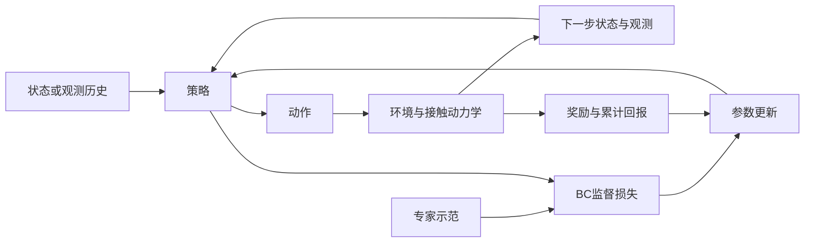

# 01 统一建模：策略如何改变未来数据

lesson_id: `01-shared-model` · 生成日期：2026-10-29 · 建议用时：20 分钟

本节目标：把 IL 和 RL 放进同一个闭环里，分清状态、观测、策略、数据分布与优化信号。你已熟悉基本术语，这里直接讨论它们为什么会影响实现。

## 一个直觉

让灵巧手把物体转到目标角度。策略先根据图像、关节位置和触觉给动作；动作改变物体姿态与接触；下一帧输入因此发生变化。一次动作不只决定当前误差，还会决定下一次需要解决的问题。

相机图像是观测，不自动等于完整状态。同一图像下，摩擦系数、接触力、被遮挡物体姿态可能不同。若当前观测不能解释接下来的变化，就需要历史、状态估计或更丰富的感知。这是建模选择，不应被网络层数掩盖。

## 关键公式

先考虑完全可观测的有限时域模型：

$$
\mathcal{M}=(\mathcal{S},\mathcal{A},P,r,\rho_0,\gamma,T),
\qquad a_t\sim\pi_\theta(\cdot\mid s_t),
\quad s_{t+1}\sim P(\cdot\mid s_t,a_t).
$$

| 符号 | 含义 | 灵巧手例子 |
|---|---|---|
| $s_t\in\mathcal S$ | 用来描述动力学的状态 | 物体位姿、速度和接触状态 |
| $a_t\in\mathcal A$ | 策略输出的动作 | 关节目标增量或力矩 |
| $P$ | 动作后状态如何变化 | 物体与手的接触动力学 |
| $r(s,a)$ | 对一次转移前状态与动作的奖励 | 角度误差、掉落和动作幅度的组合 |
| $\rho_0$ | 初始状态分布 | 起始抓握与物体姿态 |
| $\gamma\in[0,1]$、$T$ | 折扣系数、时域长度 | 对未来效果的权重与控制步数 |
| $\pi_\theta$ | 带参数的策略 | 从输入到动作分布的模型 |

轨迹概率写成：

$$
p_\theta(\tau)=\rho_0(s_0)
\prod_{t=0}^{T-1}\pi_\theta(a_t\mid s_t)P(s_{t+1}\mid s_t,a_t).
$$

这条式子的重点是：改变策略，会改变整段轨迹的分布。定义 $d^\pi_t$ 为第 $t$ 步在策略 $\pi$ 下的状态分布，平均访问分布为 $d^\pi=\frac1T\sum_t d^\pi_t$；它不是一个与策略无关的数据集。

行为克隆的一种连续动作目标是：

$$
\mathcal L_{\mathrm{BC}}(\theta)
=\mathbb E_{(s,a^*)\sim\mathcal D_E}
\left[\|\pi_\theta(s)-a^*\|_2^2\right].
$$

$\mathcal D_E$ 是专家示范，$a^*$ 是对应的专家动作；训练信号来自“这个状态该怎样做”。若策略输出概率分布，则常用负对数似然而非这里的确定性 MSE。

强化学习的目标通常写成：

$$
J(\theta)=\mathbb E_{\tau\sim p_\theta}
\left[\sum_{t=0}^{T-1}\gamma^t r(s_t,a_t)\right].
$$

这里的信号评价一段行为得到多少回报，不直接提供每步标准动作。BC 的损失较小，并不能单凭数值大小与 RL 的回报比较；它们量纲与优化对象都不同。模仿学习也不只包含 BC，后续还会接触交互式标注与从示范学习目标的方式。[Ho 与 Ermon 的原论文背景部分](https://arxiv.org/html/1606.03476v1#S2)提供了连接策略、示范与强化学习的一个原始研究视角。

## 管线



图中把两种训练信号画在同一闭环旁边，便于比较；一次具体实验应明确到底用了哪个目标，不能把两条支路的效果混为一谈。

## 最简代码

完整可运行代码：[shared_model.py](../examples/shared_model.py)。从仓库根目录运行 `uv run python courses/examples/shared_model.py`。

这个自建小环境只有一个状态 $s$，表示偏离目标的距离：$s_{t+1}=s_t+a_t$，策略 $a_t=k s_t$。下面是回报计算的核心；代码只评估两个策略，不假装实现了策略梯度训练。

```python
state = torch.tensor([1.0])
discounted_return = torch.tensor(0.0)
for step in range(12):
    action = gain * state
    reward = -(state.square() + 0.01 * action.square()).sum()
    discounted_return = discounted_return + 0.95**step * reward
    state = state + action
```

$k=-0.5$ 时每步偏差减半；$k=0.2$ 时每步偏差扩大为原来的 1.2 倍。完整示例还在同一份专家数据上计算 BC MSE。观察两个数分别在衡量什么，别把“训练误差”和“执行结果”写进同一列而不说明含义。

## 文字问题

1. 假设策略只看当前 RGB 图像。请给出两个“图像相似，但应该采取不同动作”的灵巧手情形，并说明你会补什么观测或历史。
2. 如果动作从关节目标增量改为力矩，$\pi$ 的输出接口和 $P$ 的含义分别怎样改变？奖励必须同时改变吗？
3. 将例子中的初始状态从 1 改成 0，会掩盖哪个策略问题？请先预测，再运行验证。

答案与笔记写到仓库内 `private/notes/01-shared-model.md`；反馈写在独立文件，不改你的原文。

## 来源

- [Ho & Ermon, Generative Adversarial Imitation Learning, 2016](https://arxiv.org/html/1606.03476v1)：已打开全文，参考其第 2 节的 MDP、策略与示范背景；本节不讲 GAIL 算法，也不复述其性能主张。
- [Ross, Gordon & Bagnell, A Reduction of Imitation Learning and Structured Prediction to No-Regret Online Learning, 2011](https://proceedings.mlr.press/v15/ross11a.html)：已打开原文与 PDF，参考策略影响状态分布的建模视角。

一维控制例子与代码为本课程自建教学实验，不是上述论文的复现实验。
