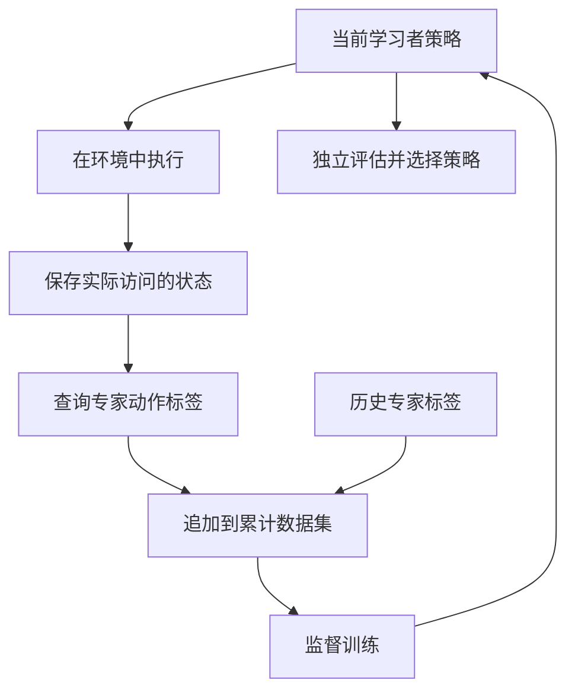

# 03 DAgger：让专家标注学习者真正遇到的状态

lesson_id: `03-dagger` · 生成日期：2026-10-29 · 建议用时：25 分钟

前置：[02 行为克隆与分布偏移](02-bc-shift.md)。本节目标：能把 DAgger 的执行策略、专家标签、聚合数据和下一轮训练逐一对应到代码。

## 一个直觉

学习者刚把物体转歪时，专家演示一段完美起始抓握未必能回答当前问题。更直接的办法是保存学习者实际遇到的状态，再询问专家“在这里应该怎样做”。把这些新答案与旧示范放在一起训练，下一轮就更可能处理自己制造的偏差。

DAgger 的核心不是换一个更复杂的损失函数，而是迭代改变获得监督数据的位置。[Ross、Gordon 与 Bagnell（2011）的原论文](https://proceedings.mlr.press/v15/ross11a.html)提出了这一数据聚合方法。

## 关键公式

第 $i$ 轮可用专家与学习者的混合策略采集状态：

$$
\pi_i=\beta_i\pi^*+(1-\beta_i)\hat\pi_i.
$$

$\pi^*$ 是可查询专家，$\hat\pi_i$ 是当前学习者，$\beta_i\in[0,1]$ 是选择专家动作的概率。这里是“按概率选择哪个策略执行”，一般不是把两个连续动作向量做线性插值。随着训练推进可以减少专家控制；具体序列会影响探索、成本与理论条件。

无论某一步实际执行了谁的动作，新标签都来自专家：

$$
\mathcal D_i=\{(s,\pi^*(s)):s\sim d^{\pi_i}\},\qquad
\mathcal D_{1:i}=\mathcal D_{1:i-1}\cup\mathcal D_i.
$$

实际实现中的并集通常是追加样本的集合或多重集；不要无意中丢掉重复访问的权重。接着重新拟合：

$$
\hat\pi_{i+1}=\arg\min_{\pi\in\Pi}
\frac{1}{|\mathcal D_{1:i}|}
\sum_{(s,a^*)\in\mathcal D_{1:i}}\ell(\pi(s),a^*).
$$

$\Pi$ 是可选择的策略模型族，$\ell$ 可采用回归损失。关键差异在 $s$ 的来源：它逐步包含学习者自己访问的状态。原文的性能分析依赖在线学习无遗憾性质及其他假设，不能据此保证任意神经网络、有限专家标签或真实机器人都必然提高成功率。

## 管线



## 最简代码

完整代码：[dagger.py](../examples/dagger.py)，复用上一节的 [bc_shift.py](../examples/bc_shift.py)。运行 `uv run python courses/examples/dagger.py`。

```python
for iteration in range(3):
    # 这里让学习者独立执行，等价于这几轮的专家混合权重为零。
    visited = bc_shift.rollout(policy)
    labels = bc_shift.expert(visited)
    states = torch.cat((states, visited))
    actions = torch.cat((actions, labels))
    loss = bc_shift.fit(policy, states, actions)
```

对应关系很直接：`visited` 是学习者采到的状态，`labels` 是在这些状态上查询的专家动作，`cat` 保留旧数据并追加新数据，`fit` 仍是普通监督训练。本例三轮都令 $\beta_i=0$，因为玩具环境可以让学习者直接执行。真实系统是否允许这样采集，必须由具体实验条件决定。

初始专家数据全部位于零点，斜率无法辨识；学习者从扰动起点执行后，获得非零状态的专家标签，才有数据支持把斜率改为恢复方向。程序打印 BC 与每轮聚合后同一起点的第 11 步偏差。

## 实验与局限

将 `labels = bc_shift.expert(visited)` 改成 `labels = policy(visited).detach()`，会用当前策略的预测充当固定伪标签。`detach()` 将标签与计算图分离，供 `fit()` 的多次反向传播使用，避免反复使用已释放的标签计算图。本例旧的零点标签也与当前策略相容，因此这种自标注不会提供专家纠正方向；先预测结果，再验证。再试一次只用最新一轮数据训练，思考它在复杂问题中为什么可能遗忘旧状态。

本例专家是精确函数，随时能提供标签；真实遥操作专家可能受延迟、观测缺失或标注成本限制。输入若只有图像而专家依赖不可见状态，同一观测可能对应冲突动作，此时仅追加标签未必解决问题。DAgger 也不自动获得奖励函数或变成 PPO。

正式实验应使用独立的初始状态、扰动和评估回合比较各轮策略，而不只看聚合数据上的训练 MSE。这里的同一起点评估是可解释的教学检查，不是泛化评测。

## 文字问题

1. 若采集时由学习者执行了错误动作，训练标签应该保存执行动作还是专家建议动作？为什么？
2. 灵巧手已经掉落物体后，专家还能给出有意义的恢复动作吗？你会怎样定义采集终止与重新开始？
3. 模型对同一图像学到互相矛盾的专家动作时，你会先增加数据、换损失，还是检查观测？请说明判断依据。

答案与笔记写到 `private/notes/03-dagger.md`。完成前三节后，下一节将用同一个任务解释回报与 Bellman 递推。

## 来源

- [Ross, Gordon & Bagnell, A Reduction of Imitation Learning and Structured Prediction to No-Regret Online Learning, 2011](https://proceedings.mlr.press/v15/ross11a/ross11a.pdf)：已打开原论文；方法对应其 DAgger 算法。本文未复述原始实验分数。
- [Ross & Bagnell, Efficient Reductions for Imitation Learning, 2010](https://proceedings.mlr.press/v9/ross10a.html)：已打开原始论文页面及 PDF，作为序列决策分布问题的前置研究。

代码是固定种子、CPU 可运行的教学实现；零状态初始化与扰动控制环境为课程自建。
