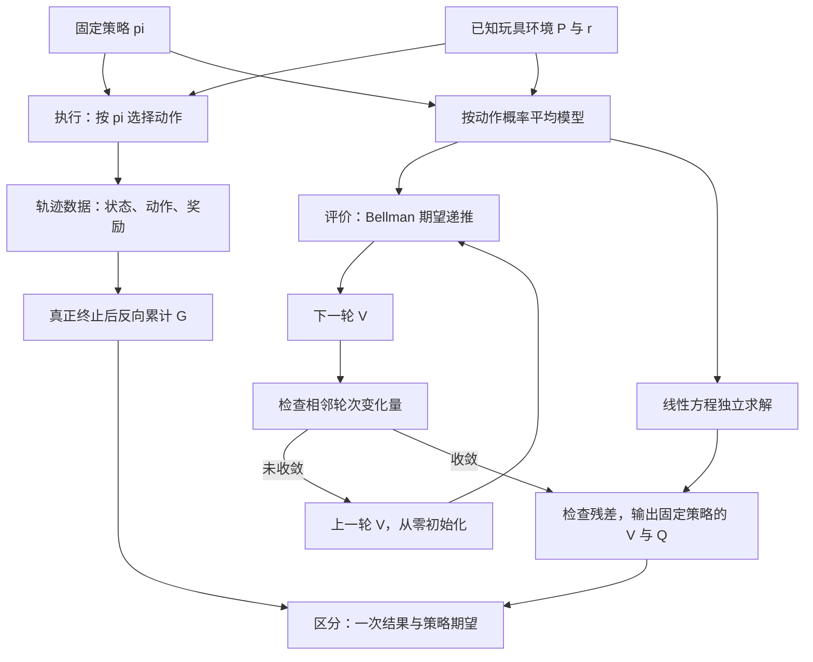

# 04 回报、价值与 Bellman 递推

lesson_id: `04-returns-values` · 生成日期：2026-10-30 · 建议用时：25 分钟

前置：[03 DAgger](03-dagger.md)。本节目标：给定一个固定策略，能从单条轨迹的回报推到状态价值的 Bellman 期望方程，并用代码检查它是否自洽。

## 从一次调整看未来收益

上一节在物体偏斜时查询专家动作；这次继续考虑调整物体，但给动作后果赋予奖励。假设主动调整一次付出成本，奖励为 −1；下一步完成任务，奖励为 +2，然后结束。若折扣因子是 0.9，从调整前看，这条轨迹的回报是 −1 + 0.9 × 2 = 0.8。眼前付出成本，仍可能换来正的长期回报。

先自检：0.8 是这一次执行的结果，还是从同一状态出发、遵循某个策略时所有可能未来的平均结果？如果策略也可能等待、让物体再次偏斜，两者通常不同。后者才是本节要计算的价值。奖励来自任务定义，DAgger 的专家动作标签本身不会自动变成奖励。

这里把操作过程压缩成三个完全可观测状态，动作只剩两种；奖励和转移都是课程自建的教学设定，不是灵巧手实验数据：

| 当前状态 | 动作 0：主动调整／完成 | 动作 1：等待 |
|---|---|---|
| 0：偏斜 | 到 1，奖励 −1 | 留在 0，奖励 −0.2 |
| 1：对齐 | 到 2，奖励 +2 | 回到 0，奖励 −0.5 |
| 2：真正终止 | 留在 2，奖励 0 | 留在 2，奖励 0 |

固定策略在状态 0、1 都以各 0.5 的概率选动作。终止态的两列仅用于矩阵占位，实际执行已经结束。稍后会发现：这条顺利完成的轨迹回报为正，但这个经常等待的策略在偏斜状态的价值为负。

## 关键公式

### 1. 奖励属于一次转移，回报属于一段未来

采用时间顺序 $S_t,A_t,R_{t+1},S_{t+1}$：在状态 $S_t$ 执行动作 $A_t$，收到奖励 $R_{t+1}$，进入下一状态。大写表示随机变量，小写 $s,a,s'$ 表示其具体取值。

设一条回合在时刻 $T$ 真正终止，则

$$
G_t=\sum_{k=0}^{T-t-1}\gamma^k R_{t+k+1},\qquad G_T=0.
$$

- $G_t$：从时刻 $t$ 起的折扣回报，尚未取期望。
- $T$：进入终止状态的时刻；最后一次奖励是 $R_T$。
- $k$：从当前转移开始数的偏移量，当前奖励的权重是 $\gamma^0=1$。
- $\gamma$：折扣因子；本例为 $0.9$，越远的奖励权重越小。

拆出第一项即可得到轨迹上的递推：

$$
\begin{aligned}
G_t
&=R_{t+1}+\gamma\left(R_{t+2}+\gamma R_{t+3}+\cdots\right)\\
&=R_{t+1}+\gamma G_{t+1}.
\end{aligned}
$$

暖身轨迹中 $G_2=0$，$G_1=2$，$G_0=-1+0.9G_1=0.8$。终止后的回报为零，并不把进入终点的 +2 抹掉。

对没有固定步数上限的任务，可将终止后补成零奖励吸收状态，并使用无限和。若 $0\le\gamma<1$ 且奖励绝对值有界于 $M$，几何级数给出 $|G_t|\le M/(1-\gamma)$。$M$ 是奖励上界；这是有界回报的充分条件。固定有限时长的任务也可使用 $\gamma=1$，但本例的全状态矩阵求解采用 $\gamma<1$。折扣改变目标本身，不能把调低它仅看作数值技巧。

反向累计与 [OpenAI 官方实现的 `discount_cumsum`](https://github.com/openai/spinningup/blob/master/spinup/algos/pytorch/vpg/core.py#L27-L41) 对应；本课用显式循环展示，不依赖其中的 SciPy。

### 2. 价值必须说明后续遵循哪个策略

对固定的平稳策略 $\pi$，定义

$$
V^\pi(s)=\mathbb E_\pi[G_t\mid S_t=s],\qquad
Q^\pi(s,a)=\mathbb E_\pi[G_t\mid S_t=s,A_t=a].
$$

- $V^\pi(s)$：从状态 $s$ 开始，当前及后续动作都遵循 $\pi$ 的平均回报。
- $Q^\pi(s,a)$：第一步指定动作 $a$，随后遵循 $\pi$ 的平均回报；首个动作可以不由 $\pi$ 采样。
- $\pi(a\mid s)$：在状态 $s$ 选择动作 $a$ 的概率；“平稳”指该规则不显式随时间改变。
- $\mathbb E_\pi$：平均掉策略选动作、环境转移以及奖励的随机性；本玩具模型只有动作选择是随机的。

因此对有限动作集合 $\mathcal A$，

$$
V^\pi(s)=\sum_{a\in\mathcal A}\pi(a\mid s)Q^\pi(s,a).
$$

这里是按策略概率加权；换成 $\max_a$ 就改变了问题。$V^\pi$ 和 $Q^\pi$ 评价的是指定策略，未必是最优策略。定义和这种区别可直接核对 [Spinning Up 的 Value Functions 与 Bellman Equations](https://spinningup.openai.com/en/latest/spinningup/rl_intro.html#value-functions)。该来源把同一次转移的奖励写成 $r_t$，本课写成 $R_{t+1}$；只是下标约定不同。

### 3. 对回报递推取条件期望，得到 Bellman 方程

假设状态满足 Markov 性、环境转移和奖励规律平稳。定义
$P(s'\mid s,a)=\Pr(S_{t+1}=s'\mid S_t=s,A_t=a)$，
$r(s,a)=\mathbb E[R_{t+1}\mid S_t=s,A_t=a]$。
其中 $s'$ 是下一状态，$r(s,a)$ 已经平均了下一状态和奖励的随机性；不要求两者独立。

$$
\begin{aligned}
V^\pi(s)
&=\mathbb E_\pi[R_{t+1}+\gamma G_{t+1}\mid S_t=s]\\
&=\sum_a\pi(a\mid s)\left[r(s,a)
+\gamma\sum_{s'}P(s'\mid s,a)V^\pi(s')\right],\\
Q^\pi(s,a)
&=r(s,a)+\gamma\sum_{s'}P(s'\mid s,a)V^\pi(s').
\end{aligned}
$$

第二行用到条件期望的分解：先按 $\pi$ 选动作，再按 $P$ 转移，到了 $s'$ 后仍遵循同一个 $\pi$。未来回报的条件均值因而可以写成 $V^\pi(s')$。这是同一价值函数应满足的等式；它本身没有训练神经网络，也没有改善策略。

把玩具模型代入，可手算出：

$$
\begin{aligned}
V^\pi(0)&=\tfrac12[-1+0.9V^\pi(1)]
+\tfrac12[-0.2+0.9V^\pi(0)],\\
V^\pi(1)&=\tfrac12[2+0.9\times0]
+\tfrac12[-0.5+0.9V^\pi(0)],\\
V^\pi(2)&=0.
\end{aligned}
$$

这组等式平均了所有未来，包括反复等待与退回偏斜；它不只计算开头那条顺利的轨迹。

### 4. 用递推求解，再用线性方程检查

定义动作平均后的转移与奖励：

$$
P_\pi[s,s']=\sum_a\pi(a\mid s)P(s'\mid s,a),\qquad
r_\pi[s]=\sum_a\pi(a\mid s)r(s,a).
$$

本例 $P_\pi$ 的形状为 $[3,3]$，每行和为 1。数学上把 $r_\pi$、$V$ 视为列向量；代码均用形状 $[3]$ 的一维张量表示。于是

$$
V^\pi=r_\pi+\gamma P_\pi V^\pi,\qquad
(I-\gamma P_\pi)V^\pi=r_\pi,
$$

$I$ 为 $3\times3$ 单位矩阵。已知模型时，从 $V_0=0$ 开始反复计算

$$
V_{n+1}=r_\pi+\gamma P_\pi V_n
$$

即可做固定策略评价。$n$ 是计算轮次，不是环境时刻 $t$；每轮同步使用上一轮的所有状态值。由于概率加权不会放大最大绝对误差，

$$
\|V_{n+1}-V^\pi\|_\infty
\le\gamma\|V_n-V^\pi\|_\infty.
$$

$\|x\|_\infty=\max_s|x(s)|$，即各状态中最大的绝对值。有限状态、有限奖励和 $\gamma<1$ 下，这解释了迭代收敛及解的唯一性；它不保证任意神经网络训练都收敛。代码同时用 `torch.linalg.solve` 解线性系统做独立检查，不显式求逆。以上矩阵展开及玩具数值是基于 Bellman 等式的教学推导。

## 管线



图中上路计算单条轨迹的结果，下路使用完整模型评价策略。两路共用任务定义，轨迹没有充当本例递推的训练集。本节不训练或更新策略，执行始终用原来的 $\pi$；下一节再讨论只拿到采样转移时如何估计价值。

## 最简代码

完整源码：[returns_values.py](../examples/returns_values.py)。`syllabus.json` 中的 `examples/returns_values.py` 相对 `courses/` 解析。在仓库根目录运行：

```bash
uv sync --extra learning
uv run --extra learning python courses/examples/returns_values.py
```

代码固定种子 7，显式使用 CPU 与 `torch.float64`，不下载数据。本例没有随机抽样；固定种子也方便后续扩展实验。轨迹反向累计的源码片段为：

```python
returns = torch.zeros_like(rewards)
running_return = rewards.new_zeros(())
for step in range(len(rewards) - 1, -1, -1):
    running_return = rewards[step] + gamma * running_return
    returns[step] = running_return
```

`rewards[step]` 对应 $R_{t+1}$，输出 `returns[step]` 对应 $G_t$。这个函数假定传入的是已经真正终止的完整轨迹，因此末端尾值初始化为零。

一次 Bellman 期望更新在源码中只有两行：

```python
action_values = rewards + gamma * (transitions @ values)
updated_values = (policy * action_values).sum(dim=1)
```

在这一段中，`rewards` 是模型的期望奖励表 $[3,2]$；它与上一片段的一维轨迹奖励不同。`transitions` 是 $[3,2,3]$，最后一个轴表示下一状态；`values` 是 $[3]$，矩阵乘法后为 $[3,2]$。`policy` 和 `action_values` 也是 $[3,2]$，沿动作轴 `dim=1` 求和才得到新的 $[3]$ 状态价值。没有在动作维度取最大值。

2026-10-30 已实际运行；主要结果为：

```text
反向计算 return=[0.8, 2.0]
固定策略迭代 V=[-0.75539568, 0.41007194, 0.00000000]
固定策略迭代 Q=[[-0.63093525, -0.87985612],
              [ 2.00000000, -1.17985612],
              [ 0.00000000,  0.00000000]]
Bellman 最大残差=6.803e-13, 迭代次数=81
```

上面省略了 PyTorch 的张量包装，仅保留打印数值。默认停止条件是相邻两轮变化小于 $10^{-12}$；程序另行计算 Bellman 残差，并以绝对容差 $10^{-10}$ 检查迭代解与线性方程解、$V$ 与策略加权 $Q$ 的一致性。终止态的 $V,Q$ 均检查为零。很小的残差说明这张表符合给定模型和策略，不意味着策略表现好。

为什么 $Q^\pi(0,0)\approx-0.631$，而顺利轨迹的回报是 $0.8$？前者只固定第一个动作；到达对齐状态后仍按各 0.5 的概率调整或等待，不能擅自假定下一步一定完成任务。

## 适用条件与局限

本例已知完整离散模型，并把偏斜、对齐当作充分状态。真实灵巧操作有连续动力学、接触隐变量、感知误差和动作延迟；同一图像可能对应不同未来。直接在不充分的观测上套用这种无记忆递推，会破坏所用的 Markov 假设。本例的奖励也只是人为设定，负价值不等于真实系统不安全，正价值也不保证成功。

真正终止与采样截断需要分开：若只是采集器达到步数上限，任务原本还会继续，就不能把截断点的未来价值强行设为零。若任务本身规定固定截止时间，应把剩余时间纳入状态，或写成随时间变化的 $V_t^\pi$。这些区别与 [Gymnasium 官方的时间限制说明](https://gymnasium.farama.org/tutorials/gymnasium_basics/handling_time_limits/) 一致。本例只有真正终止，不实现截断处理。

已知模型的同步表格递推不需要梯度下降。下一节将从采样转移构造 TD 目标，并区分评价当前策略与 Q-learning 的最优性目标；本节先把价值的含义和递推边界弄清楚。

## 文字问题

1. 同一状态出发的一次成功轨迹回报为 0.8，而 $V^\pi(0)$ 为负，这矛盾吗？请说清楚两者各自平均了什么，以及为什么 $Q^\pi(0,0)$ 也不等于 0.8。
2. 若把固定策略改为始终选动作 0，保持奖励、转移和 $\gamma=0.9$ 不变，请先手算状态 0、1、2 的价值，再在源码中修改策略表验证。为什么不能仅把原策略的动作平均换成 `max`，仍声称自己在评价原策略？
3. 操作采集器在物体仍可继续运动时因外部录制时限停止；另一次执行则到达任务定义的终点并得到 +2。两种情况下分别应怎样处理尾部价值和最后奖励？若截止时间本来就是任务规则的一部分，你会怎样补充状态？

答案与笔记写到 `private/notes/04-returns-values.md`，原文与反馈分开保存。生成章节或运行示例不等于已经学完；完成后由你自行勾选笔记中的“已学完本节”。

## 来源

资料核验日期：2026-10-30。以下官方资料均已打开核验；本节是基础概念教学，不作近期研究进展判断。

- [OpenAI Spinning Up：Key Concepts in RL](https://spinningup.openai.com/en/latest/spinningup/rl_intro.html)：核验 Reward and Return、Value Functions、Bellman Equations 小节，支持回报、策略条件价值和 Bellman 期望／最优性等式。本文采用不同的奖励下标约定，已在正文说明。
- [OpenAI Spinning Up 官方 PyTorch VPG 工具源码](https://github.com/openai/spinningup/blob/master/spinup/algos/pytorch/vpg/core.py#L27-L41)：已打开其原始源码，核验 `discount_cumsum` 的输入输出及折扣累计方向；本例使用独立的简化实现，不包含 VPG 算法。
- [Farama Gymnasium：Handling Time Limits](https://gymnasium.farama.org/tutorials/gymnasium_basics/handling_time_limits/)：核验 Termination、Truncation 与 Solution 小节，支持真正终止不自举、外部截断保留未来价值，以及有限时限任务需表示剩余时间。

三状态模型、奖励数值、手算展开和 CPU 输出均为课程自建教学示例，不是上述来源的实验结论。
