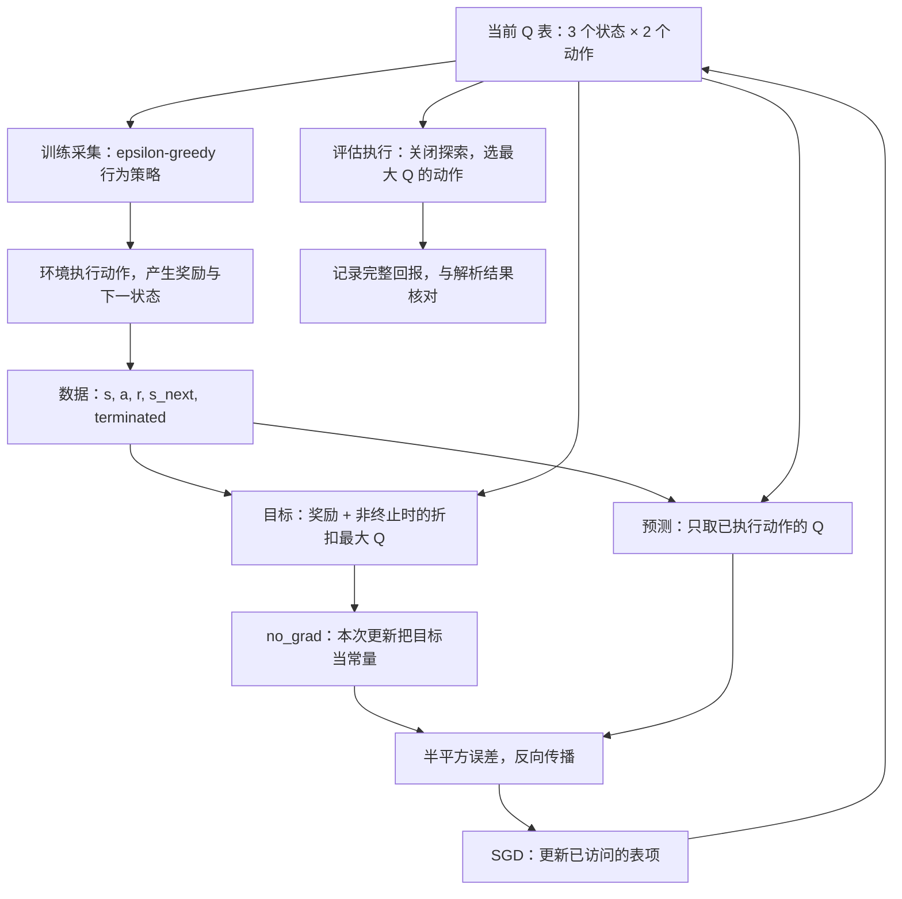

# 05 从 TD 到 Q-learning：目标值与自举

lesson_id: `05-value-learning` · 生成日期：2026-11-02 · 建议用时：30 分钟

前置：[04 回报、价值与 Bellman 递推](04-returns-values.md)。本节目标：给定一条转移，能算出 TD 目标和更新方向，并解释 Q-learning 如何从探索数据学习贪心决策所需的动作价值。

## 热身：还没等到结局，能先修正判断吗

上一节知道完整转移模型，可以平均所有后果；这次只让学习器看到执行后的一条记录。仍用同一个课程自建的操作模型：

| 当前状态 | 动作 0：调整／完成 | 动作 1：等待 |
|---|---|---|
| 0：偏斜 | 到 1，奖励 −1 | 留在 0，奖励 −0.2 |
| 1：对齐 | 到 2，奖励 +2 | 回到 0，奖励 −0.5 |
| 2：真正终止 | 执行结束 | 执行结束 |

折扣因子仍为 $\gamma=0.9$。假设正在评价一个固定策略，当前估计 $\hat V(0)=0$、$\hat V(1)=1.5$；观察到“0 → 1，奖励 −1”，尚未看到后续结果。把下一状态的估值当作剩余回报的替身，得到临时目标 $-1+0.9\times1.5=0.35$。步长为 $0.2$ 时，把旧估计向目标移动五分之一，得到 $0+0.2(0.35-0)=0.07$。

这里的 1.5 是人为设置的当前估计，不是上一节的精确价值。目标 0.35 也不是这次完整轨迹的真实回报：若下一步完成，实际回报仍为 0.8。**自举就是用已有价值估计补上尚未观察的未来，再更新当前估计。**它允许提前学习，也会把下一状态的估计误差带回来。

## 关键公式

### 1. 从 Bellman 期望到单条样本的 TD(0)

沿用时间顺序 $S_t,A_t,R_{t+1},S_{t+1}$。固定策略评价时，动作 $A_t\sim\pi(\cdot\mid S_t)$，奖励与下一状态由环境产生。对于一次观测 $(s,a,r,s',d)$，构造

$$
\begin{aligned}
y_t^{\mathrm{TD}}&=r+\gamma(1-d)\hat V_t(s'),\\
\delta_t&=y_t^{\mathrm{TD}}-\hat V_t(s),\\
\hat V_{t+1}(s)&=\hat V_t(s)+\alpha_t\delta_t.
\end{aligned}
$$

- $t$：交互／更新步；$\hat V_t$ 是更新前的整张估值表，帽子表示估计。
- $s,a,r,s'$：本次状态、实际动作、即时奖励和下一状态；$r$ 对应 $R_{t+1}$，不是整段回报。
- $d\in\{0,1\}$：这条转移是否到达任务定义的真正终点；到终点取 1。
- $\gamma\in[0,1)$：折扣因子；$\alpha_t$：本次学习步长。
- $y_t^{\mathrm{TD}}$：单步训练目标；$\delta_t$：目标减预测的 TD 误差。正误差提高当前估计，负误差降低它。
- $\hat V_{t+1}(s)$：更新后的当前状态值；表格实现的其他表项不变。

假设环境满足 Markov 性且规律不变。固定当前估值表，对动作和环境结果取平均，就恢复 Bellman 期望备份；不需要事先知道每一种转移的概率。但当 $\hat V_t\ne V^\pi$ 时，这个目标的均值一般也不等于真实 $V^\pi(s)$。拿某条挑选出来的成功轨迹反复更新，不能冒充对原策略全部后果的评价。

Monte Carlo（MC）把目标换成真正结束后算出的 $G_t$，不使用估计尾值；TD(0) 只等下一步，用 $\hat V_t(s')$ 补尾部。TD 通常减少等待和长轨迹带来的波动，却引入估值误差；不能据此断言任何任务中 TD 都优于 MC。这里的“0”对应不向更早状态累积资格迹，不是零折扣。[Sutton（1988）§2.3、§5.1、§6.4](https://jmvidal.cse.sc.edu/library/sutton88a.pdf)分别给出 TD(0)、累计结果和折扣预测的原始讨论。

### 2. Q-learning 的目标为什么取最大值

要评价某个固定策略，未来动作仍应按该策略平均；要寻找最优控制，则用最优性关系：

$$
Q^*(s,a)=\mathbb E\left[
R_{t+1}+\gamma(1-D_{t+1})\max_{a'\in\mathcal A}Q^*(S_{t+1},a')
\mid S_t=s,A_t=a\right].
$$

$Q^*$ 是最优动作价值：第一步指定 $a$，此后最优行动；$\mathcal A$ 是有限动作集合，$a'$ 是下一步候选动作。$D_{t+1}$ 是终止指示的随机变量，取到的样本为 $d$。这里的期望只平均给定 $(s,a)$ 后的环境随机性，$\max$ 在下一状态确定后沿动作维度计算。

用当前 $\hat Q_t$ 代替未知的 $Q^*$，并用一条环境样本代替期望，得到表格 Q-learning：

$$
\begin{aligned}
y_t^{Q}&=r+\gamma(1-d)\max_{a'\in\mathcal A}\hat Q_t(s',a'),\\
\delta_t^{Q}&=y_t^{Q}-\hat Q_t(s,a),\\
\hat Q_{t+1}(s,a)&=\hat Q_t(s,a)+\alpha_t\delta_t^{Q}.
\end{aligned}
$$

$\hat Q_t$ 是当前动作价值表，$y_t^Q$ 与 $\delta_t^Q$ 分别是 Q 目标与误差，只有已执行的 $(s,a)$ 表项被更新。这是最优性备份的采样版本，不能再叫作上一节固定策略的 $Q^\pi$ 评价。[Watkins 与 Dayan（1992）§2，pp.280–282](https://www.gatsby.ucl.ac.uk/~dayan/papers/cjch.pdf)给出这套更新及其表格收敛条件。

用同一张临时估值表比较目标会更清楚。假设 $\hat Q(1,0)=2$、$\hat Q(1,1)=0.2$，刚观察到 $s=0,a=0,r=-1,s'=1,d=0$：

| 未来动作的含义 | 本条样本的目标 |
|---|---|
| 固定策略 $\pi(0\mid1)=\pi(1\mid1)=0.5$，按策略求期望 | $-1+0.9(0.5\times2+0.5\times0.2)=-0.01$ |
| Q-learning，下一步按当前表贪心选择 | $-1+0.9\max(2,0.2)=0.8$ |

这个 0.2 是用于比较的临时表项，不是稍后算出的最优值 0.22。两种目标回答不同问题，数值不相等很正常。

行为策略 $b_t(a\mid s)$ 决定实际采什么数据；本例以概率 $\epsilon=0.25$ 均匀随机选动作，否则选 $\arg\max_a\hat Q_t(s,a)$。目标中的最大值不要求下一次实际动作也贪心，所以 Q-learning 是 off-policy。两个动作且没有并列最大值时，贪心动作被执行的概率是 $1-\epsilon+\epsilon/2=0.875$。探索并未消失，充分覆盖仍然重要。

### 3. 目标停止梯度，数值仍会随学习改变

把估值表视为参数 $\theta$，一次单样本更新可以写成

$$
\begin{aligned}
y&=\operatorname{sg}\left[r+\gamma(1-d)\max_{a'}Q_\theta(s',a')\right],\\
L(\theta)&=\tfrac12\left(Q_\theta(s,a)-y\right)^2,\\
\theta&\leftarrow\theta+\alpha\left(y-Q_\theta(s,a)\right)
\nabla_\theta Q_\theta(s,a).
\end{aligned}
$$

- $\theta$：可学习参数；本例就是形状 $[3,2]$ 的独立表项，没有神经网络层。
- $\operatorname{sg}$：停止梯度，前向保留数值，反向把目标视为常量。
- $L$：标量半平方误差；$\nabla_\theta$ 表示对参数求梯度，$\alpha$ 是 SGD 步长。

表格的一次单样本 SGD 因而恰好实现上一小节的 Q 更新。若让梯度也流过目标中的下一状态价值，就会多出目标分支的导数，得到另一种更新；不能继续声称它是这里的 Q-learning 半梯度步骤。

源码用 `torch.no_grad()` 阻断目标梯度；下一条数据到来时仍用更新后的表重算目标。独立的目标网络还需要另一份参数及其同步规则，本例没有实现它。[PyTorch 官方 DQN 教程的 `optimize_model()`](https://docs.pytorch.org/tutorials/intermediate/reinforcement_q_learning.html#training-loop)可用于对照目标分支；该教程另有目标网络、经验回放和 Huber 损失，不能把本例叫作完整 DQN。

### 4. 终止掩码只去掉未来，不去掉最后奖励

真正终止时 $d=1$，目标就是 $r$；进入终点的 +2 仍保留。外部采集器到时间上限、而任务还可以继续时，$d=0$，仍使用截断前最后观测的估值。若环境自动重置，要取重置之前的最后观测，不能把新回合起点当作 $s'$。若时限本来就是任务规则，应把剩余时间纳入状态，到期按真正终止处理。[Gymnasium 官方时间限制说明](https://gymnasium.farama.org/tutorials/gymnasium_basics/handling_time_limits/)支持这一划分。

## 管线



真正终止后训练从状态 0 重开；目标先用该次转移计算，再重置状态。总交互预算耗尽只是停止采集，不把最后一条非终止转移改成终止。

## 最简代码

完整源码：[value_learning.py](../examples/value_learning.py)。`syllabus.json` 的 `example` 路径相对于 `courses/`，因此仓库路径为 `courses/examples/value_learning.py`。在仓库根目录运行：

```bash
uv run --no-project --with torch python courses/examples/value_learning.py
```

该命令由 `uv` 提供 PyTorch 环境；本次验收复用了项目已有的 `uv` 环境，无需下载数据。实际验证环境是 PyTorch 2.15.0、CPU、`torch.float64`，固定种子 7。程序执行 6000 次在线交互，初始 Q 全零，SGD 步长 0.1；环境转移与奖励是确定性的，随机性只来自探索。

目标函数里的核心片段与源码一致：

```python
with torch.no_grad():
    return reward + gamma * (not terminated) * next_value
```

训练循环中的对应片段为：

```python
target = bootstrap_target(
    action_values.new_tensor(REWARDS[state][action]),
    action_values[next_state].max(), terminated, gamma)
loss = 0.5 * (action_values[state, action] - target).square()
optimizer.zero_grad()
loss.backward()
optimizer.step()
```

`action_values` 为 $[3,2]$，`action_values[next_state]` 为 $[2]$；`max()` 沿这唯一的动作轴取最大值。`reward`、`next_value`、`target` 和 `loss` 都是形状 `[]` 的标量张量，状态／动作是整数索引，`terminated` 是布尔量。环境表仅负责响应所选动作，学习器没有遍历模型做全状态 Bellman 备份。

2026-11-02 已实际运行，摘录输出如下（数值来自教学代码，不是论文实验）：

```text
TD 热身：target=0.35，更新后 V(0)=0.07
终止目标=-1.0，时间截断目标=5.3
各状态动作访问次数=[[2787, 426], [2433, 354], [0, 0]]
学习得到 Q=[[0.80000000, 0.52000000],
           [2.00000000, 0.22000000],
           [0.00000000, 0.00000000]]
与解析 Q* 最大误差=1.554e-15
贪心动作=[0, 0]，从状态 0 执行的回报=0.80
```

上面省略了张量包装。掩码自检特意设奖励为 −1、下一价值为 7：终止目标为 −1，截断目标为 $-1+0.9\times7=5.3$。若只用初始值为零的终止行测试，即使漏掉掩码也可能通过。

解析答案可直接用模型核对：候选最优动作在状态 0、1 都是动作 0，于是 $V^*(1)=2$、$V^*(0)=-1+0.9\times2=0.8$。再算等待动作，$Q^*(0,1)=-0.2+0.9\times0.8=0.52$，$Q^*(1,1)=-0.5+0.9\times0.8=0.22$；两者确实分别小于 0.8 和 2，验证了贪心选择的一致性。

程序检查整张 Q 表与解析答案的绝对误差小于 $10^{-6}$、四个非终止状态动作各至少访问 100 次、目标不带梯度，以及关闭探索后的实际执行回报。它只用热身演示一次状态价值 TD 更新，完整训练部分是 Q-learning；没有声称用 TD 训练出了固定策略的 $V^\pi$。

## 适用条件与局限

这个三状态模型删去了连续姿态、接触隐变量、动作延迟与传感器噪声。将灵巧手图像直接当作充分状态，或者把连续动作空间直接塞进枚举 `max()`，都超出了本例。实际系统还要考虑状态表示、探索代价与独立评估。

有限平稳 MDP、有限状态动作表、有界奖励、$0\le\gamma<1$、每个相关状态动作被无限次访问，并且其第 $k$ 次访问的步长 $\alpha_k(s,a)$ 满足

$$
\sum_{k=1}^{\infty}\alpha_k(s,a)=\infty,\qquad
\sum_{k=1}^{\infty}\alpha_k(s,a)^2<\infty,
$$

是经典表格 Q-learning 收敛结果的一组条件；$k$ 按各表项自己的访问次数计数。本例固定步长 0.1、有限步数不满足这组渐近条件，展示的是确定性玩具问题的数值核对。表格结论也不能直接推广为任意神经网络、自举与 off-policy 组合的稳定性保证。[原论文定理见 p.282](https://www.gatsby.ucl.ac.uk/~dayan/papers/cjch.pdf)。

小训练误差本身不能证明策略可靠；本例额外核对解析值、访问覆盖和执行回报。真实任务通常没有解析答案，需要在独立回合、扰动和不同种子上评估。下一节将转向直接调整动作概率的策略梯度。

## 文字问题

1. 热身保持 $\hat V(0)=0$、奖励 −1、$\alpha=0.2$ 不变，把 $\hat V(1)$ 改为 0 和 3，分别计算 TD 目标与更新后的值。为什么这两次更新都可能不同于成功轨迹的回报 0.8？这说明自举带来了什么信息，又依赖什么假设？
2. 用临时估值 $\hat Q(1,\cdot)=[2,0.2]$ 和转移 $(0,0,-1,1,0)$，解释为什么均匀固定策略的期望目标为 −0.01，而 Q-learning 目标为 0.8。即使实际下一次因探索选了等待，Q-learning 仍用哪个目标？为什么这不等于无须采集等待动作的数据？
3. 机械手收到奖励 −1，最后观测的最大 Q 为 7：一次因外部录制上限停止，另一次因任务定义的失败终止。分别算目标，说明该保存哪一帧作为下一状态。若失败样本漏掉终止掩码，或者让目标分支也参与求导，会分别改变什么？

答案与笔记写到 `private/notes/05-value-learning.md`，反馈另存私有文件。生成章节、运行示例均不等于已经学完；由你自行勾选笔记中的“已学完本节”。

## 来源

资料核验日期：2026-11-02。以下原论文或官方实现均已打开并核对对应位置；本节不作近期研究进展判断。

- [Sutton, Learning to Predict by the Methods of Temporal Differences, 1988](https://jmvidal.cse.sc.edu/library/sutton88a.pdf)：原论文扫描件；§2.3，正文 pp.15–16 讨论 TD(0)；§5.1，pp.33–34 讨论累计结果；§6.4，pp.39–40 给出折扣 TD 误差。本文将原文预测符号换成 $\hat V$，并显式写出终止掩码。
- [Watkins & Dayan, Q-learning, 1992](https://www.gatsby.ucl.ac.uk/~dayan/papers/cjch.pdf)：作者机构托管原文；§2，pp.280–282 的动作价值、式 (2) 与定理支持最大值目标和表格收敛边界。
- [PyTorch 官方 Reinforcement Learning (DQN) Tutorial](https://docs.pytorch.org/tutorials/intermediate/reinforcement_q_learning.html)：核验 `optimize_model()` 中的预测动作选取、目标分支 `no_grad()`，以及主循环中 `terminated` 与 `truncated` 的不同用途。本文自行简化为单样本 Q 表和半平方损失。
- [Farama Gymnasium：Handling Time Limits](https://gymnasium.farama.org/tutorials/gymnasium_basics/handling_time_limits/)：核验 Termination、Truncation 与 Solution，支持终止不自举、外部截断保留尾值和任务时限的状态表示。

三状态模型、热身数字、解析 Q 表、代码与问题均为课程自建教学材料；没有把这些输出当作作者实验结论。
