# Torch-Hand：以丝杠与连杆兼顾灵巧运动和承载的仿人手

> 审阅状态：**waiting_source**。已基于本地 40 页全文形成审阅稿并核验实际存在的 10 幅图；原文引用的图 S3 缺失，关键公式与图表矛盾仍需补充材料或作者勘误澄清。依 sp-arxiv 验收规则，暂不标记完整完成，不作为已完成解读进入日报。

> 本次复核沿用既有审阅稿：重新核对同一 SHA-256 的 v1 全文与十幅原图，补回空的图片索引，修正指尖力范围和口红任务描述，并补充局部传动的构型依赖。没有将原文中的冲突擅自订正为作者结论；复核时间和待补来源见 [review.json](review.json)。

## 原文信息与相关性

- **标题**：A fully articulated humanoid dexterous hand with human-level joint structure enabled by linkage-based actuation
- **作者**：Jihao Li、Jianguo Wang、Haotian Guo、Yanzhe Wang、Guodong Lu、Huixu Dong。
- **版本**：arXiv:2610.36789v1，分类 cs.RO。本篇仅解读指定 v1，不比较其他版本。
- **提交／元数据发布日期**：2026-10-27 07:53:51 UTC，即北京时间 2026-10-27 15:53:51；更新日期相同。该时间来自本地元数据，不能据此推定 arXiv 公告日。
- **解读日期**：2026-10-29，Asia/Shanghai（项目配置时区）。
- **来源**：[arXiv 摘要页](https://arxiv.org/abs/2610.36789v1)、[官方 PDF](https://arxiv.org/pdf/2610.36789v1)、[本地原件](paper.pdf)、[全文抽取文本](source.txt)。
- **阅读范围**：40 页 PDF，包含正文、参考文献、补充公式 S1–S32、图 1–8 与 S1–S2、实际表 S1–S7。关键公式和数值已回看 PDF，未直接采用抽取文本中的乱码。
- **相关性判断：高度相关。** 研究对象是五指灵巧手；核心问题是高关节自由度、拇指对掌、精密运动和承载之间的机械设计取舍；方法是掌内驱动的丝杠—连杆传动；实验直接覆盖指尖运动、33 类抓型和工具操作。它属于“灵巧手与操作”的硬件与运动学研究，不是仅在摘要中提及 dexterous。

**阅读结论**：值得关注的是连杆传动、差异化拇指和条件耦合机构的集成。论文展示了丰富的实机动作，但 v1 对执行器数、部分公式、关节范围和实验表格存在内部冲突；“21 路完全独立驱动”“人类水平操作”“已同时解决精度、灵巧性与负载三难题”不能直接作为已验证结论。以下区分作者报告、原文矛盾和本解读的判断。

## 一句话解释

作者尝试让同一只手既能做细小指尖动作，又能稳固握持重物：例如输入预先录制并重定向的人手关节动作，经过电机、丝杠、滑块和连杆，输出抓住口红、打开盖子并旋转管体的实机动作（正文第 17–18、24 页，图 8B）。

这里的输入不是自然语言指令，论文也没有训练自主操作策略；任务演示主要依靠预先获取的机械臂位姿和手部运动序列回放。

## 方法管线

以下 Mermaid 是依据正文第 7–12、22–24 页整理的理解图，不是论文原图。

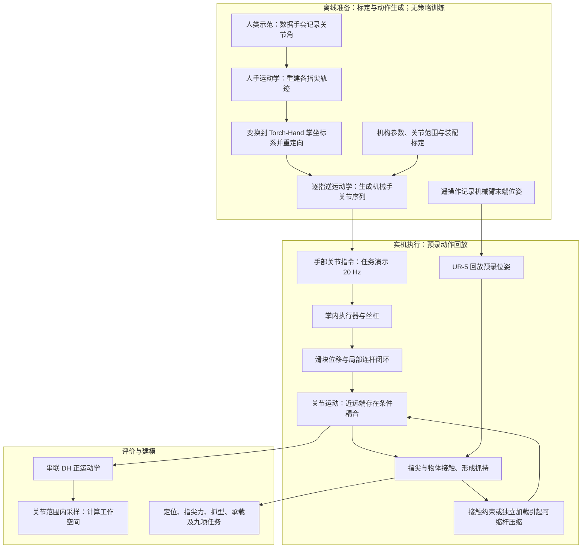

图中的接触返回箭头是**机械状态变化**，不是论文已经实现的触觉反馈控制器。文中可确认的数据是手套记录的角度、预设姿态和运动序列，以及实验用位移／力仪表读数；没有给出部署策略的完整观测向量，也不存在 teacher/student 或特权状态训练。视觉、分布式触觉、力反馈和学习策略被列为后续方向（第 20 页）。

## 核心组件：输入、输出与连接

| 组件 | 目的与输入输出 | 原文位置及边界 |
|---|---|---|
| 四指与拇指分化 | 每根普通手指用 4 个关节坐标描述；拇指用 5 个，扩展对掌方向 | 第 5、7、9 页，图 2–3；合计 21 DOF 是关节坐标结构，不能据此认定有 21 个独立电机 |
| 掌内电机—丝杠—导轨滑块 | 将旋转输入转成直线位移，再驱动连杆；减少指节内电机布置 | 第 10–12、21 页，图 4；普通手指 MCP 屈伸采用滚珠丝杠，其余关节采用梯形丝杠 |
| 空间连杆与万向节 | 输入滑块位移，输出关节角；对齐万向节中心与 MCP 两运动轴交点，减少跨关节传动干扰 | 第 12、21–22 页，图 4F；效果依赖装配同轴度与间隙 |
| PIP–DIP 可缩杆机构 | 空载时以共享连杆实现近、远端协调；接触约束或独立加载时，连杆压缩，允许远端相对运动 | 第 7 页，图 2B；第 31 页 S11–S14，图 S1D。拇指 MCP–IP 使用类似设计 |
| 三轴 CMC 拇指基部 | 改变拇指接近方向、对掌姿态及接触方向 | 第 7、12 页，图 2C、4J–L；“三轴正交”是作者设计描述，现有 DH 表与该描述不完全吻合 |
| 串联运动学与动作重定向 | 从关节角计算指尖位姿；从重定向指尖轨迹求机械手关节指令 | 第 9、22、24、32–33 页；未报告完整 IK 求解器、分支选择、奇异位形处理和约束优化设置 |

术语：自由度（degree of freedom，DOF）；腕掌关节（carpometacarpal，CMC）；掌指关节（metacarpophalangeal，MCP）；近端／远端指间关节（proximal/distal interphalangeal，PIP/DIP）；拇指指间关节（interphalangeal，IP）；外展／内收（abduction/adduction，Ab/Ad）；屈曲／伸展（flexion/extension，F/E）；逆运动学（inverse kinematics，IK）。

**最需要避免的误读**：机械上传动干扰减少、自由运动时的关节协同、接触后的被动自由度变化、控制器主动协调，是不同层次。第 7 页明确保留空载 PIP–DIP 耦合；表 S1 又写明 16 个执行器。本文不把作者的“解耦”推广成任意接触状态下 21 个关节均可独立指令控制。

## 关键公式与逐符号解释

这些公式描述几何传动与正运动学，没有神经网络损失或强化学习奖励。文中总体目标是兼顾灵巧性、精度和负载，但未给出统一加权的机构优化目标函数；逆运动学也没有给出具体代价函数。以下保留原式编号；为排版统一使用 LaTeX 字体，原文实质性疑点另行标注。

### 1. 关节状态的组织：正文式 (1)、(2)，第 9 页

$$
\mathbf q_f=
[\theta_{MCP,L},\theta_{MCP,B},\theta_{PIP},\theta_{DIP}]^\mathsf T
\in\mathbb R^4. \tag{1}
$$

$$
\mathbf q_t=
[\theta_{cmc,r},\theta_{cmc,l},\theta_{cmc,b},
\theta_{mcp},\theta_{ip}]^\mathsf T
\in\mathbb R^5. \tag{2}
$$

| 符号 | 意义与维度 |
|---|---|
| \(f\)、\(t\) | \(f\) 指四根普通手指中的任意一根，不是四指合在一起的向量；\(t\) 指拇指 |
| \(\mathbf q_f,\mathbf q_t\) | 分别为 4×1、5×1 的关节角列向量；全手共有 \(4\times4+5=21\) 个关节坐标 |
| \(\theta_{MCP,L},\theta_{MCP,B}\) | 普通手指 MCP 外展／内收角、屈伸角 |
| \(\theta_{PIP},\theta_{DIP}\) | 普通手指 PIP、DIP 屈伸角 |
| \(\theta_{cmc,r},\theta_{cmc,l},\theta_{cmc,b}\) | 拇指 CMC 旋转、外展／内收、屈伸角 |
| \(\theta_{mcp},\theta_{ip}\) | 拇指 MCP、IP 屈伸角 |
| \(L/l,B/b,r\) | 分别是侧向、弯曲、旋转标签；大、小写沿用论文对普通手指与拇指的区分 |
| \(\mathsf T,\mathbb R^n\) | 转置；\(n\) 维实向量空间。角度计算用弧度，实验关节范围以度报告 |

式后向量空间维度是本解读补充的数学说明。这是**关节坐标的维度**，并不说明所有坐标组合都能独立主动实现；接触、连杆约束、关节限位与执行器数仍需考虑。

### 2. 从电机转角到关节角：正文式 (3)、(4)，第 22 页

$$
s_i=\frac{p_i}{2\pi}\psi_i, \tag{3}
$$

$$
\theta_i=f_i(s_i). \tag{4}
$$

- \(i\)：一个被建模的局部驱动通道索引，不将其范围擅自设为 1–21。
- \(\psi_i\)：作者定义的电机角位移，标量、弧度；式 (3) 将其直接用于丝杠转换。\(p_i\)：丝杠导程，即每转一周的轴向移动长度，可用 mm/rev 表示；\(2\pi\)：一周对应的弧度。
- \(s_i\)：滑块相对参考位置的位移，标量、长度；若导程用 mm，则 \(s_i\) 用 mm。附录中某些同类 \(s\) 记号是机构几何中的当前位置／杆长，实施时要明确零位与偏置。
- \(\theta_i\)：输出关节角，标量、弧度；\(f_i\)：由具体连杆几何和装配分支确定的映射，输入长度，输出角度，不是学习得到的模型。

式 (3) 使用理想丝杠运动关系；实际还需校准零位、传动比例、间隙和变形。式 (4) 是作者对局部通道的概括；对于共享连杆的远端关节，附录实际显式依赖近端角度。普通手指 MCP 屈伸的闭环式 S6 还含 MCP 侧摆角 \(\theta_{MCP,L}\)（第 30 页）。因此不能脱离构型与接触条件，把 \(f_i\) 解释成全手全域单输入、互不影响的映射。

### 3. 为什么 DIP 仍受 PIP 构型影响：补充式 S11–S14，第 31 页

$$
|l_K|=
\sqrt{|l_{PIP}|^2+|l_{B4}|^2
-2\cos(\Phi-\theta_{PIP})|l_{PIP}||l_{B4}|}. \tag{S11}
$$

$$
\theta'_{DIP}=
\arccos\frac{|l_{B3}|^2+|l_K|^2-|s_{DIP}|^2}
{2|l_{B3}||l_K|},
\qquad \theta'_{DIP}\in[0,\pi]. \tag{S12}
$$

$$
\Lambda=
\arccos\frac{|l_{PIP}|^2+|l_K|^2-|l_{B4}|^2}
{2|l_{PIP}||l_K|},
\qquad \Lambda\in[0,\pi]. \tag{S13}
$$

$$
\theta_{DIP}=\theta'_{DIP}+\Gamma-\Lambda-\pi. \tag{S14}
$$

对应几何见[原图 S1D](figures/fig-s1-page-34.png)，不要仅凭下标猜测电机连接。

| 符号 | 几何含义与单位 |
|---|---|
| \(\lvert l_{PIP}\rvert,\lvert l_{B3}\rvert,\lvert l_{B4}\rvert\) | 图 S1D 中标注的连杆／支点间固定几何长度，均为长度标量；这里的竖线表示长度 |
| \(\lvert l_K\rvert\) | 三角形辅助边长，由近端 PIP 角改变，长度标量 |
| \(\lvert s_{DIP}\rvert\) | 可缩连杆当前实际长度，不等于“已经证明独立可命令的 DIP 电机位移”；原文另以 \(\lvert s_{DIP0}\rvert\) 表示未压缩长度 |
| \(\theta_{PIP},\theta_{DIP}\) | 近端、远端关节屈伸角，弧度 |
| \(\theta'_{DIP}\) | 由余弦定理求出的内部几何角；撇号表示中间角，不是时间导数 |
| \(\Phi,\Gamma\) | 图 S1D 中定义的机构固定几何角；\(\Lambda\) 是随构型改变的三角形中间角，均为弧度 |
| \(\cos,\arccos,\pi\) | 余弦、反余弦及半周弧度常数；反余弦输入应无量纲且在 \([-1,1]\) 内 |

阅读顺序是：PIP 角先改变辅助边 \(l_K\)，当前可缩杆长度与该边共同决定 DIP 内部角，最后换算为关节角。因而这组式子的依赖关系是“DIP 角取决于可缩杆长度**以及**PIP 角”。这是对原式结构的解释，并非新提出的控制律。

适用假设包括局部几何与选定装配分支有效、连杆尺寸已知、三角形可构成、分母非零。它们只给瞬时几何，不给压缩杆的力—长度规律或接触切换阈值，因此不能单凭 S11–S14 预测接触力或独立控制能力。

### 4. 从关节角到指尖：补充式 S28–S32，第 32–33 页

原文采用 Denavit–Hartenberg（DH）齐次变换。**下面先忠实保留 S28 的排印内容：第三行末项印为 \(d_1\)，紧随的文字却解释 \(d_i\)，二者不一致。**

$$
{}^{i-1}\mathbf T_i(\theta_i)=
\begin{bmatrix}
\cos\theta_i &-\sin\theta_i\cos\alpha_i&
\sin\theta_i\sin\alpha_i&a_i\cos\theta_i\\
\sin\theta_i&\cos\theta_i\cos\alpha_i&
-\cos\theta_i\sin\alpha_i&a_i\sin\theta_i\\
0&\sin\alpha_i&\cos\alpha_i&d_1\\
0&0&0&1
\end{bmatrix}. \tag{S28}
$$

\({}^{i-1}\mathbf T_i\) 是 4×4 矩阵，用于把第 \(i\) 坐标系的坐标转换到第 \(i-1\) 坐标系；\(i\) 此处是串联关节索引。\(\theta_i\) 是关节转角，\(\alpha_i\) 是连杆扭转角，均为弧度；\(a_i\) 是相邻轴公法线方向的长度，\(d_i\) 是轴向偏移，长度单位应与机构一致。矩阵左上角 3×3 为无量纲旋转，右上角为长度平移，末行用于齐次坐标。

按通常的标准 DH 形式及原文紧随的符号解释，第三行末项应随关节使用 \(d_i\)；**这是本解读的数学核对判断，尚无作者勘误确认**。不能静默改式后声称复现了作者模型；印出的 \(d_1\) 若按字面读取，是第一个关节的轴向偏移，而非通用的第 \(i\) 项。

$$
{}^P\mathbf T_{\mathrm{tip}}^f(\mathbf q_f)
={}^P\mathbf T_0^f
\left(\prod_{i=1}^{4}
{}^{i-1}\mathbf T_i^f(\theta_{f,i})\right)
{}^4\mathbf T_{\mathrm{tip}}^f, \tag{S29}
$$

$$
{}^P\mathbf T_{\mathrm{tip}}^t(\mathbf q_t)
={}^P\mathbf T_0^t
\left(\prod_{i=1}^{5}
{}^{i-1}\mathbf T_i^t(\theta_{t,i})\right)
{}^5\mathbf T_{\mathrm{tip}}^t. \tag{S30}
$$

$$
{}^P\mathbf T_{\mathrm{tip}}=
\begin{bmatrix}
{}^P\mathbf R_{\mathrm{tip}}&{}^P\mathbf p_{\mathrm{tip}}\\
\mathbf 0_{1\times3}&1
\end{bmatrix}, \tag{S31}
$$

$$
{}^P\mathbf p_{\mathrm{tip}}
=[x_{\mathrm{tip}},y_{\mathrm{tip}},z_{\mathrm{tip}}]^\mathsf T.
\tag{S32}
$$

| 符号 | 含义与维度 |
|---|---|
| \(P,0,\mathrm{tip}\) | 掌固定坐标系、相应手指基座坐标系、指尖坐标系；左上标表示表达所用坐标系，右上标 \(f/t\) 区分手指 |
| \({}^P\mathbf T_0^{f/t}\) | 从手指基座到掌系的固定 4×4 变换 |
| \({}^{i-1}\mathbf T_i^{f/t},\theta_{f,i},\theta_{t,i}\) | 第 \(i\) 个关节的 4×4 变换及该手指的第 \(i\) 个角度分量 |
| \(\prod\) | 按从基座向指尖的顺序连乘，顺序不可随意交换；普通手指四项、拇指五项 |
| \({}^4\mathbf T_{\mathrm{tip}}^f,{}^5\mathbf T_{\mathrm{tip}}^t\) | 指尖坐标系相对于最后关节坐标系的固定 4×4 位姿变换，将指尖系坐标转换到最后关节系 |
| \({}^P\mathbf R_{\mathrm{tip}}\) | 指尖朝向，3×3 无量纲旋转矩阵 |
| \({}^P\mathbf p_{\mathrm{tip}},x_{\mathrm{tip}},y_{\mathrm{tip}},z_{\mathrm{tip}}\) | 指尖位置，3×1 向量及三个坐标分量，长度单位一致 |
| \(\mathbf 0_{1\times3},1\) | 齐次矩阵末行的三个零与常数一；\(\mathsf T\) 为转置 |

其用途是把给定关节构型映射成指尖位姿，再对关节范围采样得到工作空间。**正运动学可写成串联乘积，不等于电机到关节的传动已全局解耦。** 此外，参数表仍有轴约定疑点、符号杆长和未数值化的固定变换，当前资料不足以直接重建数值模型。

## 创新点：作者主张、已有工作与本解读判断

| 作者贡献主张 | 论文所述已有方案与差异 | 本解读判断 |
|---|---|---|
| 在紧凑掌内集成 21 DOF、五自由度对掌拇指 | 引言比较齿轮、电机、气动、肌腱及已有连杆手；作者认为 ILDA 的拇指与并联式驱动约束了对掌和控制便利性 | 价值是多种机械设计原则的系统集成，连杆手、丝杠驱动和多轴拇指均不能据本文说成从零提出；“人类水平”尚无统一人类基准支持 |
| 将关节机械解耦与动作协同分离，保持精密运动 | 作者强调局部传动链和串联关节模型，相对肌腱路由或并联驱动更容易追踪输入输出 | 这是有价值的设计目标；但 16 执行器、远端可缩杆及 DH 表冲突限制了“21 关节完全独立主动控制”的证据强度 |
| 丝杠—刚性连杆同时带来高力、稳定保持和自锁 | 相对柔性传动，作者强调确定的力传递与机械增益 | 支持“有高负载硬件能力”的判断；未测得完整刚度、反驱性、冲击耐受与能效曲线，不能由丝杠类型名称自动证明所有通道在所有负载下自锁 |
| 用工作空间、抓型、定位、力和任务验证三方面能力 | 规格比较见表 S1，实机展示见图 5–8 | 验证维度丰富，但大多分项测试；尚未证明同一动态接触任务可同时达到各项峰值，也没有统一条件的跨手基线复测或关键部件消融 |

定位：作者贡献声明在第 3–4 页；引言比较在第 2–3 页；讨论在第 19–20 页；规格表 S1 在第 36 页。这里对其他手的描述仅转述本论文的比较口径，未独立复查全部被引论文。

## 实验：设置、结果与证据边界

### 硬件与数据来源

掌架与手背盖采用 TC4 钛合金，指节和连杆采用 6061 铝合金，配软橡胶指垫和 ABS 外壳。电机型号分 JCCM1039、JCCM1045、JCCM1254、JCCM1245；丝杠包括 NSG0401 与 MG4，导轨／滑块为 MGNR3／MGN3C（第 21 页）。这些物料说明有助于理解实现，但不等于完整加工图、物料清单（BOM）和控制软件已开放。

表 S1 报手部尺寸（Hand size）235 mm、指部尺寸（Finnger size，原表拼写）137.5 mm，执行器数 16；没有整手质量，不能计算整手力密度。任务演示按需要使用左右手和 UR-5；40 kg 承载展示的支撑方式另述，不能混入 UR-5 任务负载。没有报告训练数据集；数据手套用于姿态记录与轨迹重定向。

### 结果与评价协议

| 实验 | 样本／指令与成功判据 | 作者报告及阅读边界 |
|---|---|---|
| 工作空间 | 普通四指**每指 50,000** 个随机构型；拇指 **100,000** 个；在实测关节范围内经 DH 计算点云并重建边界 | 第 22 页，图 5 实际 C/E；这是模型采样，不是逐点实机可达性或带物体碰撞检查 |
| 关节范围 | 图 5 实机姿态和正文第 14 页 | 图中普通手指 MCP Ab/Ad **30°**、F/E **90°**；正文却写成 **90°／30°**，不能静默选择。PIP、DIP 均报告 90°；拇指 CMC 三运动分别 85°、90°、90°，MCP 60°、IP 75° |
| 指尖轨迹 | 直径 **1.5 mm** 杆沿 **2 mm** 宽路径；6 条平面轨迹 20 Hz、2 条空间轨迹 30 Hz；连续运动、不离开路径、无可见中断 | 第 14、23 页，图 5 实际 H；证明特定预生成序列能执行，未报告轨迹均方根误差（RMSE）、速度分布或重复成功率；不能把路径宽度改写成亚毫米定位精度 |
| Kapandji 对掌 | 预设目标区域；模型求姿态，必要时加入小偏置；无需外助或重放置手即可接触目标 | 第 14、23 页，图 5 实际 G 展示编号 0–10；作者称全部测试位置达到，但未报重复次数 |
| 33 类抓型 | 3D 打印标准物体和对应真实物体两组；手套姿态映射，物体按手尺度调整，必要时小幅调角；保持 **10 s**，无外部支撑、可见滑移或抓型丢失 | 第 14–15、23 页，图 6、表 S5（第 38 页）；两组均覆盖 33 类。类别覆盖率不等于随机抓取试验成功率，不能写成“66 次测试全部成功” |
| 重复定位 | 千分表相对 **3.000 mm** 参考值测稳定后端点偏差；方法称每关节 **50 次**，表 S6 实际列出含耦合关节的 16 个通道／组合 | 第 16、23、39 页；普通四指平均定位偏差 **0.0111 mm**，边界 **±0.026 mm**；拇指 **0.0115 mm**、**±0.031 mm**。属于特定姿态下重复端点测量，不是全空间三维绝对精度 |
| 指尖力 | **500 N** 传感器；关节角从 0° 起按 **10°** 递增；电流环升至预设上限，稳定读数后位置环复位；每角度条件 **10 个循环** | 第 23–24 页，图 7F、表 S7；最大条件平均值 **64.69 N** 在图、正文及小指表项中出现，但其驱动组合标签有冲突，不能用来定量证明协同增益；未报电流上限数值和力方差 |
| 全手握力与承载 | 握力球，掌面有楔形防滑挡块；另压扁易拉罐、握持并提起 **40 kg** 哑铃；无可见滑移、结构损坏或抓型丢失 | 第 16–17、24 页；球握力 **>100 N**。未报重复次数、保持时长、极限破坏载荷；图 7I 是人提握手部组件的承载展示，不能写成 UR-5 搬运 40 kg |
| 九项操作 | UR-5 回放预录位姿；手套以 **20 Hz** 录制，经人手运动学和逐指 IK 重定向，手部 **20 Hz** 回放 | 第 17–18、24 页，图 8；成功需初始物品／工具放置后无外助、完成功能且无可见滑移或中断。未报每项重复次数、成功率和耗时分布 |

九项任务为：穿尼龙线、打开口红盖并旋转管体、拧开紧封的瓶盖、移液／滴液、用碳酸钙进行气体生成操作、剪线并插入分线器、拧螺钉、电钻操作、羊角锤拔钉。穿线示例报告 **0.35 mm 线径与 0.5 mm 针眼**（第 17 页），是特定设置中的能力展示，不是自主感知误差或跨任务精度的统计估计。

### 不能合并成单一数字的原文冲突

| 冲突 | 已核对的 PDF 证据 | 本文处理 |
|---|---|---|
| 执行器数与独立驱动主张 | 第 3 页称 21 个独立驱动 DOF；第 36 页表 S1 为 21 joints、21 DOF、**NOA=16**，脚注明确 NOA 是执行器数 | 保留 21 关节坐标结构；独立主动控制维度待澄清 |
| MCP 两方向范围与图注错位 | 第 14 页与图 5D 的 30°／90° 对调；图 5 原图内 C/D、E/F、G/H 与图注描述成对错位 | 实验定位使用“实际子图字母”，不修改原图 |
| 定位单位、刻度及“低于 0.03 mm” | 表 S6 各数值列单位印成 N，但正文为 mm；图 7C 纵轴约 ±0.003 mm，而同图端点标注、正文与表为 ±0.03 mm 量级；拇指最大值为 +0.031 mm | 数值明确归为正文报告，保留单位和十倍刻度疑点；不声称所有误差均低于 0.03 mm |
| 平均误差的统计含义 | 第 16 页“mean positioning error”与表 S6 的 AD 列平均接近；表中带符号 Average 是另一组近零数值 | 称“作者报告的平均定位偏差”；不与带符号均值混用 |
| 各指力峰值与驱动组合 | 正文第 17 页及图 7F：食／中／无名／小指 **60.72／52.65／61.51／64.69 N**，正文归于协调 MCP–PIP；表 S7 的 PIP&DIP 行最大值却为 **61.72／52.65／60.30／64.69 N** | 两套数值并列，未替作者订正或计算增益百分比 |
| 力表的组合行异常 | 表 S7 前三指 MCP&PIP&DIP 行全部已列条件为 **5.45–9.55 N**；小指该行又与食指 MCP Ab/Ad 整行逐值相同 | 标为组合标签／抄录疑点，不能据此反推真实协同机制 |
| 负载上限 | 表 S1 写 >40 kg，正文与图展示 40 kg | 只写 40 kg 承载展示，不外推额定负载或极限 |

## 局限、数学审计与复现路径

### 已知边界

1. **控制与感知**：预设姿态、标定偏置和动作回放降低了任务难度；对随机物体位姿、滑移、摩擦变化、脆弱物体和扰动恢复没有系统评价。作者明确把视觉、触觉、力反馈和学习方法放在未来工作中。
2. **负载与精度没有联合验证**：端点重复定位、高指尖力、40 kg 承载来自不同设置；没有“持续大负载下仍保持所报精度”的共同测试，也没有速度—力—误差曲线。
3. **机械保持不等于全工况自锁**：作者在第 10 页将自锁保持限定于不超过结构强度的负载，但未给逐通道反驱、效率、热稳定和长期保持测试；不同丝杠／负载路径不能仅凭名称推定性能。
4. **统计与比较**：抓型、对掌和九任务缺少重复成功率；表 S1 混合整手、单指和假肢，不同尺寸、驱动条件、力指标口径并未统一。不能将规格汇总表当作公平基线实验，也不能由它确认“行业领先”。
5. **耐久性与学习适配**：长期疲劳、反复冲击、磨损、持续负载和动态工具可靠性仍待评估（作者第 20 页亦明确提出）。没有模仿学习／强化学习（IL/RL）训练实验、仿真到现实迁移实验或策略泛化评测。

### 公式和参数不能直接用于数值复现的原因

- **局部传动不全是单变量**：S11–S14 和 S24–S27 显示远端角受近端构型与可缩杆长度共同影响；普通手指 MCP 屈伸的 S6 也显式含侧摆角。缺少压缩杆刚度、行程、力—长度规律及切换阈值，仅有几何关系不能确定接触动力学，也不能据概括式 (4) 宣称全域解耦。
- **S7 的量纲疑点**：第 30 页排印的反余弦分子为长度平方，分母为长度，未形成无量纲比值；其相位写法还需与 S6 闭环式核对。这是按原式作出的数学审计判断，不在本文擅补缺失项。
- **符号问题**：第 30 页 S3 的右侧角缺撇号，与图 S1A 不同；同页 atan2 说明混用双参数和商的写法。第 32 页 S28 的 \(d_1/d_i\) 冲突已在上文保留。
- **DH 轴约定疑点**：按 S28 的标准 DH 形式解释，第 37 页表 S4 第一行 \(a_1=d_1=\alpha_1=0\) 会使前两转动轴重合，与三 CMC 轴正交的描述不吻合；表 S3 的第二行扭转角也需与三屈伸关节形成平面运动的描述核对。这可能涉及坐标系或索引约定，不能在未澄清前自动“修好”参数表。
- **数值缺口**：DH 表主要给符号杆长，S29/S30 还需要掌到基座、末关节到指尖的固定变换；现有表格没有给出完整数值矩阵。几何尺寸、零位、装配偏置和电流上限不足以重建原实验。

### 材料覆盖与后续步骤

本地已有全部 40 页 PDF，以及文件中**实际出现的 10 幅编号图**的原页渲染；本次复用既有 PNG，逐幅目视复核并修复 [figures.json](figures.json) 索引。原先 HTML 404 和源码解压失败记录仍保留在 [preparation.json](preparation.json)，未覆盖原件或伪装为已取得 TeX。

仍有以下来源边界：正文第 24 页引用防滑挡块图 **S3**，但 PDF 仅有 S1、S2，无法判断是漏图还是错引；Movies S1–S8 只见文字引用，本地没有视频，本次没有观看。正文将定位数据指向 S4、力数据指向 S5，但实际分别是 S6、S7；DH 表实际为 S3/S4；补充目录只列表 S1–S6，但文件实际含 S7；第 9 页提及 S28–S34，附录实际止于 S32。这些是原文引用或材料缺口，不用生成图像或猜测数据补齐。

论文第 29 页声明评价结论所需数据在正文／补充材料中；可读全文未给出可核验的代码、CAD 或项目仓库地址。此次检查的 [arXiv v1 页面](https://arxiv.org/abs/2610.36789v1) 在全文入口仅列 PDF，未给出图 S3 或视频的直接下载链接；本地 PDF 也无嵌入附件。这不足以断言作者未在其他渠道公开材料。本次未实际复现硬件、实验或控制器。

建议复现顺序（本解读提出，尚未执行）：先澄清 16 执行器与 21 DOF 的映射、修订 DH／局部闭环公式和实验表；取得完整几何与标定参数后，在带关节限位和连杆约束的模型中检查可达构型；再逐通道测量串扰、滞回和接触切换；最后对同一任务联合记录负载、轨迹误差、耗时和重复成功率。用于 IL/RL 时，优先明确真实动作维度和被动状态，不能直接把 21 个关节角都当作独立电机动作。

## 原图与图注

以下均来自 [本地 v1 PDF](paper.pdf)，以 **180 dpi 原页渲染**保留图号、全部子图、英文原图注及页码；中文文字是图注概述与阅读提示，不改写原图。全部 10 幅已目视确认；出处、页码和原始图注另见 [figures.json](figures.json)。第 24 页所引但未见的图 S3 和补充视频不在此覆盖范围内。

### 图 1：整体结构与能力主张（第 4 页）

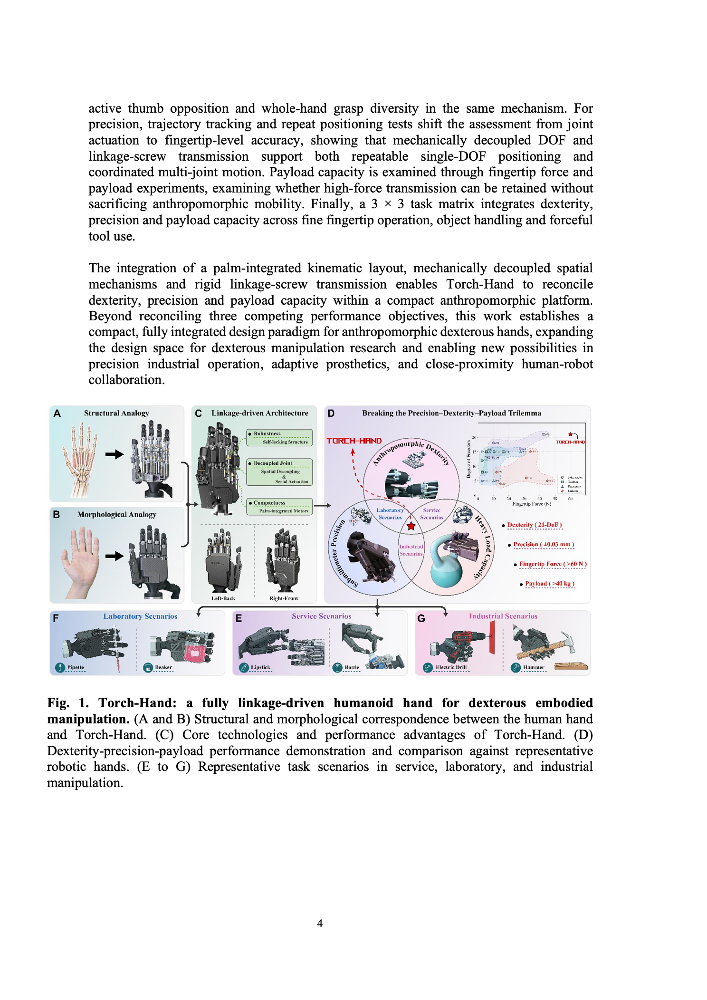

原图注主题：Torch-Hand 的连杆驱动仿人手总览。A/B 比较人手与机械手结构、形态；C 为核心技术；D 为性能主张与代表性手的比较；E–G 为服务、实验室和工业场景。读图时将 D 视为作者总结，精度与负载口径须结合实验及冲突表。

### 图 2：条件耦合与局部传动（第 6 页）

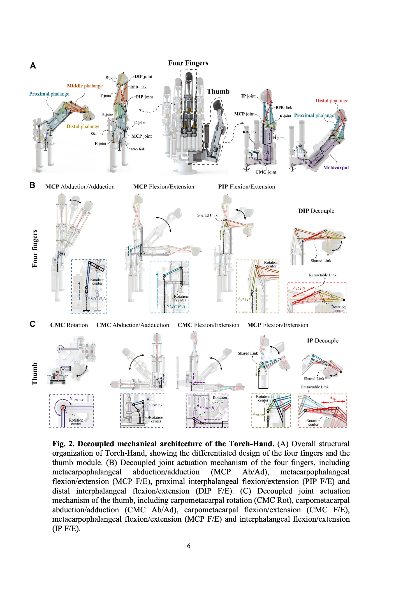

原图注主题：Torch-Hand 的解耦机械架构。A 是四指与拇指模块；B 展示普通手指 MCP 两方向、PIP 与 DIP；C 展示拇指 CMC 三方向、MCP 与 IP。重点看共享连杆和可缩杆：自由运动协同与接触后的相对运动在同一机构中实现。

### 图 3：运动学坐标与几何量（第 8 页）

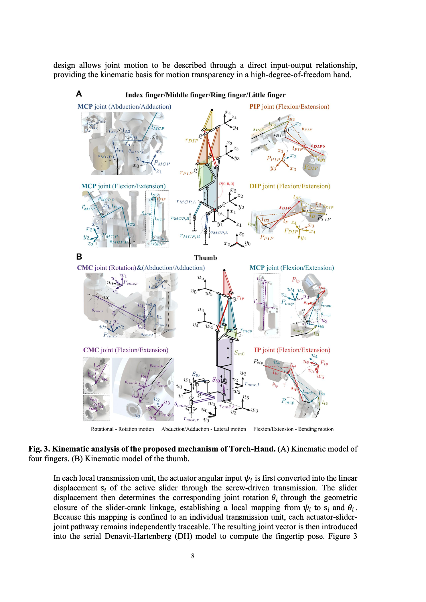

原图注主题：所提机构的运动学分析，A 为普通手指，B 为拇指。它连接物理关节、局部连杆尺寸和串联坐标系；结合式 (1)–(4)、S11–S14、S28–S32 阅读。

### 图 4：机械实现与装配关系（第 11 页）

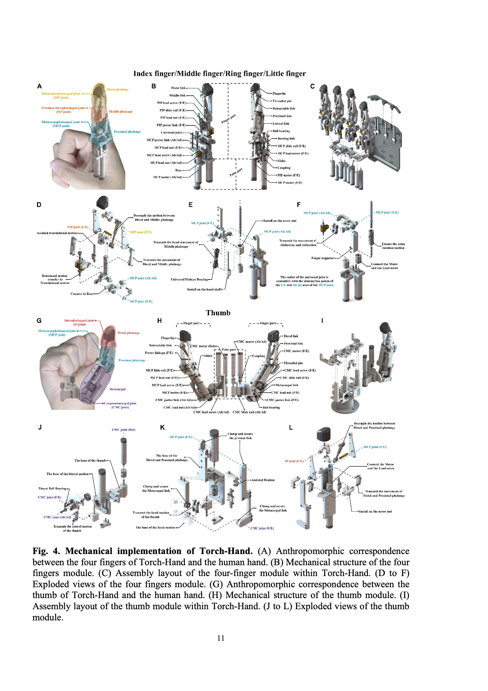

原图注主题：机械实现。A–F 为四指与人手对应、模块结构、掌内布局和分解图；G–L 为拇指的对应结构。F 中万向节中心与 MCP 轴交点的对齐，是作者减少传动干扰的具体措施。

### 图 5：活动范围、工作空间与协调运动（第 13 页）

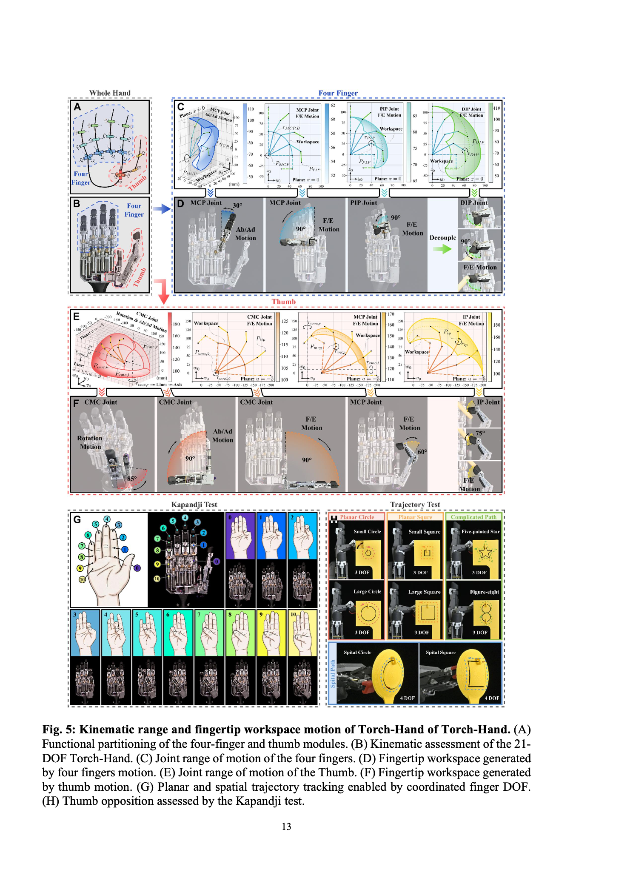

原图注主题：关节运动范围与指尖工作空间。**图注有配对错位**：实际 C/E 为四指／拇指工作空间，D/F 为实机运动范围，G 为 Kapandji 对掌，H 为轨迹任务。普通手指 MCP 的 30°／90° 应与正文对照，不将其冲突隐藏。

### 图 6：33 类抓型（第 15 页）

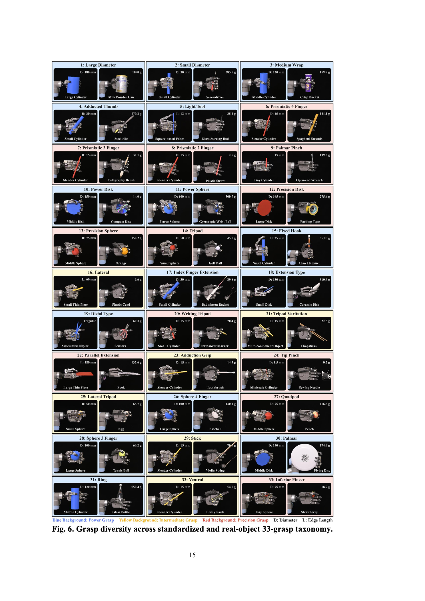

原图注主题：标准与真实物体的 33 抓型分类覆盖。每格成对展示标准物体与真实物体；它支持抓型多样性的结论，不提供随机抓取成功率。物体细节见实际表 S5。

### 图 7：重复定位、指尖力、握力与承载（第 16 页）

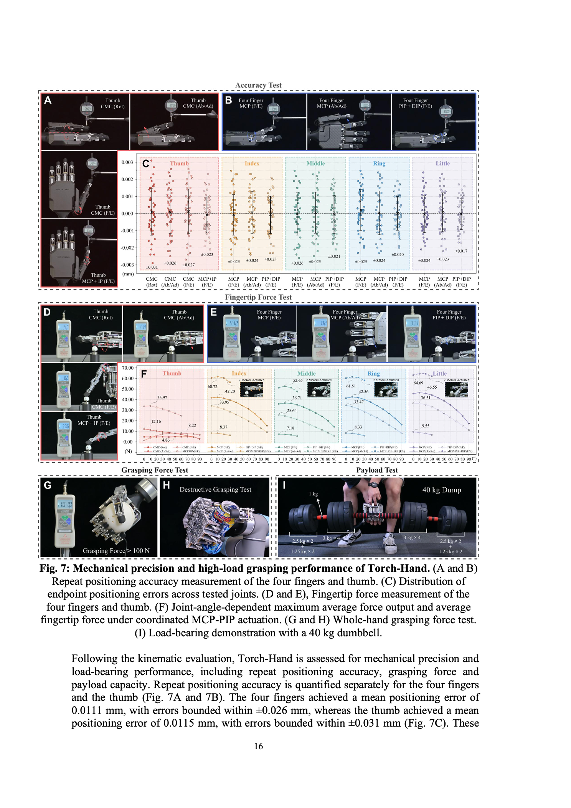

原图注主题：机械精度与高负载抓持。A/B 为重复定位，C 为偏差分布，D/E 为指尖力测量，F 为随角度变化的力，G/H 为握力球与压罐，I 为 40 kg 展示。C 的刻度、F 的组合标签和表 S7 的冲突均保留；I 不代表机械臂完成同等负载搬运。

### 图 8：九项操作演示（第 18 页）

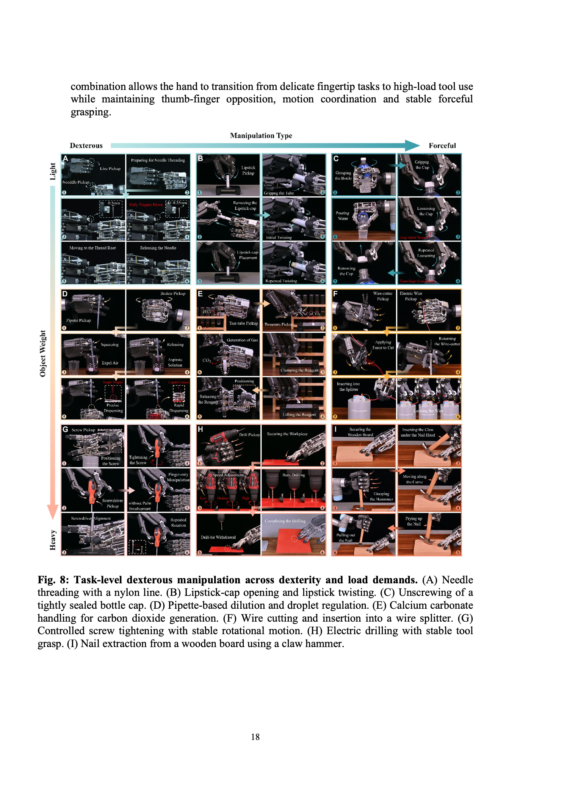

原图注逐项对应：A 穿线，B 口红，C 开紧封瓶盖，D 移液滴液，E 碳酸钙操作，F 剪线与插线，G 拧螺钉，H 电钻，I 羊角锤拔钉。该矩阵按操作需求和交互负载组织展示，不是九个任务的统计成功率矩阵。

### 图 S1：滑块到关节的几何闭环（第 34 页）

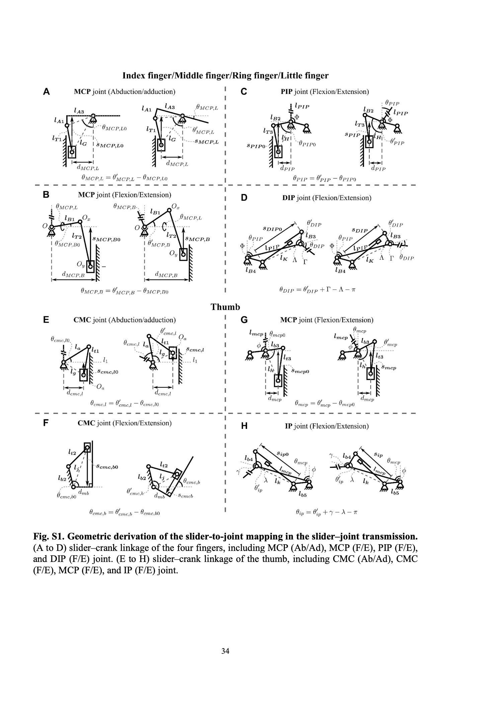

原图注主题：滑块—关节映射的几何推导。A–D 对应四指 MCP 两方向、PIP、DIP；E–H 对应拇指 CMC 两方向、MCP、IP。D/H 清楚表明远端关节和可缩杆依赖近端构型；复现时需核对角度分支与零位。

### 图 S2：模块化装配（第 35 页）

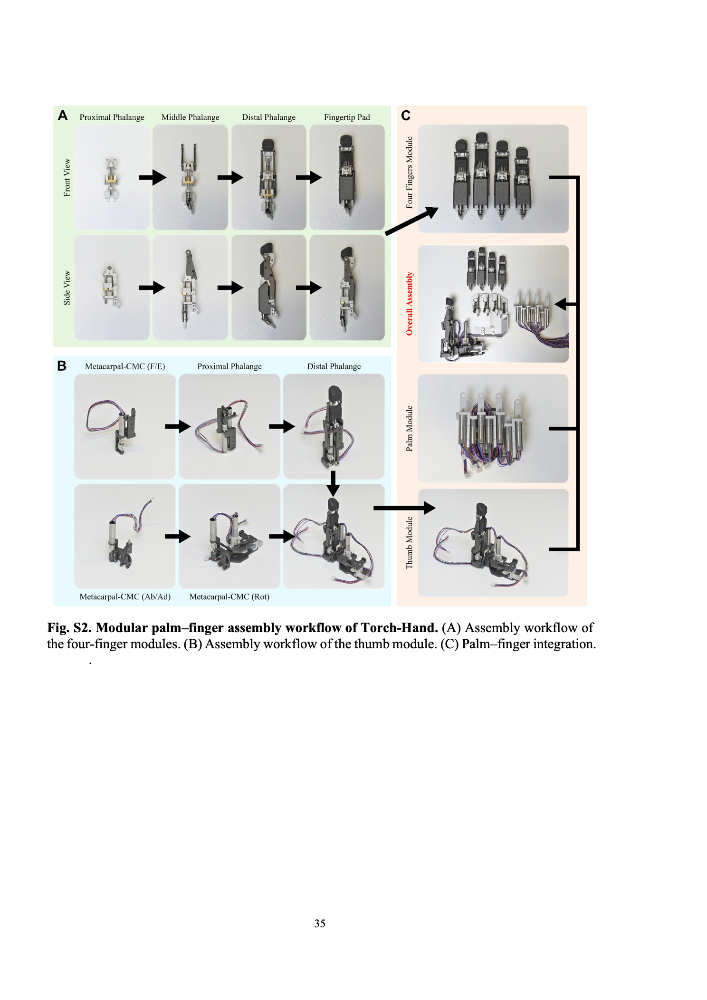

原图注主题：掌—指模块装配流程。A 为四指模块，B 为拇指模块，C 为整手集成。它说明模块连接顺序，但不能替代加工尺寸、公差和线缆／控制文档。

## 来源与阅读位置索引

以下均为本地 PDF 页码，与文内印刷页码一致；数值、公式和图注以 PDF 可视内容为准。

| 阅读问题 | 位置 |
|---|---|
| 动机、相关工作、作者四项贡献 | 第 1–4 页，Introduction，图 1 |
| 机构自由度、空载耦合与接触解耦 | 第 5–7 页，Theory Model，图 2 |
| 状态向量与串联建模 | 第 8–9 页，Kinematic Analysis，图 3，式 (1)–(2) |
| 机械传动与拇指实现 | 第 10–12、21–22 页，图 4，Mechanical Design / Assembly |
| 工作空间、抓型和运动范围 | 第 13–15、22–23 页，图 5–6，表 S5（第 38 页） |
| 定位、力与承载 | 第 16–17、23–24 页，图 7；实际表 S6（第 39 页）、S7（第 39–40 页） |
| 九任务的控制来源与成功标准 | 第 17–18、24 页，图 8，Task-level Manipulation |
| 讨论与作者承认的未来工作 | 第 19–20 页 |
| 电机—滑块—关节关系 | 第 22 页式 (3)–(4)；第 30–32 页 S1–S27；第 34 页图 S1 |
| DH 与指尖位姿 | 第 32–33 页 S28–S32；第 37 页实际表 S3/S4 |
| 规格比较与执行器计数 | 第 36 页，表 S1 |
| 模块装配与机构副定义 | 第 35 页图 S2、第 37 页表 S2 |
| 数据声明及补充目录边界 | 第 24、29–30 页；本地仅有论文与静态图，未核验视频或外部代码 |

本稿已整理现有 v1 全文的证据，完整验收状态仍待来源补齐。论文中的待澄清事项不被当作已证实结果，也不构成“已复现”的声明。
