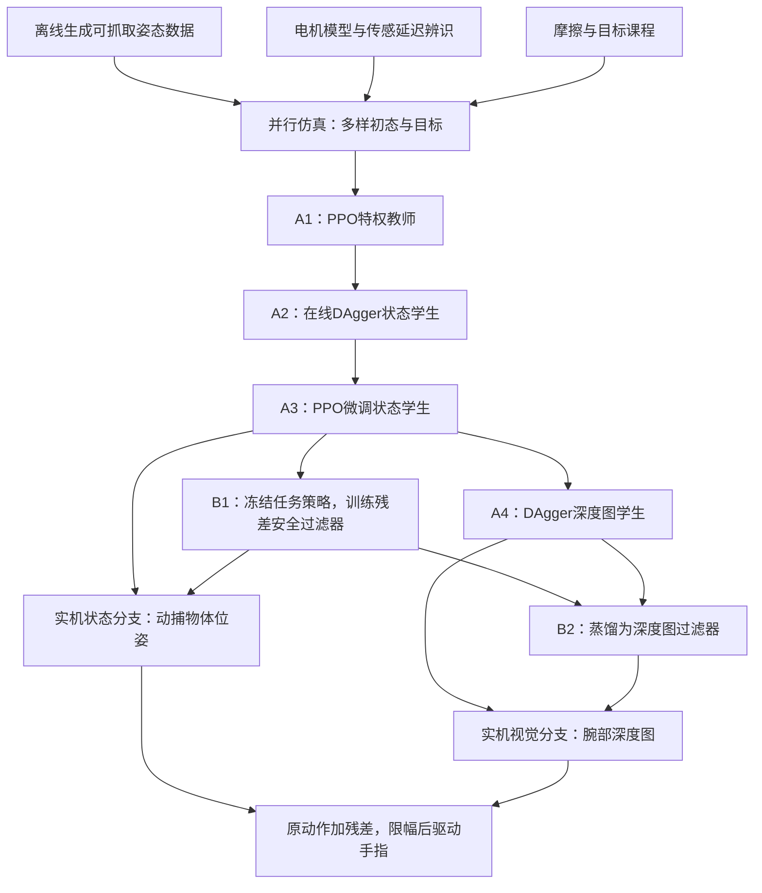

# 在手内“挪到目标位置”，同时尽量不掉：灵巧手位姿控制与安全过滤

> 真实首篇验收；不是虚构示例，也不是独立复现。检索、阅读日期：2026-10-29（Asia/Shanghai）。

**原文**：Pushing Dexterity and Safety for In-Hand Object Pose Reaching That Works Remarkably Well，Ian Chuang、Hiya Shah、Vamsi Chilamkur、Iman Soltani、Claire Tomlin。arXiv **2610.37652v1**，2026-10-27，`cs.RO / cs.LG / eess.SY`。[摘要与版本](https://arxiv.org/abs/2610.37652v1) · [全文](https://arxiv.org/html/2610.37652v1) · [作者项目页](https://ian-chuang.github.io/dexsafe/)。

**为什么入选**：核心对象是多指灵巧手，核心任务是接触丰富的在手操作；方法直接连接强化学习、DAgger 模仿学习、sim-to-real 与安全控制。它讨论的是手指如何移动物体并避免掉落，不是仅包含“dexterous”关键词的外围工作。

## 1. 先用一个例子理解

把灯泡拿在手里，让它向指尖方向移动、倾斜，再绕自己的轴转动，同时保持抓握。难点是手指既要放开一点让物体移动，又不能放得太多导致掉落。作者先学会“去目标”，再在原策略上加一层“动作修正”，这层修正以少改动原动作的方式减少掉落。

这里的目标是物体**相对于手掌**的位姿；策略控制 LEAP 手的 16 个关节，手臂不是这个策略的动作输出。灯泡、酒杯具有旋转对称性，视觉无法唯一识别其绕对称轴的朝向，论文对它们用位置和轴方向设目标，并可额外给旋转速度指令。

## 2. 训练与部署管线

以下 Mermaid 是按原文 Fig. 4 重新组织的理解图。A1—A4 是任务策略，B1—B2 是安全过滤器。

**原文 Fig. 4 的阅读要点**：橙色 A 系列学习完成目标，蓝色 B 系列学习少掉落；雪花表示冻结已有策略。教师可访问仿真特权信息，实机学生只能使用实际传感器信息。A4 和 B2 是两个不同的蒸馏步骤，不能把“学生能用深度图”误写成“教师也只用深度图”。

## 3. 四个决定效果的组件

| 组件 | 它解决的问题 | 原文位置 |
|---|---|---|
| 可行抓姿数据与随机重置 | 均匀采样空间会产生大量手根本抓不到的目标；从可抓姿态中采样，帮助探索 | V-A1、附录 E |
| 自适应摩擦课程 | 先让物体不容易滑落，学会基本移动，再逐步降低摩擦到目标范围 | V-A3、附录 G |
| 教师—学生与系统辨识 | 教师先利用完整仿真状态学技能，再让学生适应可部署观测；电机与延迟校准减小仿真落差 | IV-B、V-A4 |
| 残差安全过滤 | 冻结任务策略，只训练对动作的小幅修正，并用一个输入控制干预程度 | V-B、附录 I |

状态分支依赖动捕提供物体位姿；深度分支使用腕部双目相机及深度处理。部署不需要人类演示，但训练并非“没有模仿学习”：DAgger 用教师动作作为监督，模仿的是策略教师。

## 4. 关键公式逐个拆解

### 4.1 到底算“到达”还是“掉落”？——原文式 (1)、(2)

$$
e_p=\lVert p-p^*\rVert_2,\qquad
e_R=\lVert\operatorname{Log}(RR^{*\top})\rVert_2.
$$

`p`、`p*` 是当前和目标三维位置；`R`、`R*` 是当前和目标旋转矩阵。第一项是位置距离，第二项是旋转空间里的夹角，不能直接拿旋转矩阵逐元素相减代替。对于轴对称物体，朝向误差改为 `arccos(zᵀz*)`，只比较当前轴和目标轴。

$$
\ell(x)=d_{\max}-\lVert p_{\mathrm{obj}}-p_{\mathrm{hand}}\rVert_2.
$$

`x` 表示系统状态；当物体离手根的距离超过阈值，安全余量 `ℓ(x)` 变成负数，即判作掉落。安全过滤和仿真基准采用 `d_max=0.3 m`。这是论文定义的掉落边界，不能当成适用于所有机器人和任务的普适安全标准。

### 4.2 为什么奖励“进步”，而不是一直奖励“靠近”？——原文式 (5)、(6)

$$
\Delta\Phi_t=\Phi_t-\Phi_{t-1},\qquad
\Phi^p=-\min(e_p,0.1\,\mathrm{m}),\quad \Phi^R=-e_R.
$$

位置误差下降，负误差上升，差分奖励就为正；原地停留不会持续赚取位置进步奖励。完整奖励还包含旋转速度、保持目标进度、掉落、接触以及动作幅度与变化率项。**这里仅摘出位置和姿态的核心结构，不能用它替代原文完整奖励复现。**

原文使用的是上述势能差分写法；不要直接套用带折扣因子的其他势函数塑形定理，声称本文已经满足其所有理论条件。

### 4.3 安全过滤到底改了什么？——原文式 (7)

$$
a_t=\operatorname{clip}\bigl(a_t^{\mathrm{nom}}+\delta_t,-1,1\bigr).
$$

`a_nom` 是冻结的任务策略输出，`δ` 是过滤器输出，二者都是 16 维向量；`clip` 把动作限制在合法区间。过滤器并不重新规划全部任务，只修正即将执行的动作。

### 4.4 保守程度的旋钮——原文式 (8)

$$
r_t=\frac{1}{1+w\lVert\delta_t\rVert_2^2/n},\qquad n=16.
$$

这个奖励始终为正：活得更久仍能累计收益，减少“为逃避负奖励而赶快失败”的动机。`w` 是修正成本权重，`n` 对动作维数归一化。

- **`w` 较大**：修改动作更贵，过滤器更接近原任务策略。
- **`w` 较小**：允许更强干预，通常更少掉落，但可能更难到达目标。

因此不能把“大 `w`”误解成“更保守、更安全”。作者把 `w` 也作为网络输入，让训练后的同一个过滤器在部署时调整权衡；主要实机实验选 `w=0.5`。过滤器不观察任务目标，也不因达成目标而获得奖励。

## 5. 作者贡献与我的判断

作者强调的是一套可迁移到实机的训练方案、自适应摩擦课程、适配灵巧操作的残差安全过滤，以及较长时间的实机评测。残差安全过滤建立在已有 ResSafe 上；这里不是首次提出“给策略加残差”。

值得学习的组合有两点：第一，把难学的任务拆为“特权环境学会—可部署观测蒸馏—学生继续强化”；第二，把任务能力和安全修正分开训练，同时承认二者存在性能代价。这种拆分也适合研究后续的触觉学生或更广泛的物体泛化，但这些延伸是我的研究建议，并非本文已完成的结果。

## 6. 实验结果该怎么读

原文 VI-B1 / Table II：4 个物体、6 种手腕朝向、4 种配置，共 96 轮；每轮尝试 50 个连续目标，总计 4,800 个目标、13.3 小时的目标时间窗。下面每一行汇总该配置的 **1,200 个目标**；粗精度成功阈值为位置 2 cm、角度 0.4 rad。

| 配置 | 粗精度目标成功率 | 掉落目标数 | 读数含义 |
|---|---:|---:|---|
| 状态策略，无过滤 | 95.2% | 16/1200 | 有动捕输入 |
| 状态策略，有过滤 | 91.5% | 4/1200 | 掉落相对减少 75%，成功率下降 3.7 个百分点 |
| 深度策略，无过滤 | 71.8% | 88/1200 | 只把腕部深度图作为物体观测输入 |
| 深度策略，有过滤 | 66.7% | 46/1200 | 掉落减少，但视觉误差仍明显 |

**原文 Fig. 8** 展示一次具体失败对照。它解释机制，但总体结论应依据 Table II 的多轮数据，而不是单张成功演示图。

评测在目标时间窗内任意时刻进入位置和朝向阈值就算成功；训练还有旋转速度与保持计数要求。二者条件不同。96 轮也不是不间断运行 13.3 小时：掉落或卡住后会重置，并继续下一个目标。

## 7. 局限与可继续研究的问题

- **按物体训练**：每个物体有自己的任务策略，过滤器也绑定物体与原策略；尚不是一套策略处理任意新物体。
- **安全没有形式化保证**：过滤器是学习得到的，实机仍有掉落。动作限幅也不等于不掉落保证。
- **视觉仍是短板**：刀和酒杯的实机深度误差比仿真更重尾；状态分支的高分不能直接归给视觉分支。
- **算力成本不低**：原文 A1 在两块 RTX 5090 上约 15–17 小时，酒杯更久；轻量服务器适合检索与解读，不适合按原设置训练。
- **下游任务不是端到端通用机器人**：演示中的手臂轨迹、预抓姿和目标序列由人工编排，部分带过滤的下游任务成功率反而更低。

可优先实验：在不改任务策略的情况下给过滤器加入触觉；按物体形状与观测不确定性条件化过滤器；用“每次掉落前完成的目标数”与任务成功率同时评估，避免单看成功率掩盖稳定性问题。

## 8. 本地原文与插图

本目录保留 [HTML 原文](source.html)、[公式与正文提取](source.txt)、[原始 PDF](paper.pdf)、[元数据](metadata.json)、[全部30张原图](figures.md)、[原图清单](figures.json) 和 [准备记录](preparation.json)。原图按来源保存在 `figures/`，图号以清单中的 `figure_id` 和图注为准，不用文件名序号推断原图号。

本篇已保留 Fig. 1–30：HTML 的29张原始图片/图表，加上从PDF第1页补齐的图1；14张数据表仍保留在原始HTML/PDF内。关键式(8)及权重方向已经与PDF第7页视觉核对。一般论文的HTML转换仍可能省图或排版出错，不能把本篇覆盖率推广为全自动保证。上述数值及公式均定位于原文相应章节；本解读没有运行作者训练代码，也未核验作者项目页所链接仓库的发布状态。
