# 原图索引

已保存原文 Fig. 1–30。图1从原始 PDF 补齐，其余为 arXiv HTML 中的原始 PNG/SVG。英文原图注、地址和提取状态保存在 `figures.json`；正文重点解读了图4和图8。

## 原文 Fig. 1

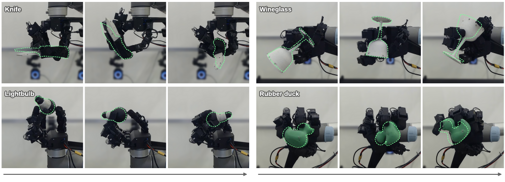

[原文位置](https://arxiv.org/pdf/2610.37652v1#page=1)

## 原文 Fig. 2

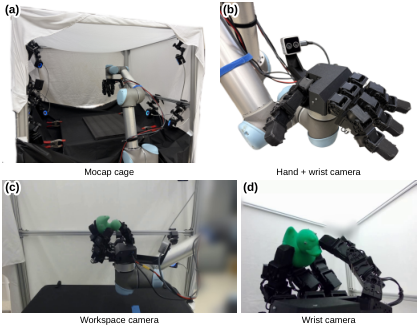

[原文位置](https://arxiv.org/html/2610.37652v1/hardware_col_nolabels_duck14.png)

## 原文 Fig. 3

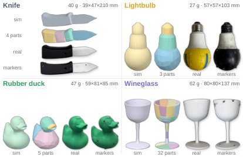

[原文位置](https://arxiv.org/html/2610.37652v1/objcoll_a_pairs_2x2_4panel.png)

## 原文 Fig. 4

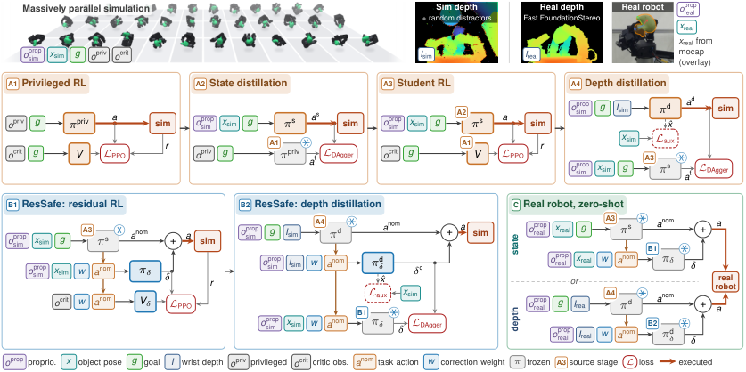

[原文位置](https://arxiv.org/html/2610.37652v1/combined13_color_aux_v8.png)

## 原文 Fig. 5

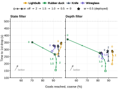

[原文位置](https://arxiv.org/html/2610.37652v1/dial_surv_1panel_state_depth_seq_col_1x2.svg)

## 原文 Fig. 6

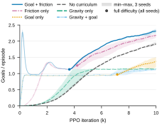

[原文位置](https://arxiv.org/html/2610.37652v1/curric_knife_seeds_goals_grav_col.svg)

## 原文 Fig. 7

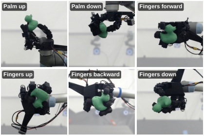

[原文位置](https://arxiv.org/html/2610.37652v1/orientations_duck_2x3_fadeblur_col_pill.png)

## 原文 Fig. 8

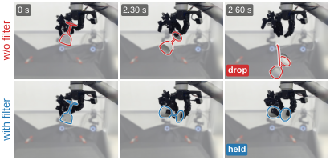

[原文位置](https://arxiv.org/html/2610.37652v1/wineglass_fade_no4_col.png)

## 原文 Fig. 9

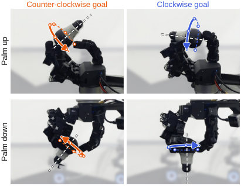

[原文位置](https://arxiv.org/html/2610.37652v1/twist_web_2x2_fadeblur_sharp_flip.png)

## 原文 Fig. 10

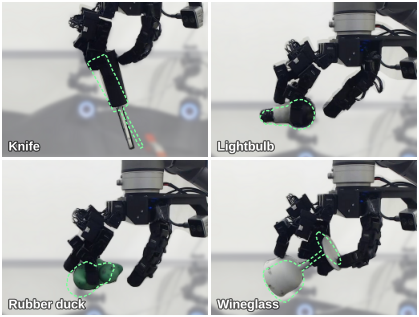

[原文位置](https://arxiv.org/html/2610.37652v1/hard_2x2_col_4x3_duckg7_wg3.png)

## 原文 Fig. 11

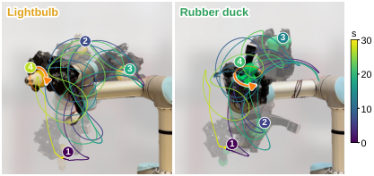

[原文位置](https://arxiv.org/html/2610.37652v1/motion_onion_plain_timebar_rot_col_vbar.png)

## 原文 Fig. 12

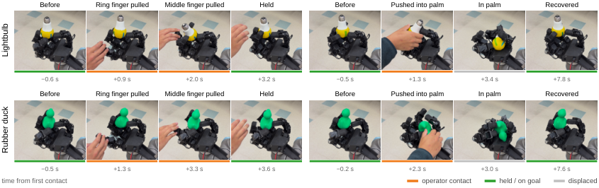

[原文位置](https://arxiv.org/html/2610.37652v1/qr6b_filmstrips_compact_timeline_pull_v8.png)

## 原文 Fig. 13

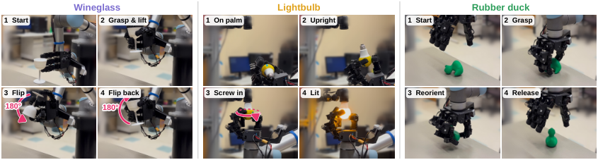

[原文位置](https://arxiv.org/html/2610.37652v1/seq_wide_blocks_sep.png)

## 原文 Fig. 14

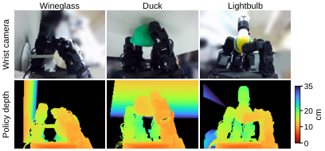

[原文位置](https://arxiv.org/html/2610.37652v1/clutter_wristonly_2x3_col_vbar.png)

## 原文 Fig. 15

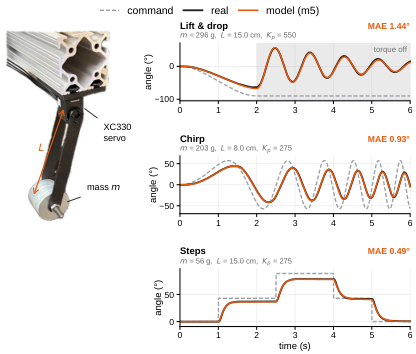

[原文位置](https://arxiv.org/html/2610.37652v1/sysid_photo_3traj_col.png)

## 原文 Fig. 16

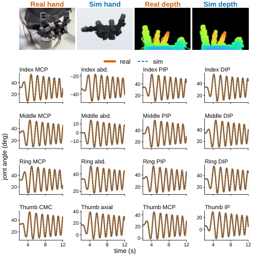

[原文位置](https://arxiv.org/html/2610.37652v1/sysidfig_row_2to12_dash_col.png)

## 原文 Fig. 17

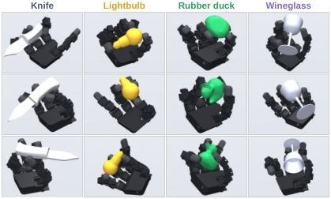

[原文位置](https://arxiv.org/html/2610.37652v1/sim_grid_dataset_3x4_diverse_jitter_col.png)

## 原文 Fig. 18

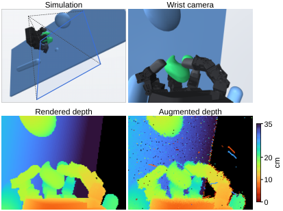

[原文位置](https://arxiv.org/html/2610.37652v1/sim_overview_duck_2x2_col_vbar.png)

## 原文 Fig. 19

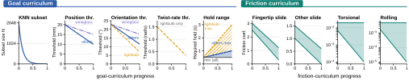

[原文位置](https://arxiv.org/html/2610.37652v1/curric_combined_1row_linear.svg)

## 原文 Fig. 20

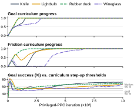

[原文位置](https://arxiv.org/html/2610.37652v1/curric_progress_col_3row_v8.svg)

## 原文 Fig. 21

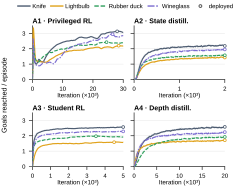

[原文位置](https://arxiv.org/html/2610.37652v1/stages_col_2x2_cvd_clean_v8.svg)

## 原文 Fig. 22

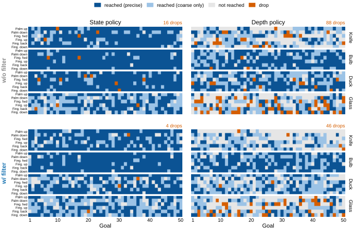

[原文位置](https://arxiv.org/html/2610.37652v1/raster_goal_outcomes_2x2_cvd_wgfix_v8.png)

## 原文 Fig. 23

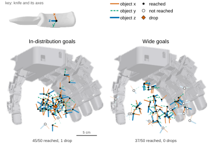

[原文位置](https://arxiv.org/html/2610.37652v1/triad_grasp4_knife_col_1x2_key.png)

## 原文 Fig. 24

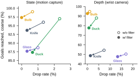

[原文位置](https://arxiv.org/html/2610.37652v1/tradeoff_2panel_nose_wgfix_v8.svg)

## 原文 Fig. 25

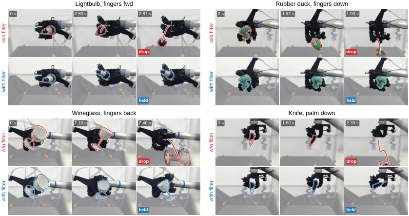

[原文位置](https://arxiv.org/html/2610.37652v1/grid2x2_bulb_duck_wgback_knife_wide.png)

## 原文 Fig. 26

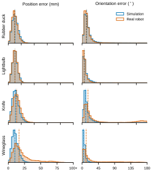

[原文位置](https://arxiv.org/html/2610.37652v1/aux_pose_hist_col_pooled_v8.svg)

## 原文 Fig. 27

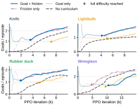

[原文位置](https://arxiv.org/html/2610.37652v1/curric_curves_2x2_col_cvd.svg)

## 原文 Fig. 28

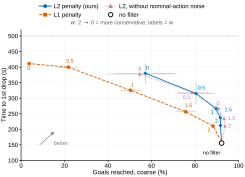

[原文位置](https://arxiv.org/html/2610.37652v1/ablation_duck_surv_v2_col_v8.svg)

## 原文 Fig. 29

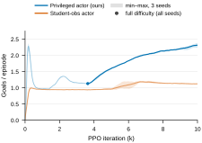

[原文位置](https://arxiv.org/html/2610.37652v1/abl_actor_obs_goals_col_v8.svg)

## 原文 Fig. 30

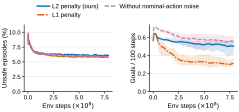

[原文位置](https://arxiv.org/html/2610.37652v1/ressafe_duck_arms_col_v8.svg)
