# Coupled Guidance for Flow Matching：通过双端点引导稳定灵巧操作轨迹补全

## 1. 原文信息与相关性

- **作者**：Mateo Clémente、Léo Maxime Brunswic、Rui Heng Yang、Amir Rasouli。
- **arXiv**：2610.40109，v1；分类 cs.LG、cs.RO。
- **提交／更新日期**：元数据均为 2026-10-29 14:12:07 UTC，即配置时区 Asia/Shanghai 的 2026-10-29 22:12:07。这里是版本提交时间，不另推断公告时间。
- **原文**：[摘要页](https://arxiv.org/abs/2610.40109v1)、[HTML 全文](https://arxiv.org/html/2610.40109v1)、[官方 PDF](https://arxiv.org/pdf/2610.40109v1)。本地保留 [HTML](source.html)、[提取文本](source.txt) 与 [核验用 PDF](paper.pdf)。
- **解读日期**：2026-10-30，Asia/Shanghai。仅解读 v1；本篇没有需要比较的本地旧版。
- **主题判定：高度相关，纳入“灵巧手与操作”**。§5.2 不只是提及 dexterous，而是把 Adroit 的 Door、Pen、Hammer、Relocate 四项灵巧操作作为主要实验之一：让低层流匹配控制器根据高层规划器的稀疏状态—动作轨迹补全控制序列，评估引导稀疏时的表现。相关点是**生成式操作策略的推理引导与层级控制**，并非新的灵巧手机械结构、触觉硬件或接触模型。

阅读依据包括完整正文、附录 A–C、本地原图，以及官方 PDF 的公式和表格。下文“作者主张”和“解读判断”分别标注；没有运行训练或复现实验。

## 2. 一句话解释

这篇论文尝试让流匹配（Flow Matching，FM）策略在接受额外约束时仍能稳定生成轨迹：例如，高层规划器只给出转笔任务未来状态—动作轨迹中的少量坐标，低层控制器从噪声出发补全其余坐标；作者同时调整生成路径的“数据端点”和“潜变量端点”，避免常规引导隐式地把潜变量朝相反方向推走。

这里的“潜变量”是生成模型的噪声端点，不是机器人不可观测的物理状态；“无需训练的引导”（training-free guidance）指在已有模型上添加引导无需重训，基础模型本身仍需训练。

## 3. 方法管线

以下是依据 §3–5 绘制的理解图，不是作者原图。

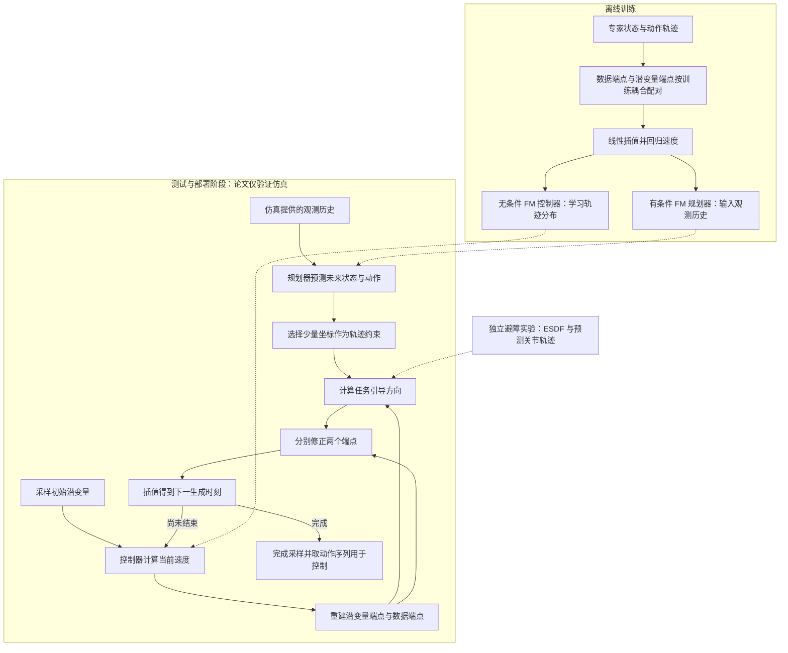

**信息边界**：Adroit 的两层模型是条件规划器和无条件控制器，不是 teacher/student 蒸馏。未来轨迹是高层模型预测的，不是部署时读取未来真值。原文没有单独定义可观测／特权状态的划分，也没有证明这些仿真观测能在实机上直接取得；不能把它描述成仅靠相机或触觉完成控制的系统。图中的避障分支属于另一项实验，不表示作者把两套任务合并训练。

## 4. 核心组件及连接关系

| 组件 | 目的与输入 | 输出及下一步 |
|---|---|---|
| 训练耦合（coupling） | 将潜变量分布与数据分布配对；沿线性插值构造训练样本 | 训练速度场；耦合是端点的联合分布，不仅是两个边缘分布 |
| 端点重建 | 输入当前生成状态、生成时间和模型速度 | 得到估计的噪声端点与数据端点；不是重新执行一次完整采样 |
| 数据侧引导 | 输入预测轨迹与稀疏约束，或预测关节轨迹与避障目标 | 计算修正向量；ΠGDM 保留雅可比，ΠGDM+ 以单位阵近似 |
| 潜变量侧引导 | 使用同一修正向量，另设系数 β | 消除或反转常规引导隐含的反向潜变量修正 |
| 端点插值 | 输入两个修正后的端点和下一生成时间 | 产生下一状态，重复至最终轨迹；修正不要求另一个神经网络 |

ΠGDM 来自已有伪逆引导方法的 FM 适配，ΠGDM+ 是本文对已有 `g^{sim-inv-A}` 的命名。本文贡献在于如何组合端点更新，而不是从零提出这两个基础引导器。避障实验使用能量梯度，原文没有为碰撞管线构造可直接套用的线性退化／伪逆算子（§2、附录 B.1）。

## 5. 关键公式与逐符号解释

下面保留原式编号；为便于阅读，将 `v_t^θ(x_t)` 与 `v^θ(x_t,t)` 视作相同记法。**生成时间** $t\in[0,1]$ 与机器人轨迹的第几步是两条时间轴。

### 5.1 训练目标：学端点之间的速度

§3.2（PDF p.3，无编号）的目标为：

$$
x_t=(1-t)x_0+tx_1,\qquad
v_t(x_t)=\mathbb E[x_1-x_0\mid x_t],
$$

$$
\mathcal L(\theta)
=\mathbb E_{(x_0,x_1)\sim\pi}\int_0^1
\|v_t^\theta(x_t)-v_t(x_t)\|_2^2\,dt
=\mathbb E_{(x_0,x_1)\sim\pi}\int_0^1
\|v_t^\theta(x_t)-(x_1-x_0)\|_2^2\,dt+\mathrm{Cte}.
$$

- $d$：展平后样本维数。轨迹生成时可写为“预测步数 × 每步轨迹坐标数”；ManiSkill 动作预测为 $24\times9=216$。Adroit 生成状态—动作对，每任务总维数原文未列明。
- $x_0,x_1,x_t\in\mathbb R^d$：潜变量端点、数据端点和插值样本；分布分别为 $\mu_0,\mu_1$ 与中间分布。
- $\pi$：定义在 $\mathbb R^d\times\mathbb R^d$ 上的联合概率分布，两个边缘分别是 $\mu_0,\mu_1$；不默认所有实验都使用独立配对，图像实验还考察小批量最优传输（minibatch OT）。
- $\theta$：神经网络参数；$v_t^\theta\in\mathbb R^d$ 是学习速度，$v_t\in\mathbb R^d$ 是条件均值给出的理想速度。
- $\mathbb E$、$\int_0^1dt$、$\|\cdot\|_2$：对端点配对取期望、在生成时间积分、欧氏范数；优化的是标量平方误差。
- $\mathrm{Cte}$：与 $\theta$ 无关的常数。两种写法有相同最优解，但数值不必相等；不能把有限数据上的回归误差直接当成已知的总体理论损失。

适用设置是线性插值、未加权二次损失；推广到其他几何或加权目标不属于本文已经证明的范围。

### 5.2 重建双端点：看见隐式的潜变量变化

原式 (6)–(7)，PDF p.4：

$$
\widehat x_0=x_t-t v_t^\theta(x_t),\qquad
\widehat x_1=x_t+(1-t)v_t^\theta(x_t), \tag{6}
$$

$$
x_{t+\delta t}=(1-t-\delta t)\widehat x_0
 +(t+\delta t)\widehat x_1. \tag{7}
$$

$\widehat x_0,\widehat x_1\in\mathbb R^d$ 是当前一步速度外推的端点估计，不保证等于真实训练样本。$\delta t>0$ 是采样步长，要求下一时刻不超过 1；式 (7) 恰等于 Euler 更新 $x_t+\delta t\,v_t^\theta(x_t)$。

常规引导先做 $\widehat x_1^g=\widehat x_1+\alpha_t\mathcal G(\widehat x_1)$（原式 (4)），却固定当前 $x_t$。为了仍满足当前位置的插值关系，潜变量端点必须变成：

$$
\widehat x_0^{g,\mathrm{naive}}-\widehat x_0
=-\frac{\alpha_t t}{1-t}\mathcal G(\widehat x_1).
$$

这是 §3.3 在原式 (7) 后的推导，亦见 (11)。上标 $g$ 表示受引导量，`naive` 是常规方案；$\alpha_t$ 是可随时间变化的标量强度，$\mathcal G\in\mathbb R^d$ 是任务修正向量，正文省略其观测和时间依赖。对正的 $\alpha_t$，潜变量修正与数据侧修正反向，且含 $t/(1-t)$ 因子。作者把这种漂移视为训练耦合失配的来源。

### 5.3 Coupled Guidance：分别控制两端

原式 (13)、(14) 代入 (8)–(10)，PDF pp.4–6：

$$
g=\mathcal G(\widehat x_1),\qquad
\widehat x_1^g=\widehat x_1+\alpha g,\qquad
\widehat x_0^g=\widehat x_0-\frac{\beta t}{1-t}g,
$$

$$
x_{t+\delta t}^g=(1-t-\delta t)\widehat x_0^g
 +(t+\delta t)\widehat x_1^g. \tag{10}
$$

- $g\in\mathbb R^d$：本步引导向量，这里与上一节函数 $\mathcal G$ 区分；不另外训练它。
- $\alpha,\beta\in\mathbb R$：数据侧、潜变量侧标量系数。本文一般固定 $\alpha=1$，因为引导器内部已经包含强度；在此条件下 $\beta=1$ 恢复 naive，$\beta=0$ 保持潜变量估计不动，$\beta=-1$ 使其沿数据引导同向移动。
- 所有端点和更新状态均为 $d$ 维；加权系数为标量。这是固定模型的采样更新，不是新的参数训练损失。

**教学推导，非作者另列原式**：把上述端点展开，可以精确得到

$$
x_{t+\delta t}^g=x_t^g+\delta t\,v_t^\theta(x_t^g)
 +\left[t(\alpha-\beta)
 +\delta t\left(\alpha+\frac{\beta t}{1-t}\right)\right]g.
$$

这说明它对同一个 $g$ 等价于改变随时间变化的有效引导系数。$\alpha=\beta=1$ 时系数为 $\delta t/(1-t)$；$\alpha=1,\beta=0$ 时为 $t+\delta t$。当固定 $\alpha\ne\beta$、$g$ 不随步长缩小时，一般存在不随 $\delta t$ 消失的校正，不能自动认为它具有通常的连续 ODE 极限。作者在 §6 明确承认实际 schedules 没有该极限。

**实现边界**：在 $t<1$ 才计算分母 $1-t$，最后一步结束于 $t=1$。Algorithm 1 的 `i=0..T` 与步数／步长关系未交代清楚，复现时需明确循环端点，不能机械照抄后在 $t=1$ 再求一次引导。本解读未提供经运行验证的实现。

### 5.4 轨迹补全使用的引导器

§2 “Base Methods”（PDF p.3）的无噪声 ΠGDM 公式，以列向量记法等价写为：

$$
g_{\Pi\mathrm{GDM}}=-\lambda_t J_t^\top
\left(H^\dagger y-H^\dagger H\widehat x_1\right),\qquad
J_t=\frac{\partial\widehat x_1}{\partial x_t}.
$$

- $H\in\mathbb R^{m\times d}$：观测／退化算子。稀疏轨迹补全中可理解为选取受约束坐标；图像中是遮罩、模糊或下采样。
- $m$：观测坐标数；$y\in\mathbb R^m$ 是约束值，图像无噪声情形为 $y=Hx^*$，$x^*\in\mathbb R^d$ 是目标图像。
- $H^\dagger\in\mathbb R^{d\times m}$：Moore–Penrose 伪逆。原文写 $H^\top(HH^\top)^{-1}$，该简式要求满行秩；对奇异算子不能直接做普通矩阵逆。
- $J_t\in\mathbb R^{d\times d}$：端点预测相对于当前状态的雅可比（Jacobian）；上标 $\top$ 是转置。ΠGDM+ 用单位阵 $I_d$ 近似它，减少雅可比带来的计算和不稳定性，也丢掉模型的局部方向信息。
- $\lambda_t$：标量引导 schedule，调节观测一致性的修正强度。括号内是 $d$ 维残差，引导输出仍是 $d$ 维。

**原文符号疑点，已核对 PDF**：式中的负号和残差次序并非 HTML 转换错误。若取 $\lambda_t>0$、$J_t=I_d$，再按式 (4) 把该向量加到端点上，会朝观测残差的反方向移动。原文未在此明确负强度或额外取反约定。因此这里忠实记录，不能直接作为可运行的下降更新；复现需要核对作者实现的符号约定。这个疑点不影响式 (6)–(14) 作为“给定任意修正向量后的端点组合”的代数核验。

### 5.5 理论上界实际说明了什么

Theorem 1，原式 (12)，PDF p.5：

$$
\mathbb E_o\,\mathcal W\!\left(\mu_1^{g(o)},\mu_1^{\theta,g(o)}\right)
\le L_g L_\theta\,\mathcal L(\theta)^{1/2}
\left\|\frac{d\pi^g}{d\pi}\right\|_{L^\infty(\pi)},\qquad
L_\theta=\exp\left(\int_0^1L_{\theta,t}\,dt\right).
\tag{12}
$$

- $o$：条件观测；$\mathbb E_o$ 对其分布平均。这里的上标 $g(o)$ 表示给定观测的引导规则，不是上一小节中的单个向量。
- $\mu_1^{g(o)}$、$\mu_1^{\theta,g(o)}$：分别用理想速度场和学习速度场、施加同类引导后得到的终点分布；它们不是自动等于目标条件分布。
- $\mathcal W$：Wasserstein 距离；附录 A 的推导使用 $\mathcal W_1$，单位与样本空间距离相同。
- $L_g$：速度场到受引导速度场映射的 Lipschitz 常数；$L_{\theta,t}$：正文定义的学习速度场对空间的 Lipschitz 常数；$L_\theta$ 是累计误差放大因子，均为非负标量。
- $\pi^g$：受引导端点的耦合分布，正文先定义了对 $o,t$ 的条件版本；$d\pi^g/d\pi$ 是相对于训练耦合的密度比，$L^\infty(\pi)$ 范数取本质上确界。要得到有限上界，需要相应绝对连续性和有界密度比。
- $\mathcal L(\theta)^{1/2}$：5.1 中总体速度误差的平方根，不是已经报告的实验数值。

作者假设相关流存在、唯一且光滑，模型可微且空间 Lipschitz，引导更新有连续时间极限，引导映射也是 Lipschitz。上界表达的是：训练误差小，也可能因耦合密度比大而失去推理误差控制。**解读判断**：这不是安全避障、任务成功或严格条件采样的保证，也没有证明选择 $\beta\le0$ 就使密度比必然减小。独立耦合下将密度比分解成数据侧与潜变量侧乘积是额外简化，不能无条件用于 OT 耦合。实际离散 schedule 又不满足连续极限，因此定理主要提供分析视角。

**证明阅读边界**：附录 A 的 Gronwall 步骤对受引导场 $v^{g,\theta}$ 的空间导数作控制，正文却把 $L_{\theta,t}$ 定义为未引导场 $v^\theta$ 的 Lipschitz 常数，二者的关系没有充分展开；密度比还需要在生成时间上有适当的统一控制。这里记录作者给出的界，不声称已独立补全这些证明细节。§3.4 的高斯潜变量密度指数表达是近似解释，本解读不将它当作普遍成立的密度比恒等式。

## 6. 创新点：主张、差异与判断

| 作者贡献主张（§1、§4） | 与已有方法的具体差异 | 本文解读判断 |
|---|---|---|
| 同时控制数据与潜变量端点 | 从既有引导器取同一个方向，用 β 改变隐含潜变量修正，再插值 | 改动集中于采样器，接入已有 FM 策略的成本较低；不是新的网络或新训练目标 |
| 用耦合偏移解释引导失稳 | 将误差上界与训练／推理耦合密度比联系起来 | 有助于发现只看终点残差的不足；实际 β 选择仍有经验性，不能称为严格保持原联合分布 |
| 稀疏引导更稳且额外开销可忽略 | 在 ΠGDM、ΠGDM+ 和能量引导上比较 naive 与 coupled | Adroit 稀疏曲线和避障成功率支持该实验范围内的收益；没有实测时延表支撑硬件实时性承诺 |

基线选择理由见附录 B.1：作者认为部分已有方法在这些设置下化为同类引导，另一些代价过高或不适用。但这仍是作者对基线范围的论证，不等于与所有引导算法都完成了对照。

## 7. 实验与证据

### 7.1 ManiSkill3：新增障碍后的仿真控制

§5.1、表 2（PDF pp.6–7）使用 PickCube 仿真与配套数据，训练 65M 参数 U-Net。输入为过去 2 步环境状态，预测 24 步、每步 9 维关节位置，共 216 维。无新增障碍的基础任务成功率为 99.8%；测试时在方块初始位置与目标间放置障碍，用 cuRobo 的欧氏有符号距离场（Euclidean Signed Distance Field，ESDF）构造关节轨迹引导。

表 2 原值如下，单位为成功率 %，**表注写 256 个环境种子**：

| 数据侧 α ／ 潜变量侧 β | −1 | 0 | 1 |
|---|---:|---:|---:|
| 0 | 73 | 21 | 17 |
| 1 | 81 | 77 | 36 |

无引导是 $(0,0)$，naive 是 $(1,1)$，coupled 的最佳配置是 $(1,-1)$。81% 相对 36% 提升 **45 个百分点**，相对无引导 21% 提升 60 个百分点；这是基于表值的算术差，不是“提升 45%”。仅潜变量侧引导 $(0,-1)$ 也达到 73%，说明改善并不要求两端都有非零修正。

**口径缺口**：附录 B.2 泛称机器人评测用 300 个环境种子，与表 2 的 256 不一致，此处按具体表注报告但不替作者消解冲突。原文未给成功所需距离、碰撞接触阈值、置信区间或独立训练种子数。所有结果是仿真，不能写成实机避障通过率。

### 7.2 Adroit：稀疏轨迹补全，与本主题最直接相关

§5.2（PDF p.7）每任务训练两个 FM 模型：规划器以观测历史为条件预测 24 步状态—动作对；控制器在相同数据上无条件训练。测试时把规划器输出中的部分坐标交给控制器，用引导补全。四项任务为开门闩 Door、转笔 Pen、锤钉 Hammer、物体搬移 Relocate。

- **样本规模**：每次评估使用 300 个环境种子，改变门位姿、目标角度、钉子位置、物体／目标位置等；这不是 300 次独立模型训练。
- **指标**：图 3、6、7 纵轴是 `Normalized Score`（归一化得分），不是标注为百分比的成功率。原文未在该处给出归一化公式或成功阈值，不能把图上 0.8 改写为 80% 成功率。
- **自变量**：横轴 cutoff 是受引导坐标的比例，不是无引导比例，也不是只给了多少完整时间步。
- **对照**：naive 的 $\beta=1$，扫引导尺度 $s\in\{0.2,0.5,1,2,3,5,10,20,50,100\}$；coupled 用 $\beta\in\{-1,0\},s=1$。$s$ 是引导强度缩放，不是状态维数。
- **结果**：作者在 §5.2 总结，naive 在受引导坐标不超过约 20% 时明显退化，coupled 到约 5% 时仍接近全引导表现。这是曲线趋势与作者近似描述，不是每任务通用的严格阈值；本文不从曲线虚构精确成功率。

附录 B.2 报告机器人 U-Net 三层宽度为 256、512、1024，时间分辨率为 $1/128$，训练 1000 epochs，数据写为 Minari `expert-v2`。该段没有逐任务展开，而 §5.1 单独写 ManiSkill 配套数据；因此不能认定所有机器人数据版本已无歧义对齐。

### 7.3 图像逆问题：支持机制，也展示收益边界

§5.3、附录 B.3：在 ImageNet-128 和 CelebA-HQ-256 上做方框修补、去模糊和 4 倍超分辨率，观测噪声为零。使用 2B 参数 U-Net；图像训练 batch size 为 128，AdamW 基础学习率 $10^{-4}$，warm-up 后 cosine annealing；训练混合精度，报告结果使用 BF16。ImageNet 另外考察 minibatch OT。图像指标包括分布层面的 FID、感知差异 LPIPS（越小越好），以及 PSNR、SSIM（越大越好）。

以下摘自 **表 1：ImageNet-128 / minibatch OT**，已对照 PDF p.6 核验四列次序：

| 任务／指标 | naive ΠGDM | naive ΠGDM+ | coupled ΠGDM | coupled ΠGDM+ |
|---|---:|---:|---:|---:|
| 超分辨率 FID ↓ | 49.7 | 46.0 | 8.5 | 50.4 |
| 超分辨率 LPIPS ↓ | 0.335 | 0.396 | 0.142 | 0.413 |
| 超分辨率 PSNR ↑ | 19.0 | 17.5 | 24.0 | 17.3 |
| 修补 LPIPS ↓ | 0.112 | 0.086 | 0.088 | 0.089 |
| 去模糊 LPIPS ↓ | 0.471 | 0.197 | 0.264 | 0.184 |

**解读判断**：coupled ΠGDM 在超分辨率上改善明显，但不能泛化成“所有基础引导器的所有指标都提升”。例如 ΠGDM+ 的超分辨率 FID 从 46.0 变为 50.4、LPIPS 从 0.396 变为 0.413，均变差；修补中 coupled ΠGDM 的 LPIPS 0.088 也没有优于 naive ΠGDM+ 的 0.086。表 3（PDF p.17）CelebA-HQ 修补 FID 同样为 coupled ΠGDM 20.7、naive ΠGDM+ 7.5。这些原值限制了 §5.3 “跨全部图像指标优于两种 naive 方法”的文字概括。

附录 C.2 提醒，弱引导时模型仍可能生成逼真但不符合给定观测的图片，所以 FID 不能单独证明条件重建正确。图 5 的雅可比贡献轨迹是各 β 调参后的最佳运行，不能当成完全免调参的对照。

### 7.4 报告完整性

全文未明确给出训练 GPU／CPU 型号、训练时长、机器人推理延迟或控制频率，也未明确给出训练示范条数、图像评估样本数、各任务全部采样步数与 schedule 细节。机器人成功阈值、Adroit 得分归一化、训练随机种子和统计置信区间仍有缺口。图像训练超参数不能拿来填补机器人训练设置；神经网络调用次数不增加，也不等价于已测得零运行时开销。

## 8. 局限与复现思路

**作者明确承认（§6）**：理论使用未加权平方损失和线性耦合，未推广到加权 Bregman 目标或更复杂几何；实际 schedules 不具有定理要求的连续极限；无噪声图像逆问题是主要验证范围，观测噪声本身的正则化可能减小该方法收益。

**由证据得到的进一步判断**：

1. 论文没有直接测量高维耦合密度比，也没有证明某个 β 精确保留训练联合分布。5.3 的代数展开说明，这套具体端点更新与相应的有效时间 schedule 逐步等价。复现可先验证两种实现的一致性；几何解释是否具有额外预测价值，还需耦合偏移的测量或其他引导结构的证据，不能靠比较两个等价实现分离所谓的几何与调度贡献。
2. Adroit 的层级控制是受控仿真设置，稀疏坐标来自另一个训练好的规划器；尚未验证规划器系统性偏差、错误约束、真实传感延迟、触觉反馈或真实接触扰动下是否仍稳定。稀疏并不等于错误或带噪声。
3. 对灵巧手，补全轨迹满足若干坐标约束，不保证接触力、关节限位或安全约束全部满足；这里的成功曲线不能替代对这些约束的逐项验证。
4. 复现前应先确认 ΠGDM 符号约定、采样终点处理、引导尺度与归一化位置。附录 B.3 的式 (23) 明确要求图像模型在归一化空间调用，再把速度恢复到原尺度施加引导；跳过这一步会混淆 scale 对比。
5. 下一步可固定同一基础模型、数据和采样预算，比较 $\beta=1,0,-1$，记录得分、观测残差、越界／碰撞、实际时延；再扫描稀疏比例与约束误差，而非只测试正确约束下的稀疏性。这是建议实验，尚未实施。

本次没有验证作者代码仓库的可获取性、版本或开源许可证。论文引用其他工作的代码不能证明本文完整实现已公开。本解读完成的是文献阅读与证据核验，不声称已复现。

## 9. 原图与阅读提示

以下均使用准备阶段保存的作者原图，相对路径与来源记录见 [figures.json](figures.json)。图注采用中文转述，保留原图号；分图在 HTML 中分开保存。

### 图 2：机器人实验场景（PDF p.7）

原图次序为 ManiSkill PickCube、Adroit Door、Hammer、Relocate、Pen：

| PickCube | Door | Hammer | Relocate | Pen |
|---|---|---|---|---|
| 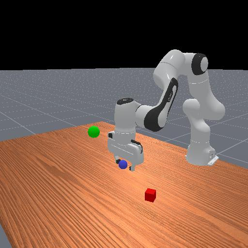 | 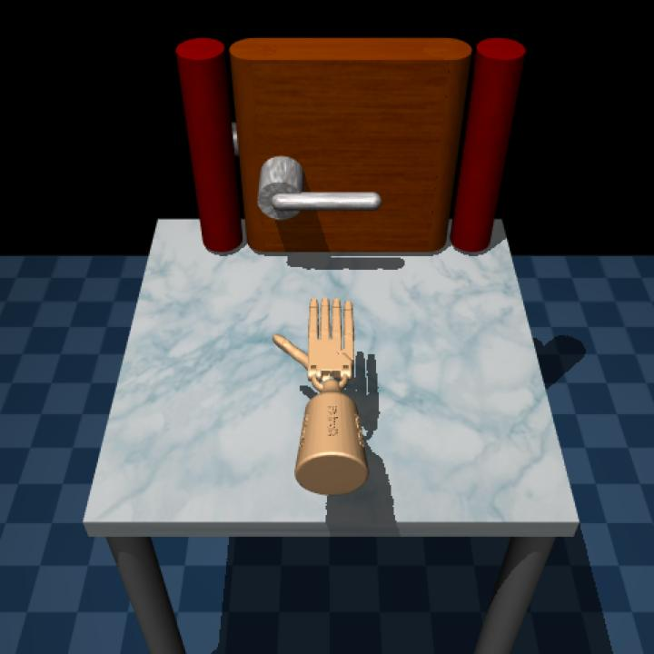 | 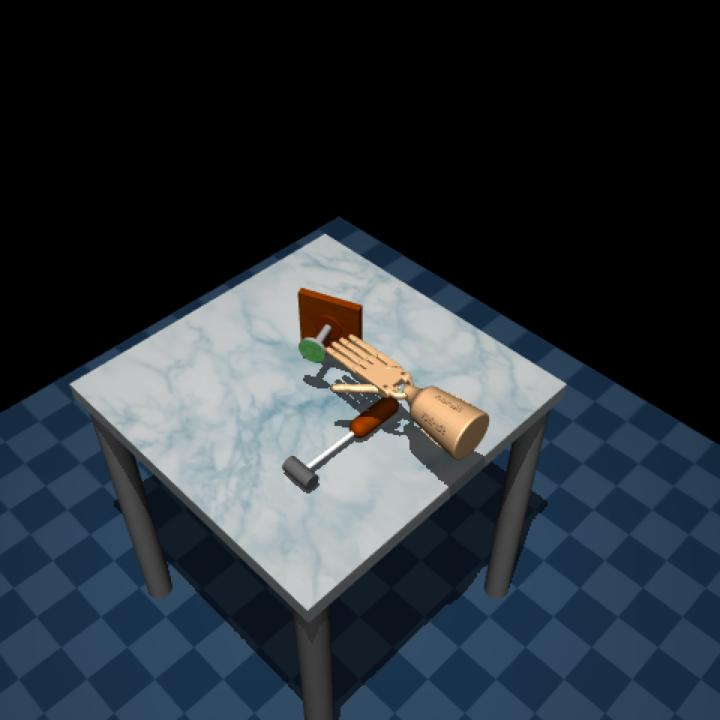 |  | 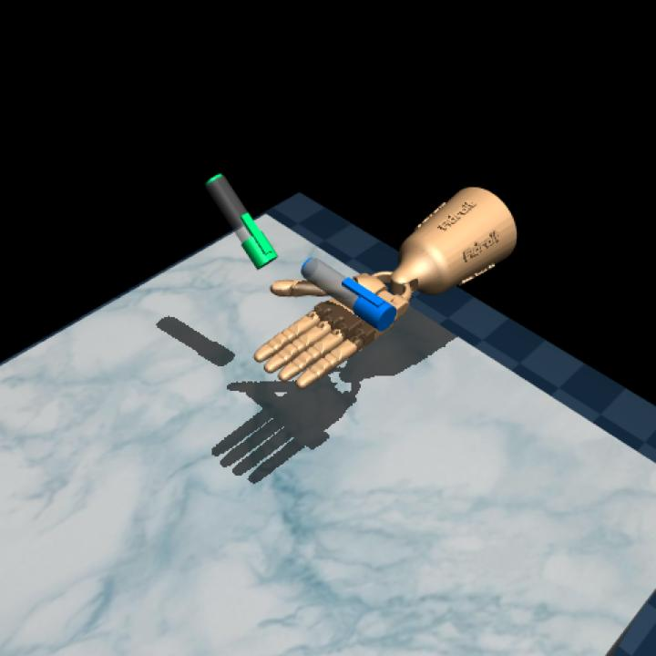 |

图注转述：机器人任务的实验场景。来源：[原文图 2](https://arxiv.org/html/2610.40109v1#S5.F2)。图中是仿真环境，说明任务对象与场景，不构成实机演示。

### 图 3：灵巧操作对稀疏引导的敏感性（PDF p.7）

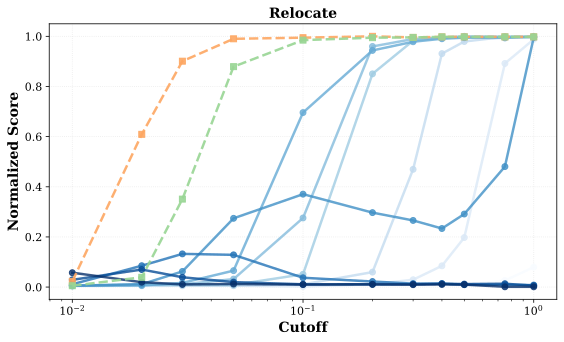
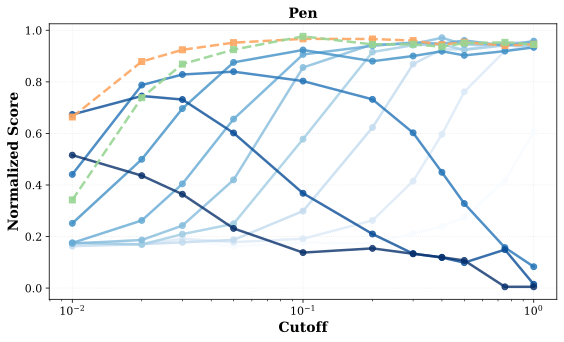
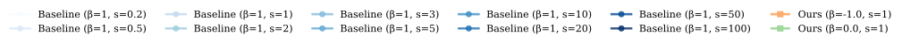

图注转述：ΠGDM 在 Adroit 的不同受引导坐标比例下的表现；蓝色系列为不同尺度的 naive，coupled 使用 $s=1$。来源：[原文图 3](https://arxiv.org/html/2610.40109v1#S5.F3)。横轴为对数刻度 cutoff，纵轴为归一化得分；不要将分数直接换成成功率。原英文图注有不通顺的措辞，尺度以图例明确的 $s=1$ 为准。

### 图 7：四项 Adroit 任务的完整 ΠGDM 对照（PDF p.16）

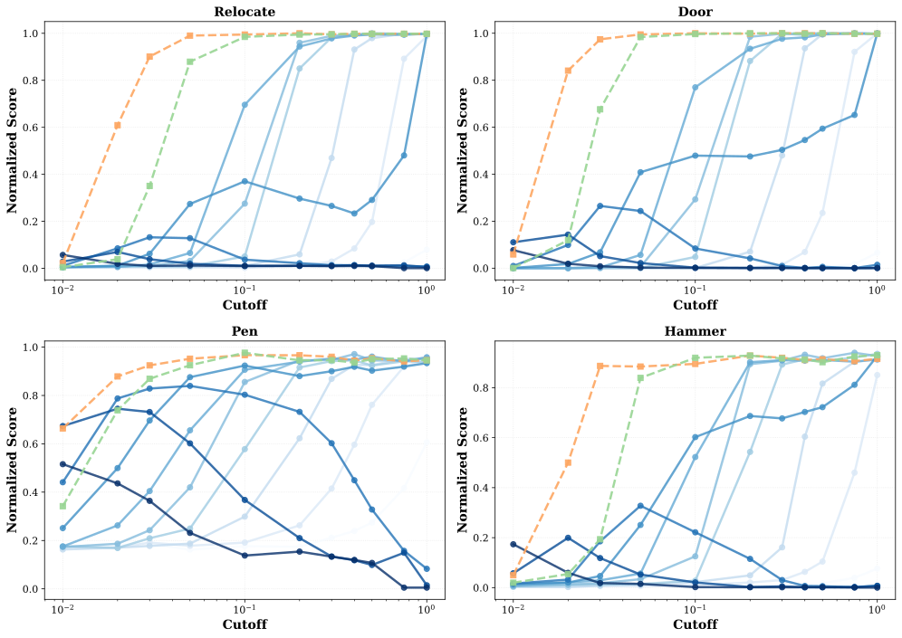

图注转述：所有 Adroit 任务的 ΠGDM 稀疏引导测试，cutoff 为受引导坐标比例，蓝色为 $\beta=1$ 下不同引导尺度。来源：[原文图 7](https://arxiv.org/html/2610.40109v1#A3.F7)。与只展示 Relocate、Pen 的图 3 合看，避免把其中两项任务当成全部实验。

### 图 4：超分辨率的稳定区域（PDF p.8）

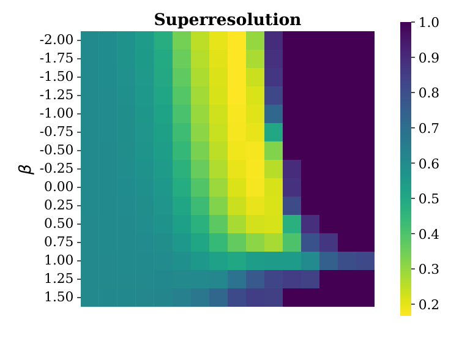
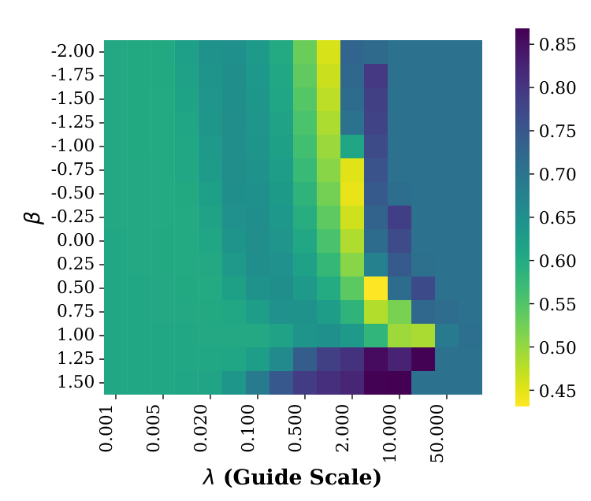

图注转述：ΠGDM（上）与 ΠGDM+（下）的超分辨率 LPIPS。来源：[原文图 4](https://arxiv.org/html/2610.40109v1#S5.F4)。横轴是引导尺度、纵轴是 β；第一张分图的横轴标签由第二张补充。两张图的色条范围不同，不能只按相同颜色判断数值相同。已实际查看保存的上排图，确认是目标 LPIPS 热图。

### 图 5：雅可比项对引导范数的贡献（PDF p.9）

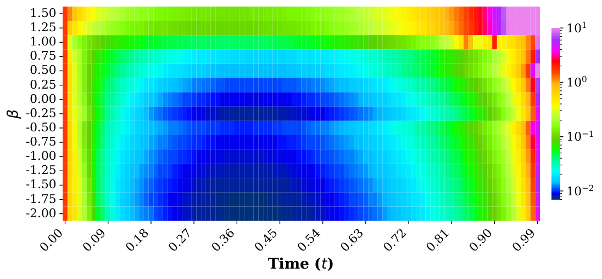

图注转述：CelebA-HQ-256 超分辨率中，ΠGDM 的 $\partial\widehat x_1/\partial x_t$ 对引导范数的贡献沿采样过程变化。来源：[原文图 5](https://arxiv.org/html/2610.40109v1#S5.F5)。它支持“引导数值行为随 β 改变”的观察，并非直接测量定理中的耦合密度比。

**图像覆盖**：本地清单覆盖图 1–23 的 HTML `img/object` 资源，部分图拆为多个文件，图例也可能单独保存。README 选择展示与机器人实验及失稳机制直接相关的图，未展开其余图像重建案例；其路径和来源仍完整列在清单中。HTML 资源提取不保证与 PDF 的排版、文字标签和整页矢量内容完全一致；无逐像素完整性声明。未用自绘图冒充原图。

## 10. 来源与阅读位置

| 要核对的内容 | 原文位置／PDF 页码 |
|---|---|
| 既有 ΠGDM、ΠGDM+ 与能量引导 | §2 “Base Methods”，p.3；附录 B.1，p.15 |
| FM 损失与速度场 | §3.1–3.2，pp.3–4；式 (1)–(2) |
| naive 隐含潜变量修正 | §3.3，p.4；式 (3)–(11) |
| 密度比误差上界及假设 | §3.4，p.5；式 (12)；附录 A，p.14，式 (15)–(22) |
| 双端点更新、β 的含义 | §4.1，pp.5–6；式 (13)–(14)、Algorithm 1 |
| 避障数值与种子数 | §5.1，pp.6–7；表 2；与附录 B.2 的口径冲突见本文 7.1 |
| Adroit 层级控制、稀疏性 | §5.2，p.7；图 2–3；附录 C.1，p.16，图 6–7 |
| 图像指标、反例与超参数 | 表 1，p.6；§5.3，pp.8–9；附录 B.3，p.15；C.2 表 3–4，p.17 |
| 作者承认的理论与无噪声限制 | §6，p.9 |
| 其他原图 | 附录 C.2，pp.18–25；图 8–23 |

本地来源清单：[metadata.json](metadata.json)、[preparation.json](preparation.json)、[figures.json](figures.json)。关键公式、表 1–4 及实验段落已与官方版本 PDF 核对；原文自身的符号、种子数及论述边界问题已在正文保留，没有替作者补成确定事实。
