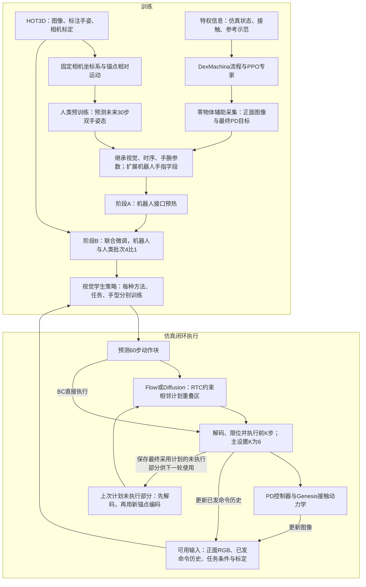
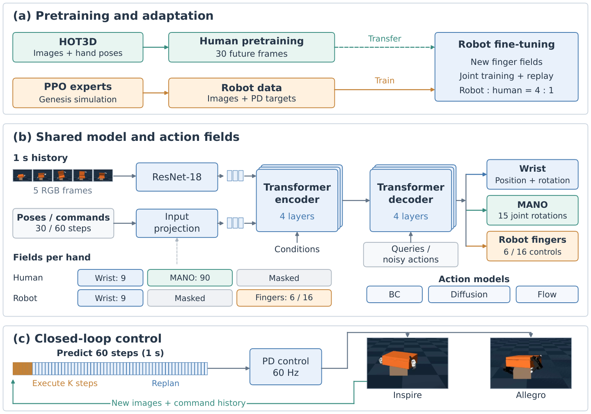
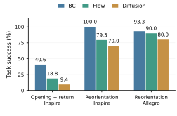
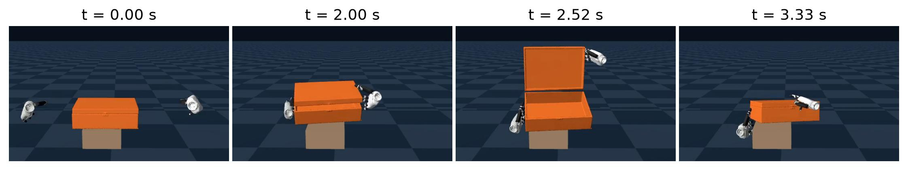
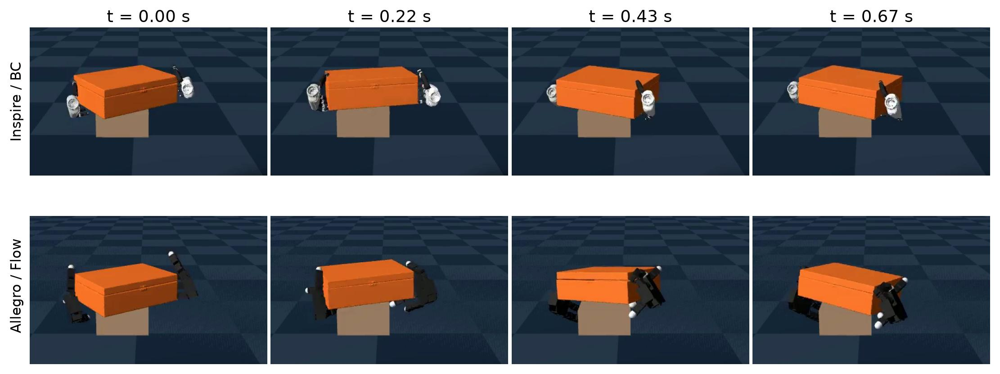

# AcrossDEX 1.0：人类运动预训练如何接到双手灵巧操作

## 原文信息与相关性

| 项目 | 信息 |
| --- | --- |
| 标题 | AcrossDEX 1.0: From Human Motion Pretraining to Bimanual Dexterous Manipulation across Hand Embodiments |
| 作者 | Xiaoyu Yang、Nan Wu |
| arXiv | 2610.40210，v1；分类 cs.RO |
| 提交／更新时间 | 元数据均为 2026-10-29 14:56:30 UTC，即 Asia/Shanghai 的 2026-10-29 22:56:30；这不是另行核实过的公告时间 |
| 原文 | [摘要页](https://arxiv.org/abs/2610.40210v1)、[HTML 全文](https://arxiv.org/html/2610.40210v1)、[PDF](https://arxiv.org/pdf/2610.40210v1)、[TeX 源码包](https://arxiv.org/src/2610.40210v1) |
| 解读日期 | 2026-10-30，Asia/Shanghai |
| 本地依据 | [全文文本](source.txt)、[HTML](source.html)、[元数据](metadata.json)、[准备记录](preparation.json)、[图片清单](figures.json) |

**相关性结论：与「灵巧手与操作」高度相关。** 正文研究两只多指手在接触动力学下共同开盖、回盖和转动物体，明确处理手腕运动、手指控制空间、专家示范与视觉闭环策略；实验对象包含六通道 Inspire 和十六关节 Allegro。相关性来自 §II–IV 的方法与任务，而非标题中的 dexterous 关键词。

本解读已阅读全文，并以同版本 8 页 PDF 和 `main.tex` 核对式 (1)–(11)、训练规模、阈值和成功率。TeX 只作为文本读取。当前目录仅有 v1，没有本地旧版可比较。论文的机器人实验**全部是 Genesis 物理仿真**：浮动手腕、单个箱体资产、分任务分手型训练，且推理时暂停仿真。以下「部署」均指文中仿真闭环执行，不代表已经完成实机部署。

## 一句话解释

它先从带三维手姿标注的人类视频学习「接下来一秒双手如何运动」，再用仿真专家实际发给控制器的目标适配机器人：例如输入箱子正面的图像历史、上一秒已发送的双手命令及开盖目标，输出未来一秒的 60 个双手控制目标，执行前 6 个，再看新图像并重新规划。

这里人类预训练的输入不仅是视频，还有标注手姿；机器人执行时的历史是**已发送命令**，不能当作传感器测得的真实关节状态。专家的接触与物体状态也不输入视觉学生策略。依据：§II-A、II-B、II-D、II-E。

## 方法管线

下图是按正文绘制的理解图；论文原图另列于后文。

专家（teacher）的作用是生成接触可行的示范；学生（student）学习最终控制目标，部署时无需调用专家。训练中的物体辅助逐步减小，正式采集和最终评价均设为零；这不等于没有场景中的固定支撑。学生评测还保留采集时的场景槽位，其他槽位回放既有 PD 目标。依据：§II-D、III-A。

## 核心组件及连接关系

| 组件 | 输入 → 输出 | 目的与边界 |
| --- | --- | --- |
| 人类数据几何处理 | 鱼眼图、相机位姿、MANO 手姿 → 224×224 针孔视图与固定坐标系运动 | 将头戴相机运动与手运动分开；同一窗口的历史、未来使用同一个坐标变换 |
| 人类运动预测 | 过去约 1 秒的 5 帧图像、30 步双手姿态 → 未来 30 步 | 图像历史索引为 `[0,7,14,22,29]`，左右手固定槽位，缺失标注掩码处理 |
| 共用骨干 | 图像、运动历史、相机及时间条件 → 未来时刻查询的输出 | ResNet-18 提取 5×7×7＝245 个视觉 token；Transformer 编码器、解码器各 4 层，宽度 256，8 头，前馈宽度 1024 |
| 三种动作模型 | 相同条件与骨干配置 → 直接轨迹或生成轨迹 | 行为克隆（behavior cloning，BC）直接回归；扩散（diffusion）预测速度参数；流匹配（flow matching，Flow）预测线性路径速度，三者分别训练 |
| 仿真专家与采集 | 特权状态、接触、参考示范 → 图像和最终 PD 目标 | 沿用 DexMachina 的重定向、奖励与课程；存储经过合成、裁剪后真正发送的目标，不把专家残差直接当学生标签 |
| 跨本体字段适配 | 人类 99 维字段＋机器人手指字段 → 带掩码的共同输入输出接口 | 手腕几何共享，MANO 与机器人手指分槽；分别适配两类手，不是一套已验证的通用双手权重 |
| 后训练 | 机器人监督预热 → 机器人／人类回放联合微调 | 先学新增接口，再联合更新；人类任务保留原有几何正则 |
| 滚动时域控制 | 最新图像、命令历史、上一计划 → 可执行前缀 | 每次预测 60 步、执行 K 步；生成模型用 RTC 保持计划连续，仿真暂停等待推理 |

视觉编码器来自 ImageNet 预训练，冻结 stem、layer1、layer2，并固定批归一化统计，只微调后部层。正文 §II-C 报告 60 个双手状态 token 和 5 个相机位姿 token，但未逐项展开机器人扩展后所有 token 的组织细节，复现时不能仅据此猜测实现。

### 动作维度必须分三个层次理解

| 层次 | 人类 | Inspire | Allegro |
| --- | --- | --- | --- |
| 每手网络完整字段 | 3 平移＋6 手腕旋转＋15×6 MANO＝99 | 99＋6＝105 | 99＋16＝115 |
| 本域有效字段 | 全部 99 | 9 手腕＋6 手指＝15 | 9 手腕＋16 手指＝25 |
| 实际双手控制命令 | 非机器人命令 | 2×(6 手腕控制＋6 手指)＝24 | 2×(6 手腕控制＋16 手指)＝44 |

六维旋转是网络表示，不能把它当作六个独立转动自由度。人类未来张量是 `30×2×99`；按正文时间长度和字段宽度整理，机器人网络字段张量对应 `60×2×105` 或 `60×2×115`，解码后的控制命令才是 `60×24` 或 `60×44`。机器人手指输出是以弧度表示的绝对关节目标，手腕未来运动相对当前已发命令锚点编码。依据：§II-B、II-D、II-E。

## 关键公式：原式、符号和适用条件

以下保留原式编号，排版做了整理；维度补充由正文的字段定义推得，推导性解释另行注明。不同章节复用了字母：式 (1) 的模型参数 θ 与式 (11) 的盖角 θ_t 不同；式 (1) 的任务 g 与式 (6) 的字段组 g 不同；式 (7) 的隐向量 z_e、式 (9) 的前缀 z、式 (11) 的高度 z_t 也不同。

### 1. 一秒预测与短前缀执行：式 (1)，§II-A，PDF 第 2 页

$$
\begin{aligned}
U_t&=\pi_\theta(\mathcal I_t,u_{t-60:t-1},
u_{t-1}^{\mathrm{anchor}},c_t),\\
U_t&=(\hat u_t,\ldots,\hat u_{t+59}),\qquad
c_t=(g,t,\mathcal C,\mathcal M).
\end{aligned}\tag{1}
$$

- `t` 是 60 Hz 机器人控制步；`π_θ` 是参数为 θ 的策略。`u_t` 为最终发出的双手控制向量，Inspire 为 24 维，Allegro 为 44 维；帽号表示预测。
- `U_t` 是未来 60 个命令；`u_{t-60:t-1}` 是过去 60 个命令，不包含当前尚未执行的命令。`𝓘_t` 是采样图像历史，机器人图像偏移为 `[-59,-44,-30,-15,0]`。
- `u_{t-1}^{anchor}` 提供未来手腕运动的参考位姿；初始时用初始 PD 目标。`g` 是任务目标，`𝓒` 是标定条件，`𝓜` 标记时间及字段有效性，`c_t` 汇集这些条件，正文未给统一总维度。
- 实际只执行前 `K` 步，主设置 `K=6`。由 60 Hz 可算得反馈间隔是 0.1 秒**仿真时间**，并不证明实际墙钟时间能达到 10 Hz。短历史填充后用掩码排除。

这是策略接口定义，不是优化目标。它假设图像、命令时间戳和标定对齐。

### 2. 先固定相机，再共享同一锚点：式 (2)、(3)，§II-B，PDF 第 2 页

$$
\begin{aligned}
T_{F\leftarrow W}&=UC_0,\\
\begin{bmatrix}p_k^F\\1\end{bmatrix}
&=T_{F\leftarrow W}\begin{bmatrix}p_k^W\\1\end{bmatrix},\\
R_k^F&=R_{F\leftarrow W}R_k^W.
\end{aligned}\tag{2}
$$

`W` 是世界坐标系，`F` 是观察时刻固定的相机参考系；`C_0` 将世界坐标变到当前原始相机坐标，`U` 是图像转正对应的刚体变换。三者的齐次变换矩阵为 4×4；`R_{F←W}` 是其中 3×3 的旋转部分。`p_k^W,p_k^F∈ℝ³` 是第 k 个时刻的手腕位置；底部的 1 是齐次坐标；`R_k^W,R_k^F∈SO(3)` 是对应手腕旋转。`SO(3)` 表示三维合法旋转矩阵集合。同一窗口中不随 k 重新更换相机坐标系。

省去 F 上标，原文再定义：

$$
\Delta p_k=p_k-p_0,\qquad
\Delta R_k=R_0^\top R_k,\qquad
\Delta Q_{k,j}=Q_{0,j}^\top Q_{k,j}.
\tag{3}
$$

`0` 表示当前锚点；`k` 是未来时刻；`j` 为 MANO 的 15 个手指关节之一。`Q_{k,j}∈SO(3)` 为局部关节旋转；`Δp_k∈ℝ³`，`ΔR_k`、`ΔQ_{k,j}` 均为 3×3 旋转矩阵；上标 `⊤` 表示转置。恢复绝对手腕旋转用 `R_k=R_0ΔR_k`，不是把旋转向量逐项相加。原式平移差保持在固定相机轴下，未乘 `R_0^⊤`；不要擅自改成手腕局部平移。

这两式定义几何表示，不涉及最小化。它们要求可靠标定、合法旋转、窗口内锚点一致；每个未来时刻都相对同一个 0，而非相对前一帧。机器人借用手腕部分，手指仍使用绝对关节角。

### 3. 三种预测目标：式 (4)–(6)，§II-C，PDF 第 3–4 页

BC 直接输出 `f_θ(c)`，以带有效性掩码的均方误差（mean squared error，MSE）拟合归一化干净轨迹 x。`c` 是所有条件，`f_θ` 是回归网络；x 的张量尺寸由当前人类／机器人字段与时间长度决定，掩码之外的字段不参与拟合。

扩散模型的原式为：

$$
x_n=a_nx+b_n\epsilon,\qquad
v_n^*=a_n\epsilon-b_nx,\qquad a_n^2+b_n^2=1.
\tag{4}
$$

`n` 是扩散步索引；`a_n,b_n` 是标量噪声日程系数；`ε` 是与 x 同形状的高斯噪声；`x_n` 是加噪轨迹；`v_n*` 是监督速度参数，星号表示目标值，并不是机械手的物理速度。网络输出 `v_θ` 与 x 同维，拟合这个目标。原文的干净估计为 `x̂=a_n x_n−b_n v_θ`。训练使用 1,000 个扩散步与末端信噪比为零的日程，推理使用 50 步 DDIM、`η=0`；η 是采样随机性参数，零值仍不消除初始噪声种子的影响。

流匹配的原式为：

$$
x_\tau=(1-\tau)\epsilon+\tau x,\qquad v^*=x-\epsilon,
\qquad
\hat x=x_\tau+(1-\tau)v_\theta(x_\tau,\tau,c).
\tag{5}
$$

`τ∈[0,1]` 是生成路径时间，而非机器人控制步 t：0 端是噪声，1 端是数据。`x_τ` 为路径上的中间轨迹，`v*` 是其线性插值速度，`v_θ` 学习条件速度场，`x̂` 是干净轨迹估计；这些变量均与 x 同形状。推理使用 32 步 Heun 积分。教学解释：对插值式求 τ 导数得到 `x−ε`，这说明了速度监督的来源；单步 `x̂` 估计不等于整段非线性采样已经完成。

三种方法的人类训练统一写成：

$$
\mathcal L_h=
\frac13\sum_{g\in\{p,R,Q\}}
\frac{\sum_i m_i\|\hat y_{i,g}-y^*_{i,g}\|_2^2/d_g}
{\max(1,\sum_i m_i)}
+\lambda_{\mathrm{BMC}}\mathcal L_{\mathrm{BMC}}(\hat x).
\tag{6}
$$

`i` 汇合样本、未来时刻与左右手索引；`m_i∈{0,1}` 表示标注有效。`g` 分别指位置 p、手腕旋转 R、手指旋转 Q 三组，维度 `d_p=3,d_R=6,d_Q=90`。`ŷ_{i,g}` 与 `y*_{i,g}` 是相应维度的网络输出与目标；目标对 BC 是轨迹，对 Diffusion 是式 (4) 的速度参数，对 Flow 是式 (5) 的速度。`‖·‖₂²` 为平方欧氏范数，分母避免有效项为零时除零，`1/3` 使三个字段组等权，而不是让 90 维手指项仅因维度大而占优。

`𝓛_h` 是最小化的人类总损失；`λ_BMC=0.01`。生物力学约束（biomechanical constraints，BMC）的 `𝓛_BMC` 作用在重建的**干净手姿** x̂ 上，依据训练标注估计屈伸、外展可行区域。论文没有给出该项的完整解析式、范围估计细节；这里保留原符号，不能补造惩罚函数。该约束鼓励人体几何合理性，不保证机器人接触稳定。

### 4. 共享腕部而分开手指：式 (7)、(8)，§II-E，PDF 第 4 页

$$
z_e=W_h(m_e\odot y)_{1:99}
+W_e(m_e\odot y)_{100:99+d_e}+b_h.
\tag{7}
$$

`e` 是手型，`d_e∈{6,16}` 是该手型的手指控制维度；`y∈ℝ^{99+d_e}` 是经机器人手腕可学习缩放、偏移校准并归一化的单手输入；`m_e` 是同维二值字段掩码，`⊙` 为逐元素乘法，切片采用论文的 1 起始索引。人类数据激活前 99 维、机器人手指字段置零；机器人数据激活前 9 维腕部和新增手指字段，90 维 MANO 手指置零。

`W_h,b_h` 继承人类投影，`W_e` 是新增的机器人手指投影，`z_e` 是隐表示。按骨干宽度 256 整理其维度：`W_h∈ℝ^{256×99}`、`W_e∈ℝ^{256×d_e}`、`b_h,z_e∈ℝ^{256}`；这是由网络宽度推得的维度说明。输出层同样保留已有行、追加机器人手指行。保留参数指迁移初始化，后续联合微调会更新共享参数，并不意味着骨干始终冻结。

$$
\mathcal J_B(\theta)=\frac45\mathbb E_{\mathcal D_r}
[\mathcal L_r(\theta)]+\frac15\mathbb E_{\mathcal D_h}
[\mathcal L_h(\theta)].
\tag{8}
$$

`𝓙_B` 是阶段 B 要最小化的期望目标；`θ` 为待训练网络参数；`𝓓_r,𝓓_h` 为机器人、人类数据分布；`𝔼` 为期望；`𝓛_r` 是有效机器人动作标量上的 MSE，`𝓛_h` 为式 (6)。`4/5,1/5` 表达交替执行四个机器人批次、一个人类批次的采样频率，不是两个损失每步都在同一批内混算，也不保证两域梯度幅度相等。

阶段 A 先做 1,024 次机器人监督更新。阶段 B 每逻辑 epoch 用 32,768 个机器人窗口、8,192 个人类窗口，批量 128，共 320 次更新。人类 30 个未来查询按物理时间插值到机器人 60 个查询，双方的预测时长仍约一秒。

### 5. 让相邻动作块保持连续：式 (9)，§II-F，PDF 第 5 页

$$
E=\frac12\sum_i w_i\|\hat x_i-z_i\|_2^2,
\qquad
\widetilde v=v_\theta-\gamma(\tau)\nabla_{x_\tau}E.
\tag{9}
$$

`z` 为上次计划未执行部分，经解码成命令再按**当前锚点**重新编码后的前缀目标，和新计划 x̂ 的重叠部分同维；`i` 索引前缀项。`w_i` 为沿剩余前缀衰减的非负权重，前缀外为零。`E` 是标量一致性能量，`x̂(x_τ)` 是当前采样状态对应的干净轨迹估计；`∇_{x_τ}E` 是对采样状态的梯度，与该状态同形状；`γ(τ)` 是引导增益，正文称上限为 5；`ṽ` 是修正后的生成速度场。

这采用既有 RTC 的软前缀原则：用完整向量–雅可比积传递梯度，Flow 在线性路径上应用；Diffusion 先转成等价线性路径再应用并转回。式子按作者原式保留，正文未给 `w_i`、`γ(τ)` 的完整调度及扩散转换实现，不能仅凭该式宣称复现。其目的为约束新旧计划重叠区，不是把旧计划强制整段执行，也不是对物理速度直接加此梯度。

**假设与代价：**旧计划剩余部分仍有参考价值、两次锚点能正确转换。若环境突变，过强的连续性约束可能阻碍及时修正；这是解读推断，原文没有对应扰动实验。本文采用同步暂停仿真的执行方式，不能把 RTC 原论文的异步实时能力直接算在 AcrossDEX 的验证范围内。

### 6. 成功率究竟在测什么：式 (10)、(11)，§III-C，PDF 第 5–6 页

$$
d_R(\hat R,R)=\arccos\!\left(
\operatorname{clip}\left(\frac{\operatorname{tr}(\hat R^\top R)-1}{2},-1,1\right)
\right).
\tag{10}
$$

`R̂,R∈SO(3)` 是两个物体姿态旋转矩阵；`tr` 是矩阵迹，`⊤` 为转置，`clip` 将数值截到 [-1,1]，避免浮点误差超出反余弦定义域。`d_R` 是标量旋转测地误差，反余弦通常输出弧度，比较下式角度阈值前必须统一单位。这里的 R 是物体姿态，与式 (3) 的手腕 R 所指实体不同。

$$
\begin{aligned}
S_{\mathrm{open}}=\mathbf1[&T=200,\ \max_t\theta_t\ge90^\circ,\\
&\theta_T\le25^\circ,\ \min_t z_t\ge0.9\,\mathrm m],\\
S_{\mathrm{turn}}=\mathbf1[&T=40,\ d_R(R_T,R_{\mathrm{goal}})\le10^\circ,\\
&\max_t|\theta_t|\le5^\circ,\ \min_t z_t\ge0.9\,\mathrm m],\\
\mathrm{SR}&=100\%\times\widehat{\mathbb E}[S].
\end{aligned}\tag{11}
$$

`T` 是实际执行步数，`t` 遍历执行过程；`θ_t` 是标量盖角，`z_t` 是以米计的箱体根部高度；`R_T,R_goal` 分别为最终、目标物体姿态。`max/min` 分别取全程最大／最小；`𝟙[·]` 是所有条件同时成立才为 1 的指示函数。`S_open,S_turn` 是两项任务的单次成功标记，`S` 指所评任务的标记，`Ê` 为评价轨迹上的经验均值，`SR` 为成功百分比。

开盖成功还必须回盖、维持高度并完成 200 步；重定向必须完成 40 步、末态方向达标，且全程盖角与高度达标。训练集「曾打开到 90°」的筛选条件明显弱于完整成功条件，不能用保留示范比例代替学生成功率。

## 创新点：作者主张、既有方法与我的判断

| 作者贡献主张（§I、II、V） | 与已有模块／基线的关系 | 解读判断 |
| --- | --- | --- |
| 把人类运动预训练、仿真专家示范与视觉闭环接成完整流程 | 专家沿用 DexMachina 的资产、奖励和训练流程；视觉与时序模块使用 ResNet、Transformer | 价值主要是几何、监督标签与执行接口的系统整合；没有提出全新的专家 RL 算法 |
| 共享手腕表示，新增各本体手指字段和有效性掩码 | 明确借鉴 Being-H0.5 的语义对齐原则；不强迫 MANO 关节与机械手通道一一对应 | 是清晰的迁移设计，但只证明同一适配流程能分别服务两类手；没有证明单一策略的零样本换手 |
| 以相同物理时间对齐 30 步人类预测与 60 步机器人命令 | 保留并微调视觉、时序、腕部参数，使用人类回放 | 有助于解释迁移边界；缺少无预训练、无回放、无腕部共享等消融，无法量化各设计的独立收益 |
| 比较 BC、Diffusion、Flow，并检验动作块连续性 | 三者共用骨干配置；RTC 来自已有方法，主生成模型结果含 RTC | 更直接的实验证据是固定模型／场景时 RTC 能改善所报成功率；并非新提出扩散、流匹配或 RTC |

BC 在所报三种任务／手型组合中最高，说明在这些局部示范分布下直接回归是有竞争力的基线；不能由此推出「生成策略普遍不适合灵巧操作」。三种方法虽然骨干配置和数据相同，人类预训练更新次数、采样过程与执行引导并不完全相同，也不是严格等算力比较。

## 实验：规模、评价与结果

### 平台与数据

| 项目 | 正文报告的设置 | 证据 |
| --- | --- | --- |
| 机器人／场景 | Genesis，浮动双手腕；Inspire 每手 6 通道，Allegro 每手 16 关节；同一箱体、固定初始支撑，局部初始条件扰动 | §II-D、III-A |
| 计算硬件 | 每次训练用一张 40 GB 显存 GPU；未报告具体型号 | §III-B |
| 人类原始数据 | HOT3D `train_aria`，124 条记录、227,400 帧；优化用 99 条、195,300 帧，约 108.5 分钟 | §III-A |
| 人类窗口 | 按完整录制分配；163,369 个有效起点中每 epoch 抽 32,768 个；不同起点窗口可重叠；离线评价窗口步长 8 帧 | §III-A |
| 人类训练量 | 各 500 epochs、读取 16,384,000 个窗口；这是重复采样读数，不是独立轨迹数 | §III-A |
| 人类训练差异 | BC 前 23 epochs 批量 32，后续 128，共 145,664 次更新；Flow／Diffusion 全程批量 128，各 128,000 次 | §III-A |
| 专家规模 | PPO，4,096 个并行环境，每次采样 32 步，minibatch 32,768，5 次优化 epochs；Inspire 专家 5,000 次更新、655,360,000 次交互；Allegro 1,500 次、196,608,000 次交互 | §III-B |
| 视觉学生执行 | 60 Hz 仿真控制；主设置 K=6；推理时暂停仿真；Flow 32 步 Heun，Diffusion 50 步 DDIM，二者主结果使用 RTC | §II-C、II-F |

| 机器人数据集 | 采集／保留情况 | 用于优化的轨迹 | 阶段 B／含预热总更新 |
| --- | --- | --- | --- |
| Inspire 开盖与回盖 | 2,000 条中保留峰值盖角 ≥90° 的 1,770 条 | 1,413 | 300 epochs／97,024 次 |
| Inspire 闭盖重定向 | 300 条中质检、人工检查后保留 298 条 | 239 | 100 epochs／33,024 次 |
| Allegro 闭盖重定向 | 采集中接受 293 条；未给原始尝试总数 | 233 | 100 epochs／33,024 次 |

机器人数据表依据 §III-A、III-B。剩余轨迹的各用途及最终闭环评价分母没有完整列出，因此不能把「保留数减优化数」直接当评测样本数。数据扰动包括腕部位置与方向、手指角、摩擦、相机位姿和照明，但仍围绕同一资产及参考动作；16 条同批轨迹的命令回放核验只是数据对齐检查，不是实机或泛化验证。

重定向是单独裁切的闭盖片段，参考动作约 0.67 秒内旋转 63.96°；60 个历史／未来槽位用掩码填充，过程中有效历史图像最多 3 张。不能将其描述为每一步都有完整的一秒五帧历史。

训练超参数：人类 AdamW 主网络／视觉学习率为 `10⁻⁴/10⁻⁵`，权重衰减 `10⁻⁴`，梯度裁剪阈值 1；机器人新增／共享／视觉参数学习率为 `10⁻⁴/10⁻⁵/10⁻⁶`，微批与有效批量均为 128，A、B 两阶段分别初始化优化器状态（§III-B）。

### 主结果：图 2、§IV-A／IV-B，PDF 第 6 页

| 任务及手型 | 时长与步数 | BC | Flow＋RTC | Diffusion＋RTC |
| --- | --- | ---: | ---: | ---: |
| Inspire 开盖与回盖 | 约 3.33 秒，200 步 | 40.6% | 18.8% | 9.4% |
| Inspire 闭盖物体重定向 | 约 0.67 秒，40 步 | 100.0% | 79.3% | 70.0% |
| Allegro 闭盖物体重定向 | 约 0.67 秒，40 步 | 93.3% | 90.0% | 80.0% |

阈值严格见式 (11)。**这些不是多次运行的均值。** §III-C 明确每个配置报告完整评价批次中成功率最高的模型和对应运行，平局用平均最终方向误差裁决。论文未报告每组闭环评测轨迹数、独立训练种子数、选择候选数量、误差条或置信区间。不能从四舍五入的成功率反推分母，也不能断言 93.3% 与 90.0% 的差异具有统计显著性。

作者认为开盖／回盖需要较长阶段转换与更多接触关系变化，这与其较低成功率一致。我的判断：这是合理解释，但两项任务同时改变时长、数据和动作结构，不构成单独证明「接触切换导致失败」的受控实验。

### RTC 配对比较：§IV-C，PDF 第 6 页

| 固定模型和场景的比较 | 未加 RTC | 加 RTC | 增加的百分点（由报告值相减） |
| --- | ---: | ---: | ---: |
| 开盖，Flow | 0.0% | 18.8% | 18.8 |
| 开盖，Diffusion | 3.1% | 9.4% | 6.3 |
| Inspire 重定向，Flow | 51.7% | 79.3% | 27.6 |
| Inspire 重定向，Diffusion | 41.4% | 62.1% | 20.7 |

后两行属于**另一次配对比较**；其中 Diffusion 的 62.1% 不是主结果 70.0%，不能替换或混合。由零提高到 18.8% 应写增加 18.8 个百分点，不能计算有限的相对增幅。正文还称首个腕部目标跳变、离散加速度减小，但未列数值；虽提及 K=10/30/60、ACG 及其组合，现有正文没有对应的完整数值比较表，因此不补写其排名或提升。

## 局限与复现边界

1. **预训练的因果收益仍未知。** 没有从零训练、去除人类回放、取消共享腕部或不同人类数据规模的控制实验。完整流程能完成任务，与「人类预训练必然提升多少」是不同证据强度。
2. **泛化范围窄。** 单箱体资产、参考动作周边的局部扰动、分任务分手型权重；未验证未见对象、未见手型、长程任务或统一多任务策略。闭盖转动仅 40 步，100% 不能推广成任意操作可靠性。
3. **实机和时间预算未验证。** 浮动腕部不包含真实机械臂可达性与全身碰撞约束；暂停仿真的推理屏蔽了延迟，命令历史也不能反映真实执行器跟踪误差。视觉遮挡、接触滑移与标定误差下的恢复能力没有充分测试。
4. **统计证据不足。** 最佳模型／运行的报告方式有选优偏差风险；评测分母、种子、方差、独立测试集细节缺失，无法重建可靠的置信区间。
5. **表示与控制之间还有未展开实现。** 机器人腕部校准的参数化与初始化、连续朝向分支、PD 增益、资产精确版本、BMC 细节、RTC 权重／增益调度和扩散路径转换，均不足以只凭正文复现。
6. **方法比较并非等更新／等推理预算。** BC 人类更新更多，三种模型采样代价不同，生成模型还加了 RTC；主结果不足以把差异归因于单一模型类别。

复现前应索取完整代码、资产和数据切分清单；本文及本次取得的 TeX 源码未给明确的项目／代码仓库链接，这不等同于断言作者没有公开代码。本次仅完成文献核验，未训练模型、未复现实验。

值得优先做的后续实验（解读建议）：固定机器人数据与更新预算，比较有／无人类预训练、回放及腕部共享；在固定独立测试集上报告每种方法的种子数、成功次数与置信区间；随后测试跨对象、延迟注入、执行器误差和遮挡，并联合报告动作跳变、接触丢失、恢复率。对 RTC，应同时检验平滑收益与突发扰动下的响应代价。

## 原图与阅读说明

保留原图号及图注意思，以下图注为中文译述；英文原图注完整保存在 [figures.json](figures.json)。已查看图 1 与图 3，确认分别为目标架构图和开盖轨迹。HTML 的四个 figure 与 TeX 的四处插图、PDF 图 1–4 对应一致；本版本正文未发现额外附录或编号图缺口。HTML 图 1、图 2 分别是 PNG、SVG 转换版本，PDF／TeX 原资源是 PDF，不能将转换后的格式称为原始矢量文件。

### 图 1：系统总览（§II-A；PDF 第 3 页）

原图注译述：(a) 人类预训练和机器人专家数据支持带人类回放的适配；(b) 共享 Transformer 处理图像与运动历史，掩码选择人类或机器人手指字段，每种方法、任务和手型独立训练策略；(c) 预测 60 个命令，执行前 K 步，再更新历史。蓝、绿、橙分别标记共享、人类、机器人组件，灰色字段被屏蔽。

阅读重点：看三组手指字段和图底部的「预测一秒、只执行前缀」；它们解释了跨本体接口与闭环控制的实际含义。[图片来源](https://arxiv.org/html/2610.40210v1/architecture.png)。

### 图 2：三种任务／手型组合的成功率（§IV-A；PDF 第 6 页）

原图注译述：报告开盖与回盖，以及两种手本体下的物体重定向成功率；每个配置分别后训练，按式 (11) 评价。

阅读重点：柱高是正文选优后的成功率，不能当作均值及方差；主生成策略带 RTC。其数值已与 PDF、TeX 正文核对。[图片来源](https://arxiv.org/html/2610.40210v1/task_success.svg)。

### 图 3：成功的开盖与回盖轨迹（§IV-A；PDF 第 7 页）

原图注译述：Inspire 手与 Flow 的一次成功闭环开盖／回盖；正面视图展示初态、接触交互、充分打开和回盖后的末态。

阅读重点：这是一个成功案例，说明策略能完成多阶段动作，不能由四张图估计全部尝试的可靠性；可见初始固定支撑。[图片来源](https://arxiv.org/html/2610.40210v1/figures/opening_sequence.jpg)。

### 图 4：成功的闭盖重定向（§IV-B；PDF 第 7 页）

原图注译述：成功闭环重定向，上行为 Inspire＋BC，下行为 Allegro＋Flow；各列对应 0、0.22、0.43、0.67 秒。

阅读重点：图中展示两类手可分别完成同类任务，没有展示一套相同权重在两类手之间直接切换。[图片来源](https://arxiv.org/html/2610.40210v1/figures/rotation_sequences.jpg)。

## 来源与定位索引

本地 HTML、文本、图像作为主体来源；2026-10-30 取得的同版本 PDF 和 TeX 作为交叉核验来源。下面列出可直接复核的位置，页码以 8 页 PDF 为准。

| 要核验的内容 | 章节／公式／原图 | PDF 页码与 HTML 锚点 |
| --- | --- | --- |
| 问题及既有方法来源 | §I | 第 1–2 页；[引言](https://arxiv.org/html/2610.40210v1#S1) |
| 策略接口、坐标系、相对运动 | §II-A/B，式 (1)–(3) | 第 2 页；[方法](https://arxiv.org/html/2610.40210v1#S2) |
| 模型目标与 BMC | §II-C，式 (4)–(6) | 第 3–4 页；[共享骨干](https://arxiv.org/html/2610.40210v1#S2.SS3) |
| 专家、命令标签与跨本体字段 | §II-D/E，式 (7)–(8) | 第 4 页；[专家](https://arxiv.org/html/2610.40210v1#S2.SS4)、[适配](https://arxiv.org/html/2610.40210v1#S2.SS5) |
| RTC 与同步暂停仿真 | §II-F，式 (9) | 第 5 页；[闭环执行](https://arxiv.org/html/2610.40210v1#S2.SS6) |
| 数据、训练、评价和选优 | §III-A/B/C，式 (10)–(11) | 第 5–6 页；[实验设置](https://arxiv.org/html/2610.40210v1#S3) |
| 主结果与独立 RTC 配对结果 | §IV-A/B/C，图 2–4 | 第 6–7 页；[实验结果](https://arxiv.org/html/2610.40210v1#S4) |
| 作者结论与后续方向 | §V | 第 7–8 页；[结论](https://arxiv.org/html/2610.40210v1#S5) |

原文无编号实验表，本解读中的表格是按正文整理。TeX 对应公式标签依次为 `eq:policy`、`eq:camera`、`eq:relative`、`eq:diffusion`、`eq:flow`、`eq:humanloss`、`eq:interface`、`eq:adaptation`、`eq:rtc`、`eq:geodesic`、`eq:success`；没有执行 TeX 或其包含的任何命令。
