# TouchBridge：把人类接触示范转换成灵巧机器人训练数据

## 1. 原文信息与相关性

- **标题**：TouchBridge: Tactile-Conditioned Human-to-Robot Transfer for Dexterous Manipulation。
- **作者**：Haozhe Zhang、Gu Zhang、Zirui Zou、Yuzheng Chen、Jinlong Wu、Zixuan Hu、Jianke Zhang、Yucheng Hu、Zhecheng Yuan、Huazhe Xu。
- **arXiv**：2610.40349，v1，cs.RO；本次只解读这个版本，目录内无旧版本可比较。
- **时间**：元数据的提交/更新时间为 2026-10-29 16:06:36 UTC，即 Asia/Shanghai 的 2026-10-30 00:06:36。这不是已经核实的 arXiv 公告时间。
- **解读日期**：2026-10-30，使用项目配置的 Asia/Shanghai 时区。
- **来源**：[摘要页](https://arxiv.org/abs/2610.40349v1)、[HTML 全文](https://arxiv.org/html/2610.40349v1)、[官方 PDF](https://arxiv.org/pdf/2610.40349v1)、[本地 PDF](paper.pdf)、[本地全文文本](source.txt)、[本地 HTML](source.html)。下文页码按这份 10 页 PDF 的物理页计。
- **语义审核：高度相关**。主题配置为“灵巧手与操作”。正文 III 节研究双手、多指接触约束下的人到机器人动作重定向（retargeting），IV 节在 Wuji 灵巧手上验证翻页、拧灯泡、挤酱和易碎物抓取；研究对象、接触保持问题、触觉方法和实机任务均直接落在主题内，依据不止是标题中的 dexterous。

阅读与核验范围：已读本地正文及附录，用官方 PDF 交叉核对公式、实验数值和表 II–IV，并查看核心方法图。下文是论文解读，没有运行作者代码或完成实机复现。

## 2. 一句话解释

人戴着动作手套和指尖触觉传感器抓起一个容易碎的蛋卷，TouchBridge 把这段示范的图像、指尖运动和接触分布，转换成机器人外观的视频与机械臂/手指动作标签，再用这些数据微调视觉–语言–动作模型（vision-language-action model，VLA），让机器人完成同类操作。

它要解决的是“手势像，但接触没保住”：人和机器人的手型不同，仅跟踪指尖轨迹可能让承托手指离开物体，或破坏两手的接触间距。触觉在这里提供**离线数据转换的约束**；IV-A3 明确说明触觉不作为策略输入。论文也没有 teacher/student 蒸馏结构。

## 3. 方法管线：采集、离线转换、训练与部署

下图为自绘理解图；原论文插图见第 9 节。

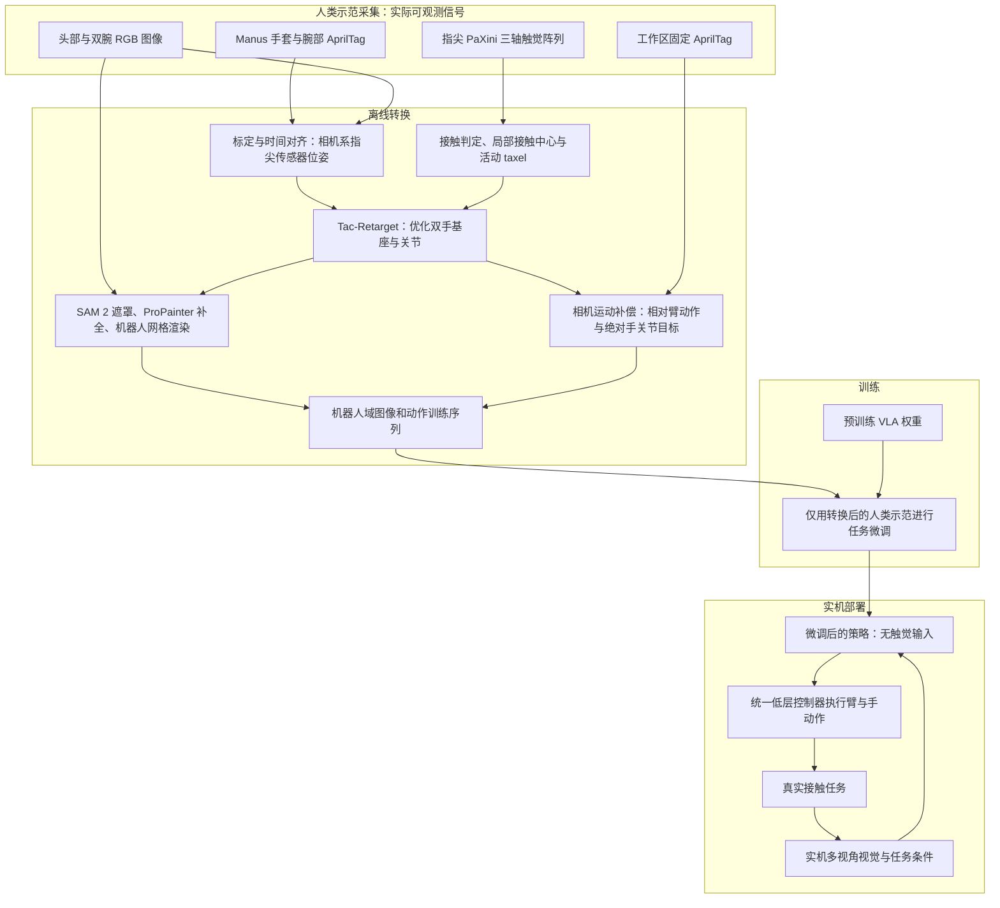

**信息边界**：重定向阶段使用人类实测手部运动、触觉和标定数据，不要求物体网格、物体位姿或物理仿真。视觉合成仍需要**机器人网格**；这与“不需要物体网格”不同。论文另在仿真评估接触误差时使用了重建的物体网格（IV-D1），并未因此让训练数据转换依赖仿真。预训练模型已有何种机器人数据经历，不能用“任务微调没有机器人示范”来否定。原文未完整枚举策略状态向量，本图没有擅自补上本体感觉输入。

## 4. 核心组件如何连接

| 组件与定位 | 目的和输入 | 输出及连接 |
| --- | --- | --- |
| 传感器共同设计，III-A，图 2 | 人端 D455 第一视角相机、双 Hikrobot 腕部相机、Manus 手套、每指 PaXini 霍尔触觉阵列；机器人端匹配腕部视角和指尖触觉布局 | 降低视觉与局部触觉坐标差异；没有要求人手关节结构与机器人一一机械对应 |
| 位姿重建，附录 A，式 (8)–(11) | 腕部多面 AprilTag、手套指尖位姿、固定外参 | 相机系的**触觉传感器坐标系**位姿，供运动和接触两类目标共用 |
| Tac-Retarget，III-B、附录 B | 相机系指尖位姿、接触激活、接触中心和活动触觉单元（taxel） | 联合优化双手基座位姿和手关节，兼顾位姿、接触区域、接触关系与正则项 |
| 视觉转换，III-C1，图 4 | 原视频和重定向状态 | 保留腕部图像；SAM 2 分割人手/穿戴硬件，ProPainter 补全第一视角，再用相机内参和深度遮挡处理叠加机器人网格 |
| 动作构造，III-C2，式 (7) | 随时间移动的头部相机坐标系内的末端位姿、工作区固定标签 | 先统一到动作块起始相机系，再构造相对末端动作；手采用绝对关节目标 |
| 策略微调，IV-A、IV-C | 每任务 60 条转换示范与预训练 GR00T N1.7 | 无任务专属机器人示范混入的人类数据策略；遥操作数据另训对照策略 |

数据流以共享主机时钟打时间戳：第一视角和双腕 RGB 均为 30 Hz、Manus 为 130 Hz、触觉为 90 Hz（表 III，PDF p.8）。附录 B1 用三轴读数的线性插值将触觉对齐到视觉时间戳。采集频率不是策略动作执行频率，后者原文只说各方法相同，没有给出数值。

## 5. 关键公式与逐符号说明

以下保留作者式号，省略时间参数时仍指同一帧。补充展开或推论均明确标注。长度使用米；实验接触误差另以毫米报告。

### 5.1 优化什么：状态、位姿与接触时的权重

原式 (1)，III-B1，PDF p.4：

\[
\mathbf x^{R*}(t)=\arg\min_{\mathbf x^R(t)\in\mathcal X^R}
\mathcal L_{\mathrm{pose}}+\lambda_C\mathcal L_{\mathrm{contact}}
+\lambda_G\mathcal L_{\mathrm{graph}}+\mathcal L_{\mathrm{reg}}.
\tag{1}
\]

- \(t\)：时间；上标 \(H\)、\(R\) 分别是 human、robot，\(*\) 表示优化解。
- \(\mathbf x^R=(\mathbf T^R,\mathbf q^R)\)：机器人双手状态。\(\mathbf T^R\in SE(3)^2\) 是两个手基座刚体位姿，每个用 \(4\times4\) 齐次矩阵表示；\(\mathbf q^R\in\mathbb R^{D_q}\) 堆叠双手关节。\(D_q\) 是这里引入的“受控手关节总数”记号，不把它当成论文公开的动作张量规格。
- \(\mathcal X^R\)：可行状态集合；\(\arg\min\) 返回使目标最小的状态。手基座本身是变量，并非硬跟踪人类手腕。
- \(\mathcal L_{\mathrm{pose}}\)、\(\mathcal L_{\mathrm{contact}}\)、\(\mathcal L_{\mathrm{graph}}\)：位姿、接触区域、接触关系损失，均为标量。\(\lambda_C,\lambda_G\) 是权衡系数。
- \(\mathcal L_{\mathrm{reg}}\)：基座正则、可行性惩罚和时间正则。原文没有完整展开其所有约束/惩罚，不能据此声称满足动力学、摩擦锥或力闭合。

原式 (2)，III-B2，PDF p.4：

\[
\mathcal L_{\mathrm{pose}}=\sum_i w_i(t)
\left[\|\mathbf p_i^R-\mathbf p_i^H\|_2^2+
\lambda_{\mathrm{rot}}d_{SO(3)}^2(\mathbf R_i^R,\mathbf R_i^H)\right].
\tag{2}
\]

\(i\) 遍历双手指尖，本系统有 10 个。\(\mathbf p_i^{H/R}\in\mathbb R^3\) 是相机系传感器原点位置，\(\mathbf R_i^{H/R}\in SO(3)\subset\mathbb R^{3\times3}\) 是旋转矩阵；\(SO(3)\) 为三维旋转群，\(SE(3)\) 为三维刚体变换群。\(\|\cdot\|_2\) 是欧氏范数，\(d_{SO(3)}\) 是旋转的测地角距离；位置平方误差与角度平方误差由 \(\lambda_{\mathrm{rot}}\) 调节尺度，不能当作天然同单位。

原式 (13)，附录 B2，PDF p.9：

\[
w_i=\lambda_p(\beta_0+\beta_c c_i)\eta^{c_i}.
\tag{13}
\]

\(c_i\in\{0,1\}\) 为接触标签；\(\lambda_p\) 是位置权重，\(\lambda_R\) 是独立配置的旋转权重；\(\beta_0\) 为基准乘数，\(\beta_c\) 为接触增量，\(\eta\) 控制接触时对位姿跟踪的缩减。附录正文说明 \(\lambda_{\mathrm{rot}}=\lambda_R/\lambda_p\)。表 IV 给 \(\lambda_p=100,\lambda_R=1,\beta_0=1,\beta_c=2,\eta=0.05\)。因此非接触权重为 100、接触为 15，后者是前者的 **0.15 倍**；\(\lambda_{\mathrm{rot}}=0.01\)。这是让接触目标有机会调整机器人指尖，而非接触时追姿态更紧。

### 5.2 从触觉读数到接触区域

附录 B1 的定义与原式 (3)，III-B3，PDF pp.4、9：

\[
s_{im}=\|\mathbf f_{im}\|_2,\quad F_i=\sum_m s_{im},\quad
\mathcal A_i=\{m:s_{im}>\tau_s\},
\]
\[
c_i=1\ \text{当且仅当}\ F_i>\tau_F\ \text{且}\ |\mathcal A_i|\ge n_{\min}.
\]

上面是附录文字定义的数学整理；下面单独保留作者原式 (3)：

\[
\boldsymbol\mu_{i,\mathrm{loc}}(t)=
\frac{\sum_m s_{im}(t)\mathbf r_{im}}
{\sum_m s_{im}(t)+\epsilon}.
\tag{3}
\]

- \(m\)：指尖上的 taxel 索引；\(\mathbf f_{im}\in\mathbb R^3\) 为三轴触觉读数，\(s_{im}\ge0\) 是其模长，\(F_i\) 是整个指尖的响应总和。论文将阈值定义在输入响应尺度，**没有把它们标成牛顿**；不要把 \(F_i\) 直接称为已标定接触力。
- \(\mathbf r_{im}\in\mathbb R^3\)：标定后的局部 taxel 坐标；\(\boldsymbol\mu_{i,\mathrm{loc}}\in\mathbb R^3\)：响应加权接触中心。
- \(\mathcal A_i\)：活动 taxel 集合；\(|\mathcal A_i|\) 是其个数。\(\tau_s=0.01\)、\(\tau_F=0.02\) 是活动单元/总响应阈值，\(n_{\min}\) 是最少活动单元数，表 IV 未给其值。
- \(\epsilon>0\)：避免除零的小量，原文未报告数值。中心计算使用**全部 taxel**；后面的点云项才只使用活动集合。

**依据正文坐标变换说明的展开，非新增作者编号公式**：

\[
\boldsymbol\mu_i^H=\mathbf p_i^H+\mathbf R_i^H\boldsymbol\mu_{i,\mathrm{loc}},
\qquad
\boldsymbol\mu_i^R=\mathbf p_i^R+\mathbf R_i^R\boldsymbol\mu_{i,\mathrm{loc}}.
\]

两边使用同一个由人类触觉测得的局部中心。机器人侧位置由候选状态的正向运动学（forward kinematics，FK）得到；\(\boldsymbol\mu_i^R\) **不是机器人已测出的真实接触点**。这一步假设两种装置的局部 taxel 布局经过匹配标定。

原式 (4)，III-B3，PDF p.4：

\[
\mathcal L_{\mathrm{contact}}=
\|\boldsymbol\mu^R(t)-\boldsymbol\mu^H(t)\|_2^2+
\lambda_x\|\mathbf X^R(t)-\mathbf X^H(t)\|_{\boldsymbol\Omega(t)}^2.
\tag{4}
\]

为解释维度，令 \(n_c\) 为当前接触指尖数、\(M_a=\sum_{i:c_i=1}|\mathcal A_i|\) 为活动 taxel 总数；这是本文解读的计数记号。中心可堆叠为 \(\boldsymbol\mu^{H/R}\in\mathbb R^{3n_c}\)，点云可按行排成 \(\mathbf X^{H/R}\in\mathbb R^{M_a\times3}\)。它们都是相机系几何量，点云对应关系来自同一局部 taxel 布局。

\(\lambda_x\) 是点云项相对中心项的权重；\(\boldsymbol\Omega\) 承载非负 taxel 权重。加权范数可理解为按每个对应点的权重累加三维平方误差，此处是教学展开，不宣称作者实现采用了某个特定矩阵存储方式。

原式 (12)，附录 B1，PDF p.9：

\[
\omega_{im}=\frac{1}{|\mathcal A_i|}
\frac{s_{im}}{\max(\max_{k\in\mathcal A_i}s_{ik},\epsilon)}.
\tag{12}
\]

\(\omega_{im}\) 是活动单元的无量纲权重，\(k\) 在本式只是同一活动集合中的遍历索引。它按最大响应缩放，再按活动单元数平均，**不保证权重和等于 1**。表 IV 的绝对权重为 \(\lambda_{\mathrm{patch}}=20\)、\(\lambda_{\mathrm{taxel}}=4\)；原文说明这对应 \(\lambda_C=20\)、\(\lambda_x=4/20=0.2\)。

### 5.3 接触图：保持单手与双手的接触关系

原式 (5)–(6)，III-B4，PDF p.5：

\[
\tilde a_{uv}=\exp(-\kappa\|\mathbf z_u^H-\mathbf z_v^H\|_2)
\left[1+\gamma(\phi_u+\phi_v)\right],
\qquad
a_{uv}=\frac{\tilde a_{uv}}
{\sum_{k\in\mathcal N(u)}\tilde a_{uk}+\epsilon},
\tag{5}
\]
\[
\boldsymbol\delta_u=\sum_{v\in\mathcal N(u)}a_{uv}(\mathbf z_u-\mathbf z_v),
\qquad
\mathcal L_{\mathrm{graph}}=\sum_u
\|\boldsymbol\delta_u^R-\boldsymbol\delta_u^H\|_2^2.
\tag{6}
\]

- \(u,v\)：对应图节点；\(k\) 是归一化分母中的邻居索引；\(\mathcal N(u)\) 是节点 \(u\) 的邻居集合。\(\mathbf z_u^{H/R}\in\mathbb R^3\) 为节点位置。正文描述接触指尖之间的同手边和跨手边，附录还说明指尖/接触中心节点的响应定义；完整节点构建细节不能仅由示意图臆造。
- \(\phi_u\)：该节点关联指尖的总触觉响应，附录 B2 说明其来源。\(\kappa=20\,\mathrm m^{-1}\) 控制距离衰减；\(\gamma=1\) 控制响应影响，依赖触觉响应的数值尺度。
- \(\tilde a_{uv}\)、\(a_{uv}\)：未归一化和按节点归一化的边权；分母的 \(\epsilon\) 稳定计算。近距离、强响应接触通常贡献更大。
- \(\boldsymbol\delta_u\in\mathbb R^3\)：加权相对位移，即这里使用的拉普拉斯坐标。对人和机器人分别计算，匹配它们可保持局部接触空间结构。\(\lambda_G=1\)。

**关键假设**：拓扑和边权完全由人类示范确定，再原样用于机器人图；不是根据机器人反馈重新构图。作者明确说这里沿用 TopoRetarget 的距离加权拉普拉斯匹配，再改成触觉激活。附录 B2 还加入所有接触指尖对的距离误差及跨手加权，表 IV 报 \(\lambda_{\mathrm{cross}}=0.4\)、\(\lambda_{\mathrm{pair}}=0.25\)，但没有把完整实现公式全部写出。

**解读判断**：相对位移本身对整体平移不敏感，所以图损失要与绝对相机系位姿/接触中心目标共同使用，不能单独决定整只手在哪里。

### 5.4 附录补充：响应相关的顺应性补偿

原式 (14)–(16)，附录 B3，PDF p.9：

\[
d_i=\min\left(d_{\max},\frac{\max(0,F_i-F_{\min})}{k}\right),
\tag{14}
\]
\[
\mathbf u_i=\frac{\boldsymbol\mu_i^H-\mathbf p_i^H}
{\|\boldsymbol\mu_i^H-\mathbf p_i^H\|_2},
\qquad
\boldsymbol\mu_i^{H,\mathrm{comp}}=\boldsymbol\mu_i^H+d_i\mathbf u_i,
\tag{15}
\]
\[
\lambda_{\mathrm{comp}}\mathcal L_{\mathrm{comp}}=
\lambda_{\mathrm{comp}}\sum_{i:c_i=1}
\|\boldsymbol\mu_i^R-\boldsymbol\mu_i^{H,\mathrm{comp}}\|_2^2.
\tag{16}
\]

\(d_i\) 是向内偏移长度；\(d_{\max}=0.01\,\mathrm m\) 限制最大偏移；\(F_{\min}\) 是补偿起始响应，论文未给数值；本式 \(k=20\) 是响应到位移的换算系数，**不是式 (5)/(12) 的遍历索引**，其尺度应与响应/长度相容。\(\mathbf u_i\in\mathbb R^3\) 为从传感器原点指向接触中心的单位方向；\(\boldsymbol\mu_i^{H,\mathrm{comp}}\in\mathbb R^3\) 是向物体内部略推的目标；\(\lambda_{\mathrm{comp}}=16\) 是补偿权重。它额外加入式 (1) 的优化。

此项以“略压入”的几何代理鼓励更稳定接触，**不是估计真实材料刚度或严格匹配接触力**。原式还默认方向分母非零；退化情况的处理未披露。对不同材料、摩擦和传感器软垫，它是否合适需要重新验证。

### 5.5 标定链与移动相机下的动作锚定

原式 (8)–(9)，附录 A2，PDF p.8：

\[
{}^C\mathbf T_{F_i}={}^C\mathbf T_Q{}^Q\mathbf T_W{}^W\mathbf T_{F_i},
\tag{8}
\]
\[
{}^C\mathbf T_{S_i}={}^C\mathbf T_{F_i}{}^{F_i}\mathbf T_{S_i}.
\tag{9}
\]

约定 \({}^A\mathbf T_B\in SE(3)\) 把 B 系坐标变到 A 系；各矩阵为 \(4\times4\)。这里 \(C\) 是相机系，\(Q\) 是腕部标签立方体，\(W\) 是手腕，\(F_i\) 是 Manus 指尖坐标系，\(S_i\) 是触觉传感器坐标系。\({}^C\mathbf T_Q\) 来自图像定位，\({}^W\mathbf T_{F_i}\) 来自手套，另两个为固定标定。注意 \(F_i\) 用作**坐标系下标**时与前面响应总和 \(F_i\) 同名异义。

式 (10)–(11) 给出该装置的具体外参矩阵（PDF p.8，平移单位米）；它们属于作者硬件安装，不应直接移植到新手套/新手。最终进入 Tac-Retarget 的目标是 \(S_i\) 的原点和朝向。

原式 (7)，III-C2，PDF p.5：

\[
{}^{C_\tau}\widetilde{\mathbf T}_{E_b,t}=
{}^{C_\tau}\mathbf T_A
\left({}^{C_t}\mathbf T_A\right)^{-1}
{}^{C_t}\mathbf T_{E_b,t}.
\tag{7}
\]

\(\tau\) 是动作块的观测/锚定时刻，\(t\) 是块内时刻；\(C_\tau,C_t\) 为当时的相机系；\(A\) 是**固定在工作区**的标签系，与腕部标签 \(Q\) 不同；\(b\in\{L,R\}\) 为左/右臂，\(E_b\) 为相应末端坐标系。逆矩阵把当前相机系转换到标签系，左乘锚定时刻的标签位姿再转换到 \(C_\tau\)；波浪号表示已经对齐的末端位姿。

作者再用对齐后的位姿构造相对动作，手指仍用绝对关节目标。原文没有给完整相对动作张量编码、动作块长度与后处理公式，本解读不代填。前提是固定标签确实静止且可可靠定位；它解决的是相机运动坐标补偿，不是物体位姿估计。

## 6. 作者贡献主张、基线差异与解读判断

| 作者在 I 节的主张 | 具体做法与比较依据 | 我的判断 |
| --- | --- | --- |
| 软硬件共同设计，使人类示范可直接用于灵巧操作策略微调 | 相近腕部相机视角、匹配触觉布局，加上机器人外观合成；IV-C 对照同数量遥操作示范 | 价值在整条数据转换链及其接触约束。仍要穿戴硬件、标定和视频处理，不能等同于任意公开视频直接可用 |
| Tac-Retarget 保持接触区域和接触关系 | DexPilot 偏重手中心/关键点向量，UniDex 为指尖 IK 与手基座偏移调整；本文使用触觉中心、活动 taxel 和接触激活图 | 改进的是重定向目标与约束来源；接触图借鉴 TopoRetarget，视觉处理使用已有 SAM 2/ProPainter，不能说从零发明图匹配、分割或补全 |
| 不需要物体网格/位姿和仿真细化，采集更快且策略表现接近遥操作训练 | III-B/C 的转换不输入物体模型；IV-C 报 7.0 倍采集速度、72.5% 对 77.5% | 四个任务支持“此设置下有用”，尚不支持已证明大规模、跨机器人普适或统计等价；7.0 倍也不能替代完整转换算力成本 |

与物体感知或仿真方法的差异主要按作者 II 节叙述，未对每篇相关工作做独立复现。表 I 中 High-DoF 的定义为至少 20 自由度；含叠加符号的能力条目有“未实验验证”的含义，不能把 HTML 文本展平后的每个勾叉当成清晰二元结论。

## 7. 实验：设置、样本、指标与结果

### 7.1 实机与成功判据

平台为 **Moz1 双臂机器人 + 两只 Wuji Hands**，视觉与指尖触觉布局见 III-A2。数据源对照、重定向对照采用 GR00T N1.7，各方法共用采集程序、低层控制器与动作执行频率，作者称训练设置相同（IV-A1、IV-C/D）。

每任务采集 **60 条人类示范和 60 条遥操作机器人示范**，四个任务合计 240 条人类示范和 240 条遥操作示范；对照策略分开训练，本文方法没有混入这些遥操作示范。每策略每任务评估 **20 次实机试验**。动作回放另用每任务 20 条转换示范，并匹配示范时的初始场景（IV-A3/4、IV-B2，PDF p.6）。

| 任务 | 原文描述的完成目标/质量要求，IV-A2 | 数值阈值披露情况 |
| --- | --- | --- |
| Flip Book | 右食指翻过单页，维持接触并避免书本移位 | 未给页角度、允许位移或超时阈值 |
| Screw Bulb | 把灯泡拧入灯座，直到亮起 | 给出“亮起”结果判据，未给扭矩/圈数/时限 |
| Apply Sauce | 左手持法棍，右手从左到右挤出所需量番茄酱 | 未量化所需酱量、覆盖范围或力阈值 |
| Grasp Egg Roll | 右手抓起易碎蛋卷并放到盘上，不滑落、无可见变形或破裂 | 未给变形容差、抓力或落点阈值 |

IV-A4 将成功率定义为满足各任务判据的试验百分比；上述为论文文字描述，没有完整评分操作手册。不能用触觉激活阈值替代任务成功阈值。

### 7.2 主结果：转换数据的效用

| 指标 | 人类转换数据 / TouchBridge | 遥操作数据 | 证据 |
| --- | --- | --- | --- |
| 四任务实机策略平均成功率 | 72.5% | 77.5% | IV-C，图 6b，PDF pp.6–7 |
| 每成功示范平均采集时间 | 11.7 s | 81.7 s | IV-C，图 6c；包括失败尝试与场景复位 |
| 匹配初始场景的实机动作回放平均成功率 | 87.5% | 此项不是遥操作策略对照 | IV-B2，图 6a |

72.5% 比 77.5% 低 **5.0 个百分点**；不能称为优于遥操作或已统计等价。\(81.7/11.7\approx6.98\)，对应作者四舍五入的 **7.0 倍采集速度**，不包含完整离线转换/训练吞吐的证明。回放 87.5% 与策略 72.5% 是不同测量，前者不能当作泛化成功率。

图 6a/b 的分任务数值如下，已按 PDF p.7 的柱顶标签核对：

| 任务 | 转换动作回放 | 转换示范训练的策略 | 遥操作示范训练的策略 |
| --- | ---: | ---: | ---: |
| Apply Sauce | 75% | 55% | 60% |
| Screw Bulb | 85% | 70% | 75% |
| Flip Book | 100% | 90% | 90% |
| Grasp Egg Roll | 90% | 75% | 85% |

图 7 展示转换图像与真实机器人图像的 VLM 特征投影更重叠；这是表征层的可视化证据，不是定量分布等价检验，也不能证明视觉合成对每种遮挡都有效。

### 7.3 重定向与消融

**仿真接触误差**（表 II，PDF p.6；IV-D1，p.7）：仅用 Grasp Egg Roll 的同一组 **20 条人类示范**，在 Isaac Sim 中加载准确重建的蛋卷物体网格并回放。指标是相应指尖局部系中，人类触觉响应加权中心与仿真接触中心的欧氏距离。

| 方法 | 平均接触误差（mm，越小越好） |
| --- | ---: |
| Tac-Retarget | 4.667 |
| DexPilot | 6.354 |
| UniDex | 7.715 |
| Tac-Retarget 去接触图 | 6.659 |
| Tac-Retarget 去接触对齐 | 7.071 |
| Tac-Retarget 仅运动学 | 7.540 |

这组数据不是四任务实机测量，也没有单独证明力保持或无穿透的严格保证。图 8 的例子显示基线会缺失接触、接触错位或穿透，属于定性补充。

**下游实机策略**（IV-D2、图 9，PDF pp.7–8）：每种重定向方法转换同一组每任务 60 条人类示范、相同设置微调，再按每任务 20 次测试。Tac-Retarget 为 72.5%，比 DexPilot 高 **25.0 个百分点**，比 UniDex 高 **42.5 个百分点**。下表直接抄录 PDF p.8 图 9 的平均值标签，保留图中一位小数的显示精度；不是按柱高估读。

| 重定向方法 | 下游实机平均成功率 |
| --- | ---: |
| Tac-Retarget | 72.5% |
| 去接触图 | 48.8% |
| 去接触对齐 | 43.8% |
| 仅运动学 | 38.8% |
| DexPilot | 47.5% |
| UniDex | 30.0% |

去掉任一触觉组件都会降分，同时去掉两者降幅最大。这支持两类约束对该训练设置有贡献，仍不能单独分离视觉合成、预训练及各隐藏实现项的全部作用。

### 7.4 预训练依赖与统计边界

| 策略设置 | 四任务实机平均成功率 |
| --- | ---: |
| 预训练 GR00T N1.7 | 72.5% |
| 预训练 \(\pi_{0.5}\) | 38.8% |
| 从头训练 GR00T N1.7 | 6.2% |
| 从头训练 \(\pi_{0.5}\) | 3.8% |
| Diffusion Policy | 13.8% |

来源：IV-E、图 10，PDF pp.7–8；所有设置使用相同的每任务 60 条转换示范，训练不使用任务专属机器人示范。这支持“在当前小样本条件下预训练很重要”，并非仅凭此实验就能把所有模型差异归因于数据转换质量。

图 6、9、10 的图注说明误差棒是**四个任务之间的标准差**，不是多随机种子方差或置信区间。单任务仅 20 次试验，一次成功对应 5 个百分点；论文没有给多种子统计检验，因此小差距的稳定性尚不清楚。

## 8. 局限、复现缺口与后续问题

**作者明确承认的范围**：V 节说示范规模较小，扩大数据量和任务多样性仍是未来工作。以下其余内容为依据方法与实验提出的解读判断，不冒充作者逐条承认的结论。

1. **几何保持不等于物理保证。** 接触中心和图来自人类示范，经 FK 得到机器人侧代理点，缺少物体动力学、材料和摩擦约束；顺应性补偿只是响应相关偏移。不同手垫、接触面、抓取摩擦可能让相同几何对应产生不同力学效果。
2. **对传感器和标定有条件。** 方法依赖匹配 taxel 布局、腕部/指尖外参、同步以及标签检测。当前装置上的成功不等于可直接换任意机器人手或使用无穿戴设备的视频。
3. **缺少部署触觉闭环。** 触觉改善离线标签，部署策略不输入触觉；对突然滑移、材质变化或接触力偏差的在线恢复能力未由本文验证。把同类触觉加入策略输入可成为后续实验，但不是本文已完成的功能。
4. **视觉转换与头部运动仍可能失效。** 采集者被要求在每段示范内减少头动，跨示范才改变视角。遮挡、AprilTag 不可见、补全删除真实物体边界、渲染深度排序错误，都可能污染训练对应关系；论文未报告这类失败占比。
5. **任务与成本覆盖有限。** 接触误差只在蛋卷仿真评估，实机为四个任务/一个机器人平台；没有展示多机器人、多操作者、大规模材料与物体组合的系统泛化。采集时间没有给出完整转换算力、人工修补或数据淘汰成本。
6. **复现参数仍不齐。** 表 IV 提供主要权重，但未给 \(n_{\min}\)、\(F_{\min}\)、\(\epsilon\)；未完整报告 taxel 数与逐单元坐标、所有可行性/基座正则、数值求解器及停止条件。策略训练轮数、学习率、批大小、动作块长度、运行频率和全部成功阈值亦未在这份正文/附录充分披露。

表 IV 还给出关节一阶平滑权重 0.45、基座平移/旋转一阶平滑权重 (10, 5)、二阶平滑权重 0.08（PDF p.10）；这些数值不足以独立恢复整个求解实现。应先验证标定链，再用相同示范比较接触位置、是否滑落/压坏与真实力响应，最后才比较策略成功率。

值得追加的实验：分别扰动 taxel 标定、时间同步和头部轨迹；跨物体材料测试固定补偿系数；增加部署触觉输入并测突发滑移恢复；按相同总采集及转换时间比较数据源。它们是后续建议，均未在本文完成。

作者在论文提供[项目页入口](https://touchbridge2026.github.io/)；本次未独立核验该站内容、代码/数据下载可用性或许可证，不据此声称已经开源或已复现。

## 9. 原图、原图注与阅读解释

以下均为作者原图，保留原图号。图注为中文译述，完整英文图注保留在本地 HTML/原 PDF；图 2–11 的原始下载路径和英文图注另见 [figures.json](figures.json)。所有图片采用本地相对路径，仅用于本地阅读。

### 图 1：总体框架

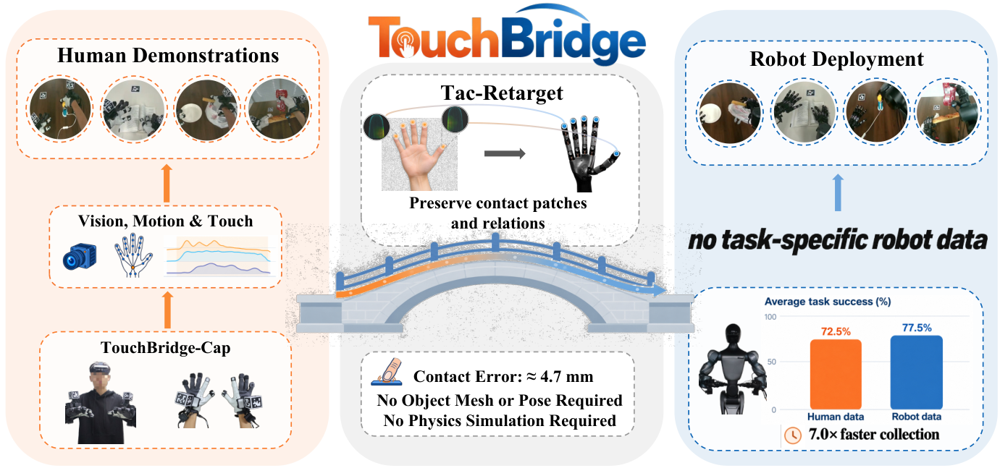

原图注译述：TouchBridge-Cap 以与机器人对齐的传感配置记录人类示范；Tac-Retarget 保留接触位置与空间关系并转换为机器人训练数据；策略效果接近遥操作训练，同时采集更快。来源：[HTML 图 1 原图](https://arxiv.org/html/2610.40349v1/teaser_new.png)，PDF p.1。阅读时把图中“无需物体/仿真”限定到数据转换，把约 4.7 mm 限定到仿真接触评估。

### 图 2：人机硬件共同设计

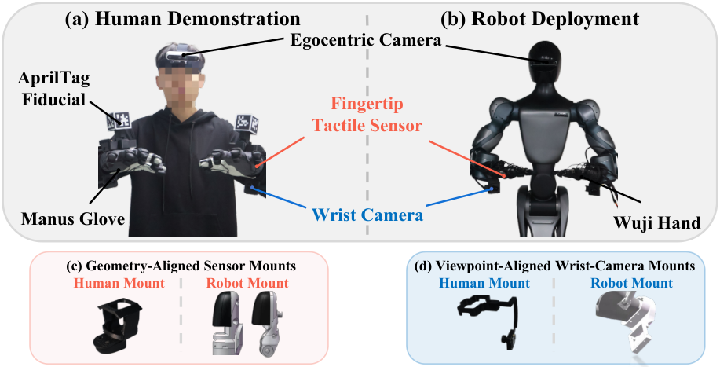

原图注译述：(a,b) 人类采集与机器人部署接口；(c,d) 对应指尖触觉安装与腕部相机配置减少形态差异。来源：[原图](https://arxiv.org/html/2610.40349v1/human_robot_system_new.png)，III-A，PDF p.3。重点看传感器坐标和视角对应，不是人机手关节结构完全相同。

### 图 3：Tac-Retarget 的三类目标

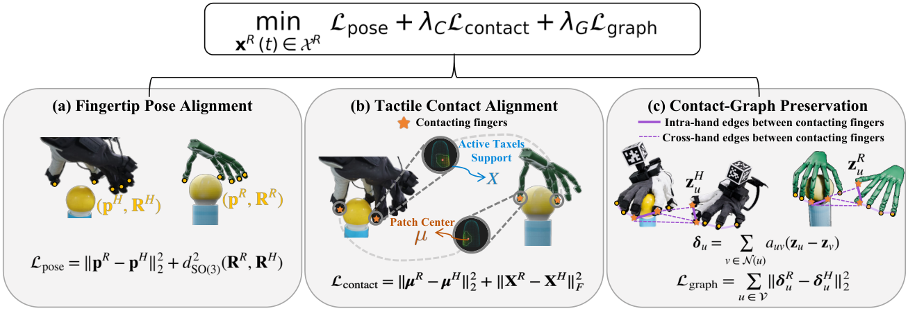

原图注译述：(a) 相机系指尖位置/朝向对齐；(b) 接触中心与活动 taxel 对齐；(c) 触觉激活图保持同手与跨手接触关系；为清晰起见省略权重和正则。来源：[原图](https://arxiv.org/html/2610.40349v1/tactile_retarget_new.png)，III-B，PDF p.4。图中的简写损失不能替代正文式 (1)–(6) 和附录附加项。

### 图 4：机器人域观察合成

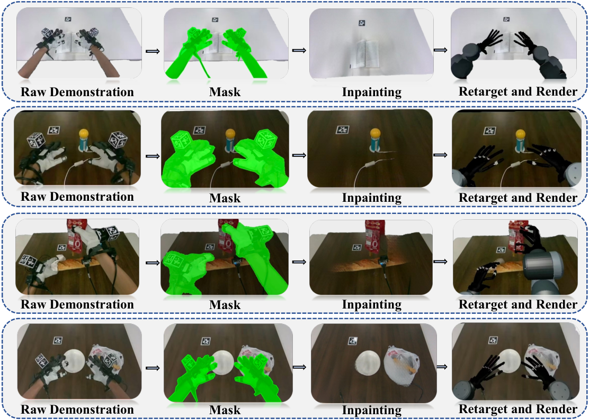

原图注译述：从左到右依次为原始人类示范、去除遮罩、补全场景、机器人域合成观察。来源：[原图](https://arxiv.org/html/2610.40349v1/data_generation_new.png)，III-C1，PDF p.5。动作重定向的状态也用于渲染，图像与动作标签由此对齐。

### 图 5：四个接触丰富的任务

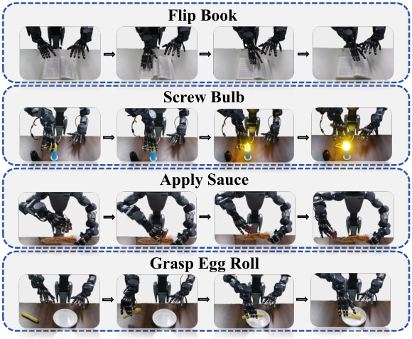

原图注译述：实验评估的四项接触丰富任务。来源：[原图](https://arxiv.org/html/2610.40349v1/task_new.png)，IV-A2，PDF p.5。任务同时覆盖持续接触、多指旋转、挤压和易碎物处理，但任务数仍有限。

### 图 6：回放、策略和采集时间

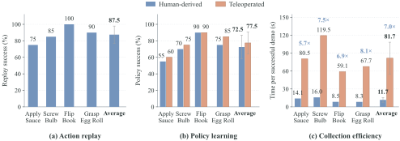

原图注译述：(a) 每任务 20 条转换示范在匹配初始场景下回放；(b) 每任务 60 条各数据源示范微调 GR00T N1.7 后的实机成功率；(c) 每成功示范采集时间，包括失败和复位，倍数为加速比；误差棒为四任务标准差。来源：[原图](https://arxiv.org/html/2610.40349v1/comparison_trigether.svg)，IV-B/C，PDF p.7。三块图的指标和实验单位不同。

### 图 7：观察域的对照

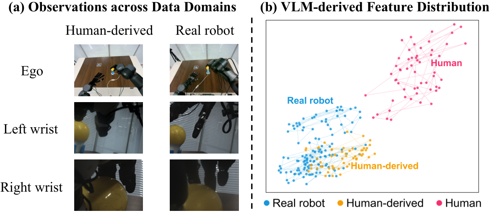

原图注译述：(a) 实机与人类转换数据的多视角观察；(b) 动作专家之前的 VLM 特征分布。来源：[原图](https://arxiv.org/html/2610.40349v1/feature_distribution.png)，IV-B1，PDF p.7。投影重叠支持视觉差异减小的解释，但不是完整分布检验。

### 图 8：重定向定性比较

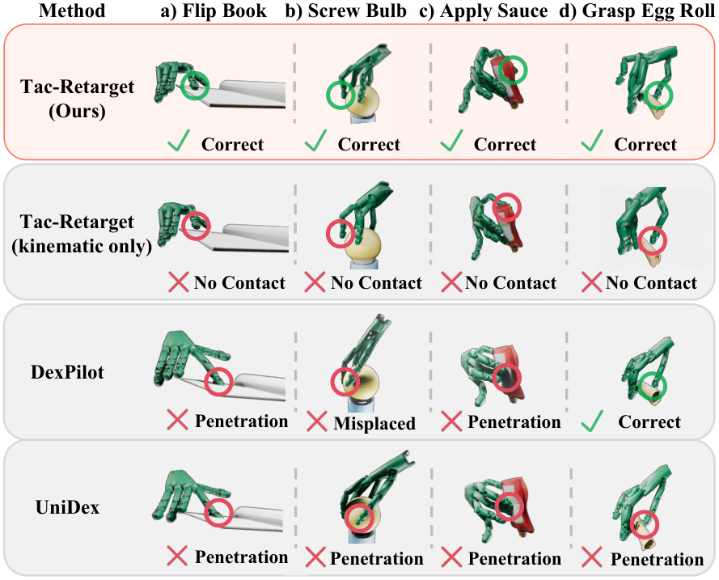

原图注译述：Tac-Retarget、仅运动学版本及基线的定性对照。来源：[原图](https://arxiv.org/html/2610.40349v1/retarget_vis_new.png)，IV-D，PDF p.7。关注漏接触、错位与物体穿透；选取的成功例子不是全量无穿透证明。

### 图 9：触觉消融后的实机策略表现

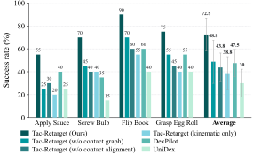

原图注译述：Tac-Retarget、触觉消融及已有重定向方法的实机策略成功率；误差棒为四任务标准差。来源：[原图](https://arxiv.org/html/2610.40349v1/policy_success_rate.svg)，IV-D2，PDF p.8。注意文件名虽含 10，原论文图号是 **9**。

### 图 10：策略与预训练设置

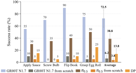

原图注译述：不同策略与预训练设置的实机成功率；误差棒为四任务标准差。来源：[原图](https://arxiv.org/html/2610.40349v1/policy_pretraining.svg)，IV-E，PDF p.8。在少量转换数据下，预训练模型与从头训练之间的差异明显。

### 图 11：相机系触觉指尖位姿重建

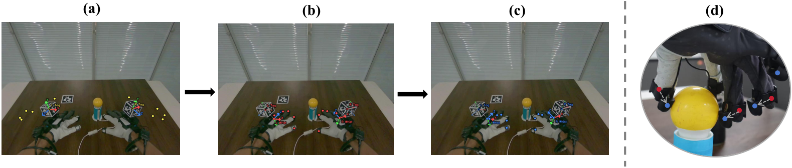

原图注译述：(a) 第一视角检测的腕部 AprilTag；(b) 经手腕–立方体标定重建的 Manus 指尖位置（红）；(c) 加固定安装变换后的触觉传感器原点（蓝）；(d) 两者固定偏移的近景。来源：[原图](https://arxiv.org/html/2610.40349v1/data_collection.png)，附录 A2，PDF p.9。该偏移解释了为何不能直接把手套指尖点当作触觉坐标原点。

**提取覆盖说明**：原准备记录只覆盖 HTML `figure` 内的资源，共 10 张，漏掉置于普通段落中的图 1。本次按缓存 HTML 的引用补取图 1；现有相对链接覆盖 PDF 的编号图 1–11。没有提取逐帧视频或项目页补充素材，也不把它们计为已读证据。原 `preparation.json`/`figures.json` 保持采集时的记录，补取来源在本节和 `review.json` 中记录。

## 10. 来源与推荐阅读位置

| 要核查的问题 | 原文位置 | 本地证据 |
| --- | --- | --- |
| 动机、贡献与相关工作差异 | I–II，表 I，PDF pp.1–3 | [HTML](source.html)、[PDF](paper.pdf) |
| 三类重定向目标 | III-B，式 (1)–(6)，图 3，PDF pp.4–5 | [方法原图](figures/figure-03-01.png) |
| 图像合成与移动相机动作 | III-C，式 (7)，图 4，PDF p.5 | [转换原图](figures/figure-04-01.png) |
| 实机样本、任务判据、两种数据源 | IV-A–C，图 5–7，PDF pp.5–7 | [全文](source.txt) |
| 仿真误差与实机消融的区别 | 表 II，IV-D，图 8–9，PDF pp.6–8 | [PDF](paper.pdf) |
| 预训练作用与作者局限 | IV-E、V，图 10，PDF pp.7–8 | [PDF](paper.pdf) |
| 时钟、频率和坐标标定 | 附录 A（HTML 标为 V-A），表 III、式 (8)–(11)，PDF pp.8–9 | [标定原图](figures/figure-13-01.png) |
| 激活、权重、顺应补偿与超参数 | 附录 B（HTML 标为 V-B），式 (12)–(16)、表 IV，PDF pp.9–10 | [PDF](paper.pdf) |

元数据与抓取覆盖另见 [metadata.json](metadata.json)、[preparation.json](preparation.json)、[figures.json](figures.json)。审核结果见 [review.json](review.json)。
