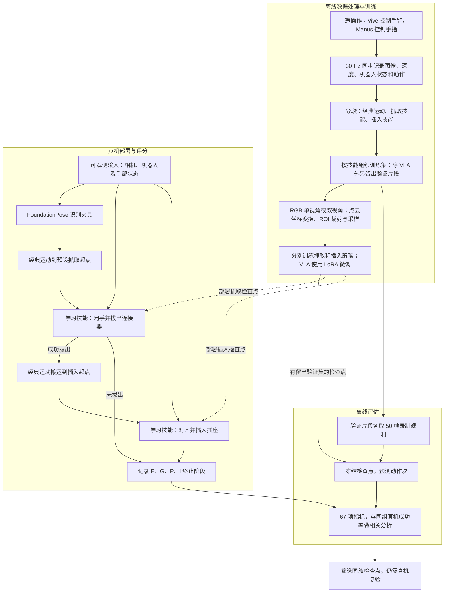
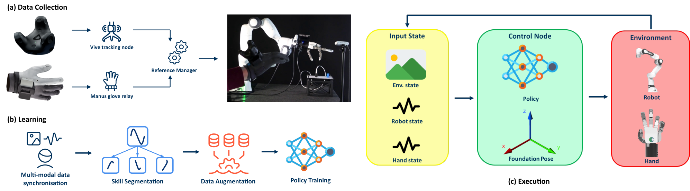
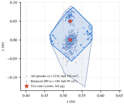
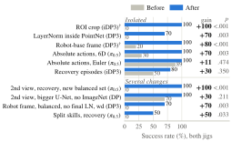
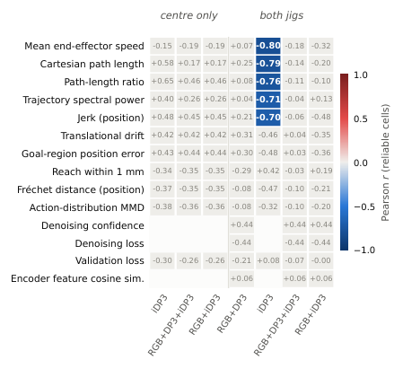
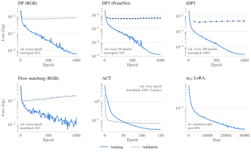

# From Teleoperation to Long-Horizon Dexterity: Evaluating Visuomotor Skills and Offline Proxies for Dexterous Manipulation

**作者与单位**：Ammar N. Abbas、Aayush Jain、Prashanth Viswanath、Nivesh Gadipudi、Giulia Vilone、Jim Gibbons；六位作者均署名 Analog Devices, Inc., EdgeAI Robotics（爱尔兰利默里克）。前两位为共同贡献作者。
**arXiv**：[2610.40828v1](https://arxiv.org/abs/2610.40828v1)
**时间**：2026-10-30 02:07:37（Asia/Shanghai，UTC+08:00，v1）

## 中文摘要

模仿学习策略旨在使机器人操作能够稳健应对物体位姿、外观和环境的变化，而这些变化会给预先编程的运动带来困难。然而，真实世界中的性能仍然难以预测，因为验证损失等常规优化信号与机器人任务成功率之间没有一致的关系。为识别决定真实世界性能的设计选择，本文使用五指机器人手，在约 1,700 次 RJ45 连接器抓取与插入的真机试验中，评估了涵盖七个策略族的 281 个模仿学习策略。受控消融表明，观测和动作表示的影响大于常规的优化器与采样选择。对于点云策略，感兴趣区域裁剪、机器人基座坐标系表示以及点编码器内部的归一化，各自使成功率提高了 70–100 个百分点。对于视觉语言动作策略，预测绝对动作而非相对动作使插入成功率最多提高了 70 个百分点。技能分解、多视角感知和恢复示范与表现最好的系统相关联，但它们的效果并未被独立分离。在评估的 67 项离线指标中，只有五项衡量预测运动平滑性和直接性的指标，与插入成功率存在可靠相关性（$r=-0.70$ 至 $-0.80$），而且这种相关性仅出现在一个策略族内。这些结果表明，表示方式是决定真实世界模仿学习性能的关键因素；离线指标可以帮助筛选策略，但不能替代真机评估。

## Key insight

**作者的贡献**是把已有策略放进同一个接触密集任务中，逐项记录配置差异，用真机消融检验哪些设计有效，再检验离线指标能否预测真机表现。DP、DP3、iDP3、ACT、流匹配和 VLA 都是所采用的既有方法；本文的主要价值是实验依据，以及坐标变换、裁剪、动作表示、双视角和训练基础设施的实现整合（§1、附录 D）。

**解读判断**：这个任务首先要求策略看清局部几何，并输出容易执行的动作。点云裁剪把有限的采样点集中到连接器或插座；基座坐标系消除了腕部相机运动带来的坐标变化；逐层归一化改变了点特征进入后续网络时的数值条件。这些设计可能比继续调优化器更直接地缓解学习难度。不过，论文验证的是具体配置的成败，未分别证明上述机制；也不能把“绝对动作更好”推广到所有机器人任务。

离线回放的另一个边界是：策略始终读取示范中录好的观测，错误动作不会改变下一帧。因此，回放能显示插入预测是否抖动、绕行，却无法完整重现第一次接触失败后的状态偏移。五项平滑性指标更适合同一 iDP3 配方内的候选筛选，而非跨策略族排名。技能分解和第二视角也与最佳结果相伴，但相关比较存在其他同步改动，不能把全部增益归因于其中一个组件。

## 方法管线

这是示范学习和真机评估流程，没有 teacher/student 蒸馏或仿真特权状态。图中的状态均来自实际传感器或机器人接口；离线评估使用录制观测，部署则在执行动作块后继续读取真实观测。

## 方法详解

### 1. 用经典运动连接两个接触技能

原图 1 展示了从人类操作到策略执行的连接关系。硬件是 Franka Research 3 机械臂、Tesollo DG5F-M 五指手和腕部 RealSense D455 RGB-D 相机；双视角配置另有静态第三人称相机。人用 HTC Vive 跟踪器控制手臂、Manus 手套控制手部，ROS 2 以 30 Hz 同步记录数据（§2、附录 A）。

四阶段依次为：移动到抓取起点、学习抓取并拔出、搬运到目标插座、学习插入。FoundationPose 用来识别连接器所在夹具，再选择对应的预设起点。论文的“长时程”能力由这套编排完成，抓取和插入之间的搬运交给经典运动。

抓取技能闭手后，还要达到 grip effort 阈值才能提起连接器。阈值多数取 80，项目过程中曾在 10–120 之间调整，原文没有提供物理单位，不能解释成牛顿。部署策略运行在 10 Hz；附录 A 用 11 次示范回放、其中 4 次成功的结果说明，30 Hz 和 10 Hz 回放得到相同成败。这个小规模回放依据并非学习策略在任意频率下性能相同的证明。

### 2. 数据分配围绕技能的失败来源

示范覆盖中心、前、后、左、右五个夹具位置；真机评估使用中心与左侧两处。完整数据集的位置分布不均，平衡集按起始位姿聚类抽取数量相等的片段，减少较少出现的左侧位置被忽略的情况。抓取对接近姿态敏感，作者通常使用平衡集；插入始终面向同一个插座，通常使用全量片段保留精细接触数据。表 4 的具体配置有例外，例如 PointNet DP3 的两个技能均使用平衡集。

原图 3 的星号是两个测试起点，凸包显示平衡子集仍保持起始位置的空间覆盖。这里的“Balanced-200”是数据集名称，并非各技能都恰有 200 条：点云版本实际为抓取 180 条、插入 166 条；加恢复示范后为 286/272 条。全量点云集为 1216/1185 条，加恢复示范后为 1322/1291 条（附录 B、表 2）。

恢复示范展示错误抓姿或插入未对齐后如何修正。它提供正常成功轨迹之外的状态覆盖；但 iDP3 仅增加恢复数据的比较从 50% 提升到 80%，Fisher 检验 $p=0.350$，样本下尚未显示显著差异。双视角 VLA 的强结果还伴随数据重抽样和恢复数据增加，不能单独作为恢复示范的因果证据。

### 3. 把视觉观测变成适合局部接触的表示

RGB 分支读取腕部相机的 $848\times480$ 彩色图像，双视角再加入外部相机图像。点云分支由深度重建几何，提供两种坐标系：随腕部运动的相机坐标系，以及通过手眼标定转换得到的固定机器人基座坐标系。ROI（region of interest，感兴趣区域）裁剪仅保留抓取连接器或目标插座附近三维包围盒内的点，再用最远点采样（farthest-point sampling）取得 2048 点（附录 A–B）。

以下是对附录 B 处理过程的**教学记号**，原文没有对应的编号公式：

$$
\mathbf{x}^{b}_{t,i}
=R^{b\leftarrow c}_{t}\mathbf{x}^{c}_{t,i}
+\mathbf{t}^{b\leftarrow c}_{t},\qquad
X_t=\operatorname{FPS}_{2048}
\left(\{\mathbf{x}^{b}_{t,i}\mid\mathbf{x}^{b}_{t,i}\in\mathcal B\}\right).
$$

$t$ 是观测时刻，$i$ 是点索引；$\mathbf{x}^{c}_{t,i},\mathbf{x}^{b}_{t,i}\in\mathbb R^3$ 分别是相机和基座坐标中的同一点；$R^{b\leftarrow c}_{t}\in\mathbb R^{3\times3}$、$\mathbf{t}^{b\leftarrow c}_{t}\in\mathbb R^3$ 是该时刻相机到基座的旋转与平移，随腕部位姿变化；$\mathcal B$ 是该技能的三维 ROI；$\operatorname{FPS}_{2048}$ 表示采样，$X_t\in\mathbb R^{2048\times3}$ 仅表示几何坐标部分。公式表示基座坐标版本的一条处理路径，未声称全部策略都使用同一坐标系、包围盒或附加特征。原文未给出统一的 ROI 数值边界或完整标定参数。

在网络内部，PointNet DP3 使用输出维度为 64 的点编码器，iDP3 使用输出维度为 128 的多阶段编码器。论文强调的归一化消融，是把 LayerNorm 从仅放在 PointNet 输出处改为每个隐藏层后都使用；这与对整幅点云做坐标归一化是不同的开关（附录 D–E）。

图 2a 上半区标为 isolated。其中，iDP3 的 ROI 裁剪使**拔出成功率**由 0% 到 100%；同一平衡集上，PointNet 的基座坐标表示使拔出成功率由 20% 到 100%；逐层 LayerNorm 使 DP3 **整条管线插入率**由 0% 到 70%。图中带 † 的行是拔出率，其余是管线插入率，不能把这些增益全部当成插入技能的条件成功率。下半区同时改变多个设置，不能按单因素解释（§3、图 2a）。

### 4. 从表示生成动作块，再转换到机器人接口

机器人接口只接收 10 维动作：末端平移 3 维、欧拉角姿态 3 维、手部关节命令 4 维。使用 6D 旋转表示时，策略内部状态和动作扩大到 13 维，执行接口仍为 10 维（附录 A）。下面只是把该维度关系和 §2 的动作块描述写成**教学记号**：

$$
a_t=[\mathbf p_t,\mathbf r_t,\mathbf h_t]\in\mathbb R^{d_a},
\qquad d_a=3+d_r+4\in\{10,13\},
$$

$$
\widehat A_t=\pi_\theta(o_t,s_t)
=[\widehat a_t,\ldots,\widehat a_{t+H-1}]
\in\mathbb R^{H\times d_a}.
$$

$\mathbf p_t\in\mathbb R^3$ 是平移命令，$\mathbf r_t\in\mathbb R^{d_r}$ 是姿态表示，欧拉角时 $d_r=3$、6D 表示时 $d_r=6$；$\mathbf h_t\in\mathbb R^4$ 是四个手部关节命令。$o_t$ 是视觉观测，$s_t$ 是机器人状态，$\pi_\theta$ 是参数为 $\theta$ 的技能策略，帽号表示预测；$H$ 是预测步数。随机生成过程及内部预处理在此简写中省略。每轮执行动作块的前 $n_a\le H$ 步后再预测；$n_a$ 是实际执行步数。

不同策略的编码器和生成器可以分别替换：DP 用 RGB 编码和扩散去噪；DP3/iDP3 用点云编码和扩散去噪；流匹配（flow matching）学习速度场；ACT 用条件变分自编码器与 Transformer 解码动作块；等变扩散策略在点编码器中引入旋转和尺度对称性；$\pi_{0.5}$ 是跨机器人数据预训练的视觉语言动作模型（vision-language-action model，VLA），在这里用低秩适配（LoRA）微调。论文没有给出新的扩散或流匹配目标函数，不能把这些基础算法的损失公式当作本文贡献。

代表配置为：DP 的 $(H,n_a)=(4,4)$，PointNet DP3 为 $(4,3)$，iDP3 为 $(16,8)$，$\pi_{0.5}$ 为 $(50,10)$（表 4）。在双视角 $\pi_{0.5}$ 中，6D 姿态下由相对动作改为绝对动作，使管线插入率从 30% 到 100%（$p=0.003$）；欧拉角下则仅从 89% 到 100%（$p=0.474$）。这说明收益依赖动作表示组合。相对动作还涉及时间归一化选项，原文未给出完整代数定义，此处不把它直接等同于简单的相邻帧差分。

### 5. 按阶段评分，分开抓取能力和插入能力

§2 与附录 A 的核心公式没有编号，含义如下：

$$
n=F+G+P+I,\qquad
\mathrm{Pick}=\frac{I+P}{n},\qquad
\mathrm{Insert}\mid\mathrm{pick}=\frac{I}{I+P},\qquad
\mathrm{Insert}=\frac{I}{n}.
$$

$F,G,P,I$ 是按**最后完成阶段**分箱的试验次数：$F$ 为未闭手抓住连接器，$G$ 为闭手但未达到提起阈值，$P$ 为拔出但未插入，$I$ 为最终插入。四个计数互斥，$n$ 是总试验数；三个比率均无量纲，乘 100 后以百分数报告。$\mathrm{Pick}$ 衡量能否拔出，条件插入率只评估实际收到连接器的插入技能，$\mathrm{Insert}$ 评估整条管线。若 $I+P=0$，条件插入率没有定义。

由这些定义可得，在**同一批试验**上，管线插入率等于拔出率乘以条件插入率。表 1 却分别汇总了检查点跨会话、跨搭档的技能成功率，并另列最佳配对的管线插入率；因此不能直接把表中同一行两个汇总比例相乘来验算第三列。

标准会话在两个起点各做 5 次，即 $n=10$。表现好的检查点会复测，明显失败的配置有时在 2–3 次后停止，故各配置样本量不等。作者按检查点合并试验，报告 95% Clopper–Pearson 置信区间，并以双侧 Fisher 精确检验比较前后配置；“isolated”依据是保存的训练配置只改变指定因素（附录 C）。这不是统一样本量、统一搭档的完全随机化试验。

### 6. 离线代理指标究竟在预测什么

每个纳入分析的检查点在自己的留出验证片段上回放，每段均匀取 50 帧，逐帧输入**录制观测**并预测动作块。67 项指标包括验证损失、与示范动作的开环误差、预测末端路径的运动质量、目标区域误差、编码器统计和去噪诊断等。附录 F、表 6 说明：第一套工具提供 38 项，另一套提供 29 项；作者声明未按真机结果选择或剔除指标。原文未完整公布每项指标的计算式、动作块拼接规则及频谱处理细节，因此这里不补造精确实现。

相关分析的组别由策略族和测试夹具范围共同决定：RGB DP 与 PointNet DP3、iDP3 单独、三者合并、RGB DP 与 iDP3，再区分仅中心或两个夹具。附录 F 报告两个夹具范围分别覆盖 80 和 120 个检查点；这不是全部 281 个策略都参加了相同的相关性分析，$\pi_{0.5}$ 微调也没有验证集切分。

每个单元格计算某个离线指标与真机拔出率或条件插入率的 Pearson 相关系数 $r$，原文称按 episode 加权。一个结果被标为可靠须同时满足：所在组至少 10 个检查点；在该相关矩阵内经 Benjamini–Hochberg 多重检验校正、假发现率阈值 $q=0.05$ 后仍通过；逐一移除任意一个策略时相关系数符号不变。$q$ 是多重检验的控制阈值，不是某项原始检验的 $p$ 值；逐一移除检查不等于对未见任务的外部验证。

只有**在两个夹具均测试过的 21 个 iDP3 插入检查点**通过五项：平均末端速度 $r=-0.80$、笛卡尔路径长度 $-0.79$、路径长度比 $-0.76$、轨迹频谱功率 $-0.71$、位置 jerk（加加速度）$-0.70$。这些量分别描述移动速度、总行程、路径直接程度和变化剧烈程度，较小值与较高插入率相伴；它们彼此的相关性高达 $0.82$–$0.99$，大体是同一类行为信号。原文所谓“单一平滑度分数”是信息冗余性的概括，没有给出一个已验证的组合评分公式。

**解读判断**：负相关不能转成“让机器人越慢越好”的优化规则——静止轨迹也可能很短、很平滑，却永远无法插入。这里检验的是既有候选中的排序关系，并未直接优化这些指标或证明因果性。中心夹具组、混合 RGB/点云的组均无指标通过可靠性判据，也没有指标可靠预测拔出率（§4、附录 F）。

原图 4 中多数验证损失早早见底，随后平坦或上升，而训练损失继续下降；形状相近的曲线却对应明显不同的真机成功率。21 个 iDP3 插入检查点的最佳验证损失与条件插入率仅有 $r=+0.08$、$p=0.72$。这支持“本实验中验证损失不足以选出最佳部署检查点”，并不意味着可以普遍忽略过拟合或验证集。

## 实验

研究共评估七个策略族、281 个策略、约 1,700 次真机试验。训练通常使用四张 H100；评估任务是固定类型的 RJ45 连接器与插座、两个抓取起点，成功标准为最终坐入目标插座。离线的 1/2/5 mm 到达阈值用于轨迹指标，不能替代真实插入成功判定。

表 1 的代表结果如下；“最佳配对”与“族内配对中位数”分开列出，避免把经过选择的最佳配置理解成该策略族的通常表现。

| 策略配置 | 最佳配对管线插入率 | 配对插入率中位数（配对数） | 说明 |
| --- | ---: | ---: | --- |
| iDP3，ROI 裁剪 | 100% | 57%（22） | 条件插入率 100%，95% CI 为 [69%, 100%] |
| 双视角 $\pi_{0.5}$ | 100% | 10%（20） | 条件插入率 100%，95% CI 为 [69%, 100%] |
| 双视角 DP 插入 | 100% | 未列 | 抓取使用 $\pi_{0.5}$，不是两个技能都用 DP |
| RGB DP / PointNet DP3 | 70% / 70% | 60%（5）/ 0%（26） | 两个最佳配置相近，族内分布不同 |
| 流匹配：RGB / PointNet / iDP3 编码器 | 40% / 50% / 33% | 40%（1）/ 15%（4）/ 0%（3） | 更换编码器后的三组结果 |
| ACT | 30% | 0%（3） | 条件插入率虽为 100%，但仅来自 3 次成功拔出，CI 为 [29%, 100%] |

iDP3 较大技能约 69M 参数、推理显存约 1.0 GB，$\pi_{0.5}$ 总参数约 3.3B、推理显存约 8 GB。显存是在 batch 1 下比较较大技能的单 GPU 占用；这支持本任务中的紧凑模型取舍，不证明二者跨任务能力相等，也不等于整套系统资源相差八倍。

鲁棒性测试每个条件、每个起点仅 5 次：iDP3 在单独光照变化下为 5/5、5/5，背景变化和迁移场地下均为 5/5、4/5；更紧公差的插座降至 2/5、0/5。正文概括为环境变化下保持 80–100%，但表 3 的“新场地＋光照变化”中心组原始结果为 **3/5（60%）**，重新调整插入起点后才为 4/5。阳光及紧公差实验还使用了同配方下较大 UNet 抓取、batch 320 插入的检查点，不能描述为同一冻结检查点在全部条件下的统一结果。

最强结论是具体表示改动能在这个接触任务上产生大幅收益。技能拆分、多视角和恢复示范的联合收益尚不能完全拆开；最佳结果受有限样本、配置选择和不均衡复测影响；五项离线指标的有效范围也止于一个策略族内的插入检查点。原文提供了所用代码体系与设置（附录 D、表 4），但未给出本实验代码和数据的明确公开下载入口。
