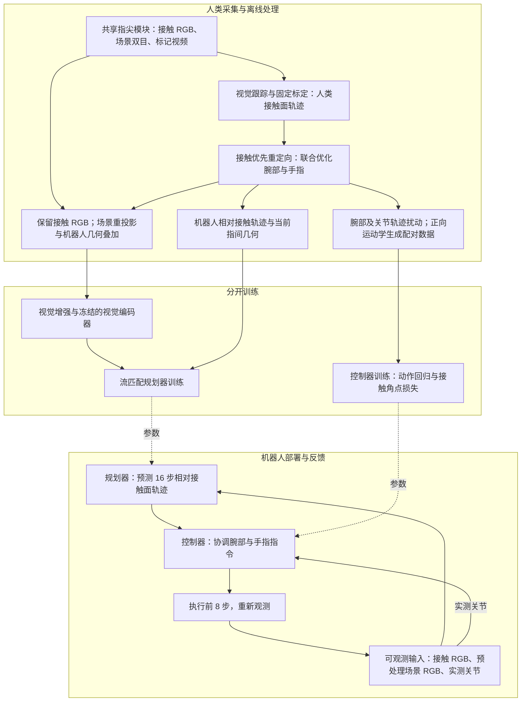
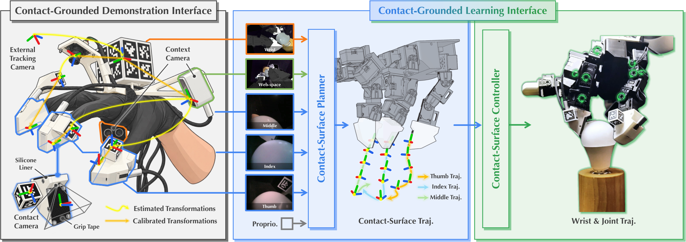
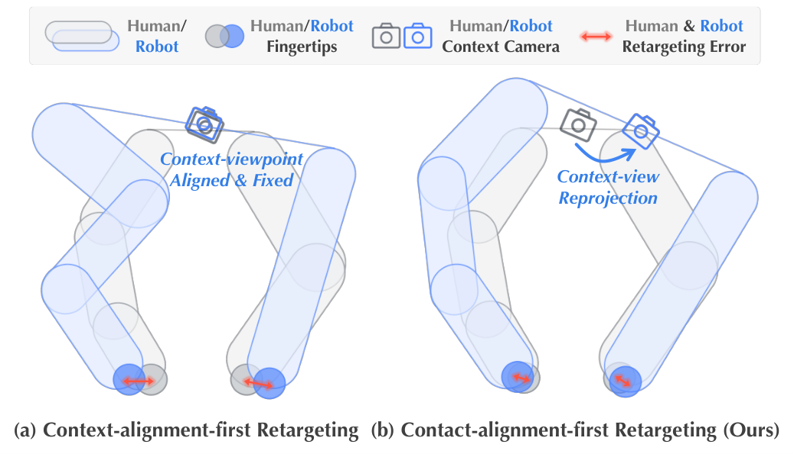
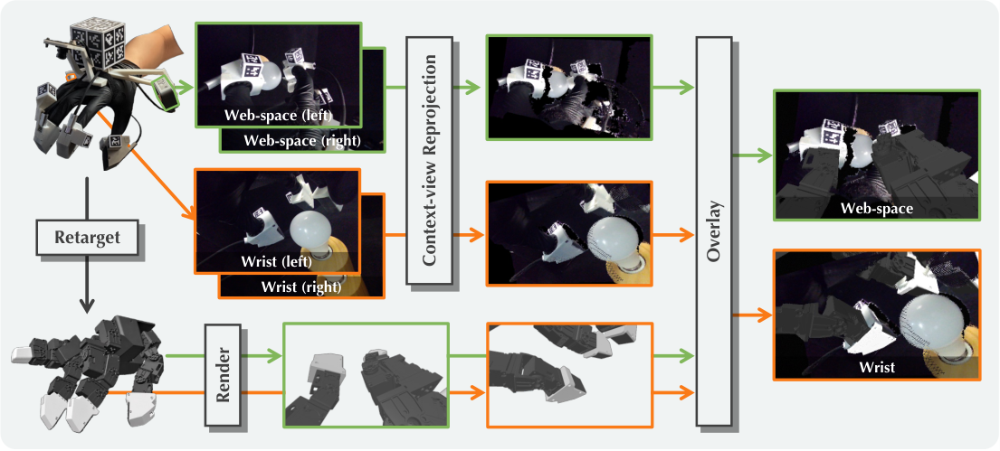
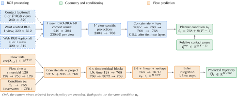
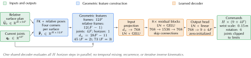

# Contact Imitation Interface: Transferring Dexterous Skills by Showing How Contact Unfolds

**作者与单位**：Zhixuan Xu¹∗、Yichen Li¹²∗、Bingchen Wu¹²、Rui Wang¹²、Yiwen Hou¹、Zixuan Liu¹、Tianyu Qiu²³、Lin Shao¹²†。¹新加坡国立大学（National University of Singapore）；²RoboScience；³华南理工大学（South China University of Technology）。∗同等贡献；†通讯作者。

**arXiv**：[2610.41028v1](https://arxiv.org/abs/2610.41028v1)

**时间**：2026-10-30 06:14:31 Asia/Shanghai（UTC+08:00，v1）

## 中文摘要

无需机器人参与的人类示范，为扩大灵巧操作数据规模提供了一条有前景的路径。关键挑战在于：保留示范者自然的灵巧性，同时生成能够迁移至机器人手、以接触为基础的观测与动作。我们提出接触模仿接口（Contact Imitation Interface，CIMI），一个包含接触驱动示范接口与学习接口的框架。示范接口将共享的接触几何和指尖 RGB 视图，与接触对齐优先的重定向、较大范围场景视图的重投影结合起来。学习接口引入分层策略：接触面规划器预测相对接触面轨迹，控制器协调腕部与手指指令，以改善接触对齐。CIMI 结合以接触为基础的观测、重定向和动作表示，在 LEAP 与 Wuji 的六个手型—任务组合上，将平均最终阶段成功率相较基线策略提高至少 50 个百分点。硬件设计与软件已公开提供。

## Key insight

**作者提出的贡献**是把人手与机器人手之间的共享接口放在“接触面如何运动、接触附近看到了什么”上。人和机器人佩戴几何与相机布置对应的指尖模块；离线重定向允许腕部配合手指移动，以优先复现接触面的位姿；因此产生的场景相机视点差异再用重投影修正。学习时也沿用同一接口：视觉策略预测各接触面的相对轨迹，另一个控制器负责把轨迹实现为协调的腕部和关节动作。

**解读判断**：这项设计的价值在于让观测、示范目标和动作表示围绕同一个局部几何对象对齐。仅模仿指尖中心会漏掉表面朝向，仅固定腕部匹配相机又可能牺牲接触精度。共同的接触表面既给视觉提供近距离参照，也给跨手运动映射提供可计算的约束。规划器因而可以更集中地学习任务需要的接触演化，把具体手型的运动学实现交给控制器。

作者沿用已有视觉标记跟踪、流匹配（flow matching）和相对轨迹建模；放松相机位姿约束也明确承接 HoMMI。新意主要在接口与训练方式的组合（原文 §III）。实验比较的是这一组合，不足以把全部提升归因于单独的动作坐标系。跨手复用的是示范及接口设计；LEAP 与 Wuji 各自重定向并训练策略，并非同一策略零样本迁移。

## 方法管线

这里没有教师—学生蒸馏。标记跟踪提供离线示范监督；机器人部署时通过相机和实测关节获得输入，不需要人类标记轨迹、物体真值位姿或接触力作为策略输入。双目深度在部署时仍用于场景图像预处理，但策略接收的是 RGB，而非深度或点云。

原文图 2：左侧共享模块、跟踪与标定构成示范接口；中间规划接触面轨迹；右侧实现腕部与手指动作。下面按这个数据流展开。

## 方法详解

### 1. 共享模块与视觉跟踪：记录有几何意义的接触面

人类和机器人指尖模块共享名义接触面几何与接触相机（contact camera）位置，相机从指根朝接触区域切向观察。腕部和拇指—食指虎口的场景相机（context camera）补充较大范围的信息。三指采集系统以 10 Hz 同步记录九路视频：三路接触视图、四路双目场景视图，以及中指和外部跟踪视图（§III-A，D1）。这些采集通道并不全部成为策略输入。

跟踪使用 AprilCube 上的 AprilTag、DeepTag 检出的密集关键点，以及多标记联合透视 n 点估计（PnP）。已知标记尺寸给出尺度，固定安装标定把标记位姿转换为接触面位姿。补充材料 §I-B 的式 (S1) 为：

$$
{}^{E}\mathbf T^{S_{H,i}}_t
= {}^{E}\mathbf T^{D_H}_t\,
{}^{D_H}\mathbf T^{C_{H,j(i)}}\,
{}^{C_{H,j(i)}}\mathbf T^{M_{H,i}}_t\,
{}^{M_{H,i}}\mathbf T^{S_{H,i}}.
\tag{S1}
$$

其中，所有 $\mathbf T\in\mathrm{SE}(3)$ 都是 $4\times4$ 刚体变换；${}^{A}\mathbf T^B$ 把 $B$ 坐标变到 $A$。$t$ 为采样时刻，$i$ 为手指编号，下标 $H$ 表示人类示范装置。$E$ 是固定外部相机系，$D_H$ 是手背标记系，$C_{H,j(i)}$ 是观察手指 $i$ 的手载跟踪相机系，$M_{H,i}$ 是该指尖标记系，$S_{H,i}$ 是接触面系；$j(i)$ 选择对应相机。右侧第一、第三项随视频估计，第二、第四项为固定标定。拇指与食指共用虎口跟踪视图，中指使用独立视图。

每个面有四个已知局部角点。令 $\bar{\mathbf v}_{i,\ell}=(v_x,v_y,v_z,1)^\top\in\mathbb R^4$ 为第 $\ell$ 个角点的齐次坐标，则示范角点为（式 S2）：

$$
\mathbf p^H_{i,\ell,t}
=\left[{}^E\mathbf T^{S_{H,i}}_t\bar{\mathbf v}_{i,\ell}\right]_{1:3}.
\tag{S2}
$$

$\ell\in\{1,2,3,4\}$，$[\cdot]_{1:3}$ 取三维位置，单位为米。输出的角点轨迹成为下一步重定向的目标。多面标记可在局部遮挡时提供冗余，但仍依赖足够有效关键点；无效观测不能视为真实接触轨迹。

### 2. 接触对齐优先重定向：腕部与手指共同补偿形态差异

如果固定腕部去匹配人类与机器人场景相机位姿，就只剩手指关节能消除接触误差。CIMI 允许腕部一起变化，匹配每个接触面的四个有序角点，从而同时约束位置和朝向（§III-A，D3）。

原文图 3：灰色为人类，蓝色为机器人；接触优先方案移动腕部以改善表面对齐，由后续图像重投影处理视点变化。

主文用角点平方误差加平滑正则概括优化。补充材料 §I-C 给出实际归一化目标：

$$
\mathcal L_{\mathrm{contact}}
=\frac{1}{|\mathcal V|}
\sum_{(t,i,\ell)\in\mathcal V}
\left\|\widetilde{\mathbf p}^{R}_{i,\ell,t}
-\widetilde{\mathbf p}^{H}_{i,\ell,t}\right\|_2^2,
\tag{S4}
$$

$$
\mathcal R=\frac{1}{Z_e}\sum_t e_t
\left[\lambda_q\|\delta\mathbf q_t\|_2^2
+\lambda_x\|\delta\mathbf x_t\|_2^2
+\lambda_R\|\delta\boldsymbol\omega_t\|_2^2\right].
\tag{S5}
$$

优化变量为机器人腕部／根部位姿 $\widetilde{\mathbf X}_t=(\widetilde{\mathbf R}_t,\widetilde{\mathbf x}_t)\in\mathrm{SE}(3)$ 和活动关节 $\mathbf q_t\in\mathbb R^{4F}$；$F$ 为受控手指数，每指四个关节。$\mathcal V$ 是有效的“时间—手指—角点”集合，$|\mathcal V|$ 是其大小。$\widetilde{\mathbf p}^{R}$ 由机器人正向运动学（forward kinematics，FK）计算，$\widetilde{\mathbf p}^{H}$ 来自示范；两者均为三维米制位置。

平滑项中，$\delta\mathbf q_t=\mathbf q_t-\mathbf q_{t-1}$，$\delta\mathbf x_t=\widetilde{\mathbf x}_t-\widetilde{\mathbf x}_{t-1}$，$\delta\boldsymbol\omega_t=\log(\widetilde{\mathbf R}_{t-1}^{\top}\widetilde{\mathbf R}_t)\in\mathbb R^3$；旋转对数返回旋转向量。$e_t$ 是相邻保留帧的时间边权重，$Z_e=\max(\sum_t e_t,1)$；$\lambda_q,\lambda_x,\lambda_R$ 分别控制关节、平移和旋转平滑，并吸收单位及维度归一化。

实际求解在移动的手背坐标系 $D_H$ 中最小化 $\mathcal L_{\mathrm{contact}}+\mathcal R$，并施加关节限位；不活动关节固定。输出再转回固定外部坐标系 $E$。共同刚体变换保持瞬时角点距离不变，但平滑项在哪个坐标系计算仍有区别，不能把它随意改成世界坐标系速度正则。相机对齐仅用于初始化，在自由腕部方案中不是额外目标。原文使用 PyRoki，求解日程见表 S2。

### 3. 保留局部视图，重投影场景视图

接触相机相对名义接触面的布置相同，因此保留人类示范的接触 RGB。场景相机则会受重定向后的腕部／手部位姿影响，需要离线转换（§III-A，D4）。

原文图 4：绿色为虎口、橙色为腕部视图。Fast-FoundationStereo 从双目图像估计深度，RGB 与深度反投影为彩色点云；按重定向位姿和拟合的机器人相机安装位姿变换点云，再投影到目标图像平面；渲染机器人几何，按最近深度决定可见性并合成 RGB。

这样，保留的接触视图、转换后的场景视图和机器人状态在时间上对齐，供规划器训练。作者还跨示范拟合每只机器人手的固定场景相机安装位姿（补充 §I-D）；安装拟合不会重新牺牲已经优化的接触轨迹。

部署时仍对实时双目图像做校正、深度重建和栅格化，以维持训练时的场景图像处理方式；人类到机器人的视点转换与机器人几何叠加仅在离线示范处理中执行。每个双目单元只提供一路策略 RGB，另一幅图用于深度重建（补充 §II-E）。这是视觉域对齐，不能保证局部材质、遮挡和接触变形完全相同，因此后续视觉增强仍很关键。

### 4. 接触面规划器：预测相对当前表面的未来轨迹

重定向得到最优腕部与关节轨迹 $\mathbf X_t^*,\mathbf q_t^*$。令 $\mathrm{FK}_i(\mathbf q_t^*)$ 为接触面 $i$ 在腕部系下的位姿，则主文 §III-B，L1 的两个无编号关系为：

$$
\mathbf Y_{i,t}=\mathbf X_t^*\mathrm{FK}_i(\mathbf q_t^*),
\qquad
\Delta\mathbf T_{i,t,h}=\mathbf Y_{i,t}^{-1}\mathbf Y_{i,t+h}.
$$

$\mathbf Y_{i,t}\in\mathrm{SE}(3)$ 是接触面在固定外部系中的位姿，$h\in\{1,\ldots,H\}$ 是未来步偏移，$H=16$ 是预测长度。一个动作块中的所有未来位姿都相对预测时刻 $t$ 的该接触面表示，**不是逐步相对上一帧的增量**。这种表示对固定全局坐标系变换不变；它仍需具体手型的运动学来实现。

每个相对位姿编码为三维平移加旋转矩阵前两行的六个坐标，拼接 $F$ 根手指后得到 $\mathbf u_{t,h}\in\mathbb R^{9F}$，整块 $\mathbf U_t\in\mathbb R^{H\times9F}$。训练时平移乘 20，旋转坐标不缩放（表 S5）。

原文图 S3：冻结的 C-RADIOv3-B 为每个选定 RGB 视图提取摘要 token；视图专用投影与多层感知机（MLP）融合成 $\mathbf z_t^{\mathrm{vis}}\in\mathbb R^{768}$。本体感觉输入 $\mathbf s_t^{\mathrm{prop}}\in\mathbb R^{9(F-1)}$ 使用其他接触面相对拇指的位姿，显式提供指间几何。它在训练时来自重定向关节，在执行时来自实测关节的 FK。

条件为 $\mathbf o_t=(\mathbf z_t^{\mathrm{vis}},\mathbf s_t^{\mathrm{prop}})\in\mathbb R^{768+9(F-1)}$。补充 §II-A 的式 (S7)–(S8) 定义生成和训练：

$$
\frac{d\mathbf Z_{t,s}}{ds}
=v_\theta(\mathbf Z_{t,s},s\mid\mathbf o_t),
\qquad
\mathbf Z_{t,0}=\boldsymbol\epsilon,
\qquad
\widehat{\mathbf U}_t=\mathbf Z_{t,1},
\tag{S7}
$$

$$
\mathcal L_{\mathrm{FM}}
=\mathbb E\!\left[
\left\|v_\theta(\mathbf U_{t,s},s\mid\mathbf o_t)
-(\mathbf U_t-\boldsymbol\epsilon)\right\|_2^2
\right],
\quad
\mathbf U_{t,s}=(1-s)\boldsymbol\epsilon+s\mathbf U_t.
\tag{S8}
$$

$\theta$ 是可训练的流网络参数；$s\in[0,1]$ 是生成过程的流时间，不是机器人实际时间。$\boldsymbol\epsilon\sim\mathcal U([-1,1]^{H\times9F})$ 是均匀分布初始样本，$\mathbf Z_{t,s}$ 是演化中的动作块，$v_\theta$ 为同维度条件速度场，$\widehat{\mathbf U}_t$ 是预测块。$\mathbf U_{t,s}$ 是噪声与示范目标的直线插值，目标速度是 $\mathbf U_t-\boldsymbol\epsilon$；期望覆盖训练样本、噪声和流时间采样，平方范数汇总动作块坐标误差。实现只计入有效未来步，屏蔽填充项；推理使用三步 Euler 积分。

视觉增强在冻结编码器之前完成：每个视图缓存一张原图和八张增强图，涉及纹理混合与光度扰动；场景图还使用相机外参及渲染材质／灯光变化（补充 §II-A，图 S4）。规划器训练期间控制器参数固定，两者分开训练。

### 5. 接触面控制器：用运动学监督协调腕部与手指

规划器只提出希望接触面怎样运动。控制器使用当前关节 $\mathbf q_t$ 与预测轨迹，把它们转换为腕部相对位姿和绝对关节目标。它先将每个相对接触面目标变到当前腕部系，计算有序角点（补充 §II-B，式 S9–S10）：

$$
\widehat{\mathbf p}_{i,\ell,t,h}
=\left[\mathrm{FK}_i(\mathbf q_t)
\widehat{\Delta\mathbf T}_{i,t,h}
\bar{\mathbf v}_{i,\ell}\right]_{1:3},
\tag{S9}
$$

$$
(\widehat{\Delta\mathbf X}_{t,h},\widehat{\mathbf q}_{t,h})
=c_\phi(\widehat{\mathbf P}_{t,h},\mathbf q_t,h/H).
\tag{S10}
$$

$\widehat{\Delta\mathbf T}$ 从规划器的九维位姿表示恢复；$\widehat{\mathbf p}\in\mathbb R^3$ 是目标角点，$\widehat{\mathbf P}_{t,h}\in\mathbb R^{12F}$ 是四角点跨手指拼接。$c_\phi$ 是参数为 $\phi$ 的共享残差 MLP，$h/H$ 是归一化预测步。输出 $\widehat{\Delta\mathbf X}_{t,h}$ 相对当前腕部表示，$\widehat{\mathbf q}_{t,h}\in\mathbb R^{4F}$ 为绝对关节目标；每步共 $9+4F$ 个输出坐标。

原文图 S5：确定性的几何前端从角点构造目标坐标系和拇指相对坐标系特征，再与当前关节、预测步一起送入网络。这里每个坐标系特征包含乘 10 缩放的三维平移和完整旋转矩阵九个元素，共 12 维；它与规划器的九维位姿编码不同。共享解码器在一次批处理前向传播中并行处理全部 $H$ 步，不进行迭代逆运动学。

控制器训练数据来自重定向轨迹的平滑腕部／关节扰动，再由 FK 生成相容的“接触轨迹—动作”配对。经过动作回归预热后，使用式 (S11)：

$$
\mathcal L_{\mathrm{ctrl}}
=\mathbb E\!\left[
\frac{1}{4F}\sum_{i,\ell}
\left\|100\left(\mathbf p^{\mathrm{FK}}_{i,\ell}(\widehat{\mathbf a})
-\mathbf p_{i,\ell}\right)\right\|_2^2
\right]+\lambda_a\mathcal L_{\mathrm{act}}.
\tag{S11}
$$

$\widehat{\mathbf a}$ 是预测的腕部—关节动作；$\mathbf p^{\mathrm{FK}}(\widehat{\mathbf a})$ 为该动作经 FK 实现的角点，$\mathbf p$ 为合成监督目标，两者处于同一坐标系。因每指四角点，$4F$ 用于平均；位置原为米，乘 100 转为厘米后再平方。$\mathcal L_{\mathrm{act}}$ 是归一化腕部—关节回归误差，$\lambda_a=0.01$，期望取自训练样本。几何项惩罚动作真正实现的接触面偏差，动作项约束运动学解。

推理时预测 16 个 10 Hz 采样目标，覆盖 1.6 秒，执行前八步后重新观测，名义执行窗口为 0.8 秒；**10 Hz 指轨迹采样率，不是重规划频率**（补充 §II-C）。同一手型、受控手指、关节顺序、接触几何和采样方式下可跨任务复用控制器，更换手型或手指集合则需要相应控制器。

关节裁剪只能满足关节限位，不能保证规划出的多个接触面目标同时可达。目标描述运动而非接触力；作者用柔顺硅胶、机器人侧额外摩擦胶带厚度、摩擦支撑及相对运动反馈解释接触任务的实现机制（补充 §II-D）。这不等于测量或闭环调节接触力，也没有给出一般动力学可行性保证。

## 实验

主实验包含 LEAP 的方块拾取、硬币拾取、取信和灯泡安装，以及 Wuji 的方块、硬币拾取。四类任务分别使用 146、187、183、103 条训练示范；两种手的方块和硬币任务复用同一批人类记录，但各自训练策略。每个方法、手型、任务运行 20 次，报告分阶段成功率；总均值等权平均六个组合的**最终阶段**成功率（§IV-A，表 II）。

| 手型与任务 | 训练示范数 | 最终阶段 | 直接腕部／关节预测 + CTX+CC | CIMI + CTX+CC |
|---|---:|---|---:|---:|
| LEAP 方块 | 146 | Lift | 20% | 75% |
| LEAP 硬币 | 187 | Lift | 35% | 85% |
| LEAP 取信 | 183 | Lift | 15% | 80% |
| LEAP 灯泡 | 103 | Light | 70% | 90% |
| Wuji 方块 | 同上 146 | Lift | 15% | 70% |
| Wuji 硬币 | 同上 187 | Lift | 30% | 85% |
| 六组合等权均值 | — | — | 30.8% | 80.8% |

CTX 是所选场景视图，CC 是接触相机视图。在仅用 CTX 时，直接预测与接触面策略的均值分别为 0.8% 和 1.7%；加入 CC 后变为 30.8% 和 80.8%。因此相同 CTX+CC 输入下 CIMI 提高 **50.0 个百分点**。比较匹配了同一手型的数据、视觉及本体感觉输入、流模型宽度和规划器训练预算。

重定向消融（表 III）进一步显示，LEAP 硬币任务中，“中心匹配 + 接触优先”的平均角点误差为 9.31 mm、最终成功率 0%；“四角点匹配 + 接触优先”为 0.51 mm、85%。灯泡对应为 4.36 → 1.09 mm、20% → 90%。这些毫米值衡量**重定向轨迹相对示范的几何误差**，不是机器人执行跟踪误差。仅固定腕部匹配场景相机的两个变体，在两项任务的最终阶段都为 0%。

设计消融（表 IV，仅 LEAP 硬币与灯泡）中，完整方法平均为 87.5%；去掉机器人叠加为 62.5%，同时去掉重投影与叠加为 30.0%；去掉规划器视觉增强后最终阶段均为 0%。任务专用且无运动增强的控制器为 52.5%，但该消融同时减少跨任务数据覆盖，不能将损失单独归因于运动增强。

采集效率实验由同一操作者各执行 15 分钟，计时包含失败、重置和物体随机化。CIMI 在硬币／灯泡任务的成功示范吞吐量分别达到裸手的 70%／71%；灯泡为遥操作的 2.3 倍，遥操作未采到成功的硬币示范（§IV-C，图 6）。这项结果尚无多操作者统计。

**结果边界**：每格仅 20 次测试，成功率以 5 个百分点递增。原文提供 Align／Lift、Wedge／Lift、Open／Lift、Screw／Light 阶段标签，但未明确给出诸如抬升高度、持续时间等定量成功阈值，也未报告置信区间或多随机种子统计。两种手、四类任务支持所测范围内的有效性，尚不能推出任意物体、任意手型或力控制任务的泛化结论。作者提供的[项目入口](https://nus-lins-lab.github.io/CIMIWeb/)用于视频、硬件及软件线索；本文未进行代码运行或实验复现。
