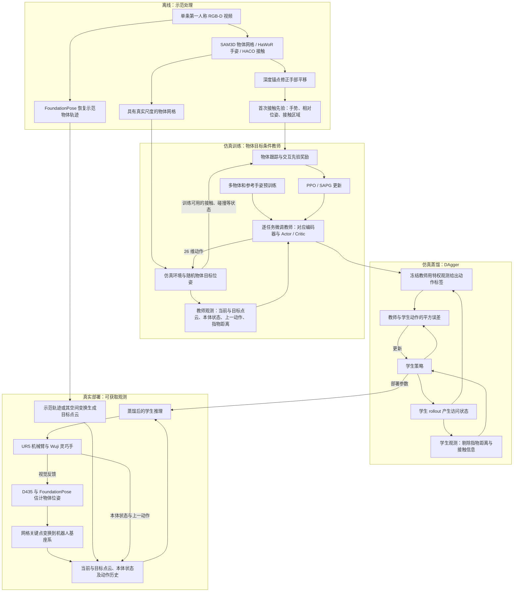
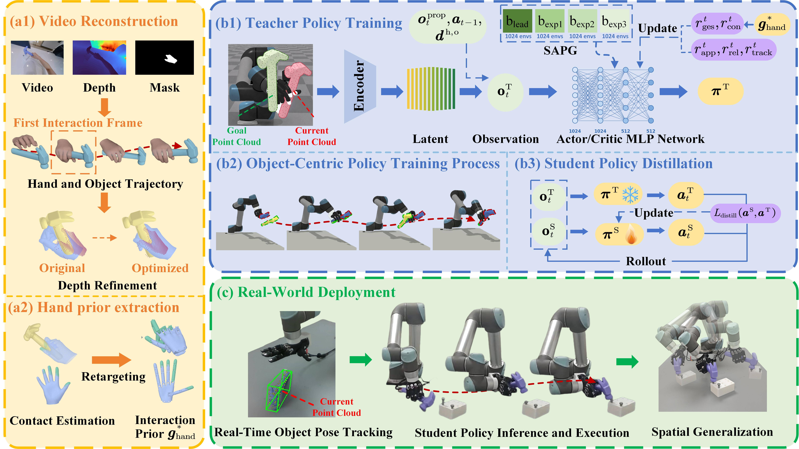
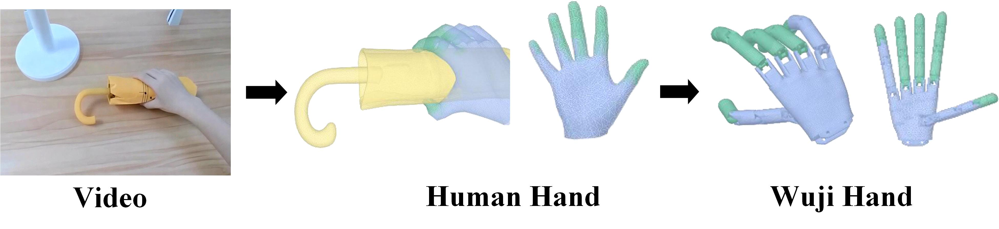
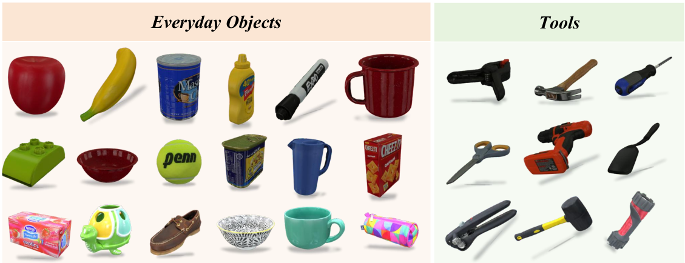
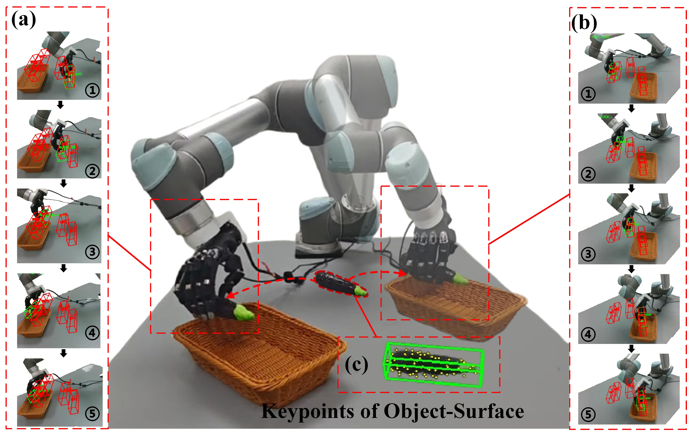
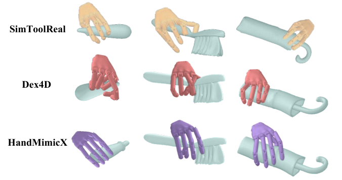

# HandMimicX: Learning Human-Like Dexterous Manipulation via an Object-Centric Policy from Egocentric Videos

**作者与单位**：Zihan Gao¹²³、Yufei Liu²⁴、Yuhong Zhang¹²、Zhen Yu²、Xinhao Huang¹²、Zhinan You²、Kai W. Ho⁵、Zipeng Ye³、Peng Jiao¹²、Haoqian Wang¹。  
¹ 清华大学（Tsinghua University）；² TsingTec；³ MeiTuan；⁴ 香港中文大学（深圳）（The Chinese University of Hong Kong, Shenzhen）；⁵ NVIDIA。Zihan Gao 与 Yufei Liu 为共同第一作者，Yuhong Zhang 为项目负责人，Zipeng Ye 与 Haoqian Wang 为通讯作者。  
**arXiv**：[2610.41336v1](https://arxiv.org/abs/2610.41336v1)  
**时间**：2026-10-30 14:51:27 Asia/Shanghai（UTC+08:00）

## 中文摘要

从人类视频中学习灵巧操作仍是一项开放挑战，尤其是在将单次示范转化为具有空间泛化能力的机器人技能，同时保持物理上合理、类似人类的交互方面。不同于以往强调手部运动模仿的工作，我们提出一种以物体为中心的框架，从第一人称人类 RGB-D 视频中获取灵巧操作技能。在这一框架中，我们以物体运动来定义强化学习（reinforcement learning，RL）目标，使技能本身与特定的手部轨迹解耦，并对手与物体的交互状态施加约束，以促进更符合解剖结构的自然手部构型。大量仿真及真实机器人实验表明，我们的方法能够高效地从人类视频中学习，并将技能泛化迁移到新的空间配置中。项目页面：[HandMimicX](https://anonymous.4open.science/w/handmimicx/index.html)。

## Key insight

**作者的核心设计**是把示范拆成两类信息：物体几何决定“操纵什么”，首次接触时的手势、手物相对位姿和接触区域提供“怎样与它交互”的先验；策略则学习把物体送往不同的目标位姿。完整示范物体轨迹用于部署时生成执行目标，并不直接作为策略训练的轨迹监督（§III-B2）。这样，同一种抓握或用工具方式可以在不同空间位置复用，而不必重放原视频中手经过的每个位置。

**解读判断**：方法最有价值的是让物体目标与手部交互先验各司其职。物体目标允许动作随空间配置改变；交互先验通过奖励约束接触和手指构型，降低策略仅为完成物体位移而采用不自然姿态的倾向。这些是软奖励约束，不能理解为对自然性、无碰撞或接触力的硬性保证。

**贡献边界**：作者将深度修正的手物重建、物体对应关系编码和交互先验整合为视频到机器人学习框架。SAM3D、HaWoR、HACO、FoundationPose、AnyTeleop 重定向方法、PointNet、SAPG 和 DAgger 均承接已有工作，点对应设计也明确受 CordViP 启发（原文 [38–45]、[13]），不宜把这些模块本身写成本论文首创。“单条视频”指每项任务的示范来源；策略先经过超过 3,200 个物体的预训练，再做逐任务微调，并非从一条视频零基础学会通用操作。

## 方法管线

上图是对原文数据流的整理。训练阶段的先验用于奖励，部署阶段的目标轨迹用于构造目标点云；这两条路径的用途不同。接触与碰撞信号在原文中属于训练评估可用的特权信息，不能据此推断部署时配有触觉传感器。

## 方法详解

### 1. 从视频提取几何与交互先验

原文图 2 把框架分为重建与先验提取、物体中心教师训练、DAgger 蒸馏、真实执行。教师学习追踪不同目标物体位姿，学生负责用现实中可获取的观测执行控制。

对于视频序列 $\{I_t\}_{t=1}^{T}$，$I_t$ 是第 $t$ 帧，$T$ 是总帧数。SAM3D 恢复物体网格，HaWoR 估计世界坐标系中的手姿，HACO 识别手物接触区域；FoundationPose 另行恢复全段物体轨迹（§III-B2）。第一人称相机在运动，独立重建的手与物体可能错位，因此作者利用深度修正手部的全局平移。

每帧将手部掩码内的有效深度像素反投影到世界坐标系，随机选取 10 个点作为深度锚点集合 $\mathcal P_t$；将相机可见的 MANO 手网格顶点组成集合 $\mathcal V_t$。原文式 (1) 为：

$$
\Delta\mathbf t_t^*
=\arg\min_{\Delta\mathbf t}
\sum_{\mathbf v\in\mathcal V_t}
\rho\!\left(
\min_{\mathbf p\in\mathcal P_t}
\left\|\mathbf v+\Delta\mathbf t-\mathbf p\right\|_2^2
\right).
\tag{1}
$$

这里 $\mathbf v,\mathbf p,\Delta\mathbf t\in\mathbb R^3$ 分别是可见手顶点、深度锚点和待求平移；内层最小值寻找平移后顶点到最近深度锚点的平方距离；$\|\cdot\|_2$ 是欧氏范数，$\rho$ 是抑制深度离群点影响的 Huber 损失，星号表示优化所得解。用 $\mathbf t_t=\mathbf t_t^0+\Delta\mathbf t_t^*$ 更新原始手部平移 $\mathbf t_t^0$。式中 Huber 的输入确实是平方距离，保留原文写法。

**解读判断**：式 (1) 的优化变量只有平移，没有旋转、手指关节或尺度参数，也没有显式的跨帧平滑项。它能通过真实尺度深度缓解空间错位，但不应被解释成完整的尺度重估计、时序优化或接触力求解。原文未给出 Huber 转折参数。

图 3 对应两种重定向（retargeting）：HACO 在 MANO 网格上预测接触，再按解剖区域映射到 Wuji 手的语义区域与候选连杆；手势采用原文 [41] 的 AnyTeleop 方法重定向。作者在首次接触帧提取交互先验 $\boldsymbol g_{\mathrm{hand}}^*$，包含手势、手物相对位姿和区域接触，而非要求机器人逐帧复制整段人手运动。该先验是多种量的组合，论文没有给出统一的向量维度。

### 2. 用对应点表示“物体当前在哪、目标在哪”

教师采用 Actor–Critic 架构（§III-C1）。Actor 输入当前与目标物体点云、本体关节位置和速度 $\boldsymbol o_t^{\mathrm{prop}}$、上一动作 $\boldsymbol a_{t-1}$，以及指尖到物体最近点的距离 $\boldsymbol d^{\mathrm{h,o}}$。几何特征与其余观测的多层感知机（MLP）编码拼接后输出 $\boldsymbol a_t\in\mathbb R^{26}$，联合控制 6 自由度 UR5 和 20 自由度 Wuji 手；Critic 估计未来累计回报。论文未在这里明确动作是位置目标、增量还是力矩，不据维度自行补定控制接口。

物体网格上固定采样 $N=128$ 个规范表面点 $\bar{\mathbf X}=\{\bar{\mathbf x}_i\}_{i=1}^N$，其中 $\bar{\mathbf x}_i\in\mathbb R^3$。在当前和目标位姿下，这些相同表面点形成 $\mathbf X_t^c,\mathbf X_t^g\in\mathbb R^{N\times3}$。这种构造使两组点保留物体表面对应关系，而非两次独立随机采样。

共享 PointNet 编码器 $\phi_\theta$ 得到 $\mathbf H_t^s=\phi_\theta(\mathbf X_t^s)$，其中 $s\in\{c,g\}$ 分别表示当前（current）与目标（goal），$\theta$ 为可学习参数。随后进行双向交叉注意力（cross-attention），原文式 (2)：

$$
\begin{aligned}
\widetilde{\mathbf H}_t^c
&=g_\theta(\mathbf H_t^c,\mathbf H_t^g)+\mathbf H_t^c,\\
\widetilde{\mathbf H}_t^g
&=g_\theta(\mathbf H_t^g,\mathbf H_t^c)+\mathbf H_t^g.
\end{aligned}
\tag{2}
$$

$g_\theta$ 是基于 Transformer 的交叉注意力模块，两个方向分别以当前和目标特征为查询侧，与另一组几何交互；加号为残差连接，波浪号表示融合后的特征。若用 $d$ 表示特征宽度，则 $\mathbf H$ 与 $\widetilde{\mathbf H}$ 可记为 $N\times d$；这里的 $d$ 仅是维度说明符号，原文未给出其数值，也未完整展开池化与融合实现。

**解读判断**：同一个物体表面点在当前位置与目标位置的关系，比两个彼此独立的全局形状摘要更直接地表达“物体该怎么动”。这里的注意力是几何关系编码；论文没有另外给出显式点匹配损失或将注意力权重解释为严格一一匹配。

### 3. 奖励同时规定物体目标与手部交互方式

原文式 (3) 将五项奖励加权相加（§III-C1，Reward Functions）：

$$
r_t=w_{\mathrm{app}}r_{\mathrm{app}}
+w_{\mathrm{con}}r_{\mathrm{con}}
+w_{\mathrm{ges}}r_{\mathrm{ges}}
+w_{\mathrm{rel}}r_{\mathrm{rel}}
+w_{\mathrm{track}}r_{\mathrm{track}}.
\tag{3}
$$

$r_t$ 为时刻 $t$ 的标量总奖励；各 $w$ 是对应标量权重。$r_{\mathrm{app}}$ 鼓励手指靠近物体，$r_{\mathrm{con}}$ 鼓励指定区域接触，$r_{\mathrm{ges}}$ 约束手势，$r_{\mathrm{rel}}$ 保持手物相对位姿，$r_{\mathrm{track}}$ 在到达目标时给予奖励。

**接触区域。** HACO 对 MANO 顶点 $\boldsymbol v$ 预测二值标签 $h_t(\boldsymbol v)\in\{0,1\}$，再聚合并映射成机器人目标接触区域集合 $\mathcal C$。原文式 (4)：

$$
r_{\mathrm{con}}=\sum_{i\in\mathcal C}
I\!\left(d_i^{\mathrm{h,o}}<\epsilon\right).
\tag{4}
$$

$i$ 是目标区域索引；$d_i^{\mathrm{h,o}}$ 是该机器人手部区域到物体的标量距离；$\epsilon$ 是接触距离阈值；$I(\cdot)$ 是条件成立取 1、否则取 0 的指示函数，此处并非视频帧 $I_t$。奖励统计达标的目标区域数。距离阈值代表几何接近，式中没有接触力或摩擦锥约束，也没有对所有非目标区域接触的显式惩罚。

**手势。** 将关节相对掌心的位置变换到手掌局部坐标系，避免手掌整体移动时被误判为手势变化。原文式 (5)、(6)：

$$
\mathbf v_{f,j}^{t}
=(\mathbf R_t^H)^\top
\left(\mathbf p_{f,j}^{t}-\mathbf p_t^H\right),
\tag{5}
$$

$$
r_{\mathrm{ges}}^{t}
=\exp\!\left(-\beta\sum_{f,j}
\left\|\mathbf v_{f,j}^{t}-\mathbf v_{f,j}^{*}\right\|_2\right).
\tag{6}
$$

$f,j$ 分别索引手指与关节；$\mathbf p_{f,j}^{t}\in\mathbb R^3$ 为关节位置，$\mathbf p_t^H\in\mathbb R^3$ 为掌心位置，$\mathbf R_t^H\in SO(3)$ 为手掌朝向的 $3\times3$ 旋转矩阵，上标 $H$ 表示手掌坐标系，$\top$ 表示转置。$\mathbf v_{f,j}^{t}\in\mathbb R^3$ 是当前局部手势向量，$\mathbf v_{f,j}^{*}$ 是重定向后的参考向量；$\beta$ 控制偏差敏感度，$\exp$ 为指数函数。这里累加的是欧氏距离，不是距离平方。匹配越好，奖励越接近 1；局部坐标表示则使这一手势约束不直接锁定手掌的世界位置。

**相对位姿与跟踪。** 作者说明 $r_{\mathrm{rel}}$ 惩罚相对平移差 $\mathbf P_{\mathrm{rel}}^t-\hat{\mathbf P}_{\mathrm{rel}}^t$ 和相对旋转差 $\mathbf R_{\mathrm{rel}}^t\ominus\hat{\mathbf R}_{\mathrm{rel}}^t$：$\mathbf P_{\mathrm{rel}}^t\in\mathbb R^3$ 是手物相对位置，$\mathbf R_{\mathrm{rel}}^t$ 是相对朝向，帽号表示示范参考，$\ominus$ 将旋转差表示成三维轴角向量。原文只解释这两种偏差，没有给出完整奖励函数；也没有展开 $r_{\mathrm{app}}$、$r_{\mathrm{track}}$ 的具体表达式。尽管相对位姿参考带有时间下标，整体方案仍明确以接触起始状态构造先验，不能据此推断存在逐帧人手轨迹模仿。

原文未提供奖励权重、$\epsilon$、$\beta$ 以及目标到达的位置或角度容差。因此这些公式足以解释设计，但不足以唯一确定可复现的训练配置。**解读判断**：对需要频繁换抓或切换接触区域的技能，固定首次接触先验可能构成限制；论文没有用这类任务系统验证这一点。

### 4. 先学一般操纵能力，再适配视频中的交互

图 4 展示预训练覆盖的日常物体与工具。作者使用超过 3,200 个物体，每个物体配有数百个参考手姿；预训练 30K 次迭代，然后每个任务微调 10K 次迭代，使用 4,096 个并行环境。预训练与微调共享架构和奖励形式，微调引入对应视频提取的物体及交互先验（§III-C1，Training Strategy；PDF 第 5 页）。

优化采用 PPO 配合分块聚合策略梯度 SAPG（Split and Aggregate Policy Gradients）。四个分块使用不同探索分布采样轨迹；图 2 标示每块 1,024 个环境，合计 4,096 个。这里的“训练轨迹”是策略与仿真交互得到的 rollout，不是要求复现视频中那条手部轨迹。作者报告的是迭代数，没有给出足以据此换算墙钟训练耗时的信息。

### 5. 将特权教师蒸馏为可部署学生

教师训练完后，通过数据集聚合 DAgger（Dataset Aggregation）蒸馏（§III-C2）。图 2(b3) 表示学生产生 rollout，冻结教师提供动作标签，学生在自己访问的状态上学习。学生保留相同的 Actor 架构形式，但移除指物距离和接触信息。原文式 (7) 的单时刻损失为：

$$
\mathcal L_{\mathrm{distill}}
=\left\|
\pi^{\mathrm S}(o_t^{\mathrm{partial}})
-\pi^{\mathrm T}(o_t^{\mathrm{priv}})
\right\|_2^2.
\tag{7}
$$

$\pi^{\mathrm T}$、$\pi^{\mathrm S}$ 分别为教师与学生策略；$o_t^{\mathrm{priv}}$ 是仿真中可用的特权观测，$o_t^{\mathrm{partial}}$ 是真实部署可获取的部分观测。两个策略输出相同的 26 维动作空间，$\mathcal L_{\mathrm{distill}}$ 是标量动作平方误差。这里上标 $\mathrm T$ 表示教师，与视频长度 $T$ 无关；论文没有在式中展开批量平均、数据聚合轮次或策略混合比例。

真实执行时，侧置 RealSense D435 提供视觉观测，FoundationPose 估计物体六自由度位姿，结合相机到机器人基座的外参将网格采样点变换到基座系。当前点云、本体状态和按任务设置的目标点云进入学生策略（§IV-C）。因此策略输入的物体点云来自已知重建网格与在线位姿估计，而不是直接把原始、遮挡不完整的深度点云当成完整物体。

图 8(a)(b) 展示空间配置变化后的执行，(c) 展示规范表面点。真实评测把示范物体轨迹作仿射变换，改变中间路点和目标位姿，检验同一任务技能的空间迁移。**解读判断**：这一结果支持物体目标条件控制在所测空间变化下复用，尚不能推出对未见物体、任意新任务或其他机器人本体的同等泛化能力。

## 实验

**设置。** 八项任务为锤钉、挂伞、扫碎屑、扶正喷壶、移杯、叠碗、放茄子与抬起甜椒。比较对象 SimToolReal、Dex4D 保留各自训练协议，并增加逐任务微调。仿真在 4,096 个环境中统计成功率：物体依次到达全部 **5 个随机路点**才算成功（§IV-A/B）。原文未报告路点到达的距离或角度容差，不能直接将此指标理解为锤钉等功能目标的独立验收。

| 仿真方法 | 八任务平均成功率（表 I） |
| --- | ---: |
| SimToolReal | 57.3% |
| Dex4D | 66.8% |
| HandMimicX | **85.4%** |

按表中数值相减，HandMimicX 分别提高 28.1 和 18.6 个百分点。表 II 中，移除交互姿态先验、对应特征融合、预训练后的平均成功率分别为 75.1%、78.3%、73.3%；完整方法为 85.4%。预训练带来的差值为 **12.1 个百分点**，原文写作“12.1%”。这些是所测配置下的消融差值，不是统计显著性结论；叠碗任务去掉先验为 76.6%，略高于完整方法的 75.2%，改善并非逐任务一致。

**真实机器人。** UR5 + Wuji 手在八项任务各测试 10 条由示范变换得到的轨迹，共 80 次。按上述任务顺序，成功次数为 8、7、7、6、7、6、8、8（表 III），合计 **57/80**，即 71.25%，论文报告四舍五入后的 **71.3%**。真机表未提供两种基线的对照，正文也未给出统一数值化的真实任务成功容差、随机种子或置信区间；不能把仿真优势直接当作已完成真机对比验证。

图 5 为作者关于“更自然手姿”的定性证据，没有独立的自然性量表或接触力指标。作者在 §VI 明确承认：几何、手姿与接触估计误差会传播到学习；接触仅以离散区域表示，未建模细粒度接触力；跨本体与双手操作评测范围有限。这些限制也界定了当前“类人交互”和“技能泛化”结论的适用范围。
